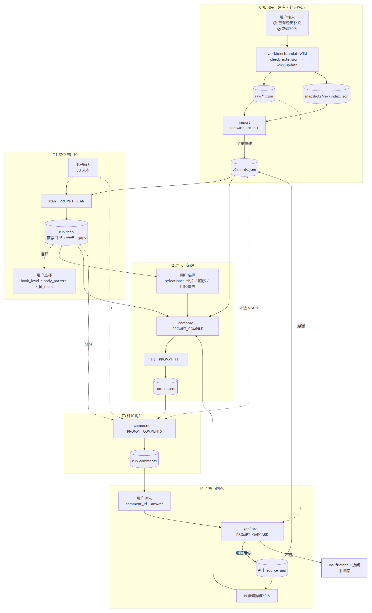
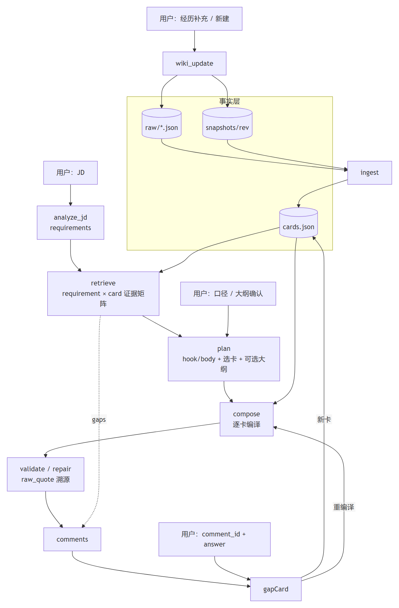

# 输入流程与数据落点（INPUT FLOW）

> 目的：把"用户能输入什么、在什么时间块输入、输入长什么样、存到哪、怎么处理、被谁消费"一次讲清。
> 配套：[输入审计](./INPUT-AUDIT.md)（现状缺口）、[核心链路](./MODEL-CHAIN.md)（阶段细节与提示词）、[数据契约](./DATA-CONTRACT.md)
> 状态标记：✅ 已实现可用 / ⚠️ 部分可用 / ❌ 能力有但入口缺失
>
> **本文分两部分**：第 0–5 节 = 现状（当前 v2 输入流程）；第 6 节起 = **合并设计稿**（v1 证据骨架 + v2 卡片主干、检索设计），尚未改代码。

---

## 0. 时间块划分

| 时间块 | 什么时候发生 | 主要动作 | 主要落盘 |
| --- | --- | --- | --- |
| **T0 知识库** | 开始做简历之前 / 任何时候补充经历 | 建库、补充经历、重建卡片 | `raw/`、`snapshots/`、`v2/cards.json` |
| **T1 岗位与口径** | 选定目标岗位 | 输入 JD、确认 Hook 层级与表达骨架 | `v2/runs/<id>.json` 的 `scan` |
| **T2 选卡与编译** | 扫描后、生成前 | 选哪些卡、覆盖口径、生成正文 | `run.selections`、`run.content` |
| **T3 评论提问** | 正文生成后 | 系统给出可补强方向 | `run.comments` |
| **T4 回答与回流** | 看到评论后 | 回答 → 补卡 → 重编译 → 知识库 +1 卡 | `cards.json`、`run.comments`、`run.content` |

---

## 1. 时间块主流程图



（SVG 源文件：`images/input-timeline.svg`）

---

## 2. 时间块明细

### T0 知识库

| 项 | 内容 |
| --- | --- |
| 触发 | 第一次建库；或想补充/新增一段经历 |
| 用户输入 | ① **已有经历补充**：选中 `experience_id` + 一段自由文本（讲细节/补充结果）<br>② **新建经历**：一段自由文本（概述这段经历） |
| 系统输入 | 已有经历正文（`documentFor()` 读快照）、全部经历清单 `catalog` |
| 输入形式 | 自由文本（Markdown/口语都可以），`message` 字段 |
| 处理 | `check_extension`（判断内容是否属于当前经历，拒绝无关输入）→ `wiki_update`（整理进 Markdown、拆故事/片段、更新经历类型） |
| 存到哪 | `raw/raw_<id>.json`（原话）+ `snapshots/<rev>/index.json`（节点/关系）+ `snapshots/<rev>/wiki/*.md`（正文） |
| 输出 | 新快照版本号；经历正文更新 |
| **关键依赖** | **写经历只更新 raw/snapshots，不会自动更新 `v2/cards.json`**；要重新建卡必须再跑 `import`（当前是全量重建） |
| 现状 | ❌ `workbench.updateWiki/createWikiExperience` 存在，但 API/CLI 没有入口 |

### T1 岗位与口径

| 项 | 内容 |
| --- | --- |
| 触发 | 选好目标岗位，准备生成简历 |
| 用户输入 | ① **JD 文本**（必填）<br>② **Hook 层级**：L1 功能直白 / L2 行业术语 / L3 架构权衡（可选，默认用扫描推荐）<br>③ **正文骨架**：XYZ 成果 / CAR 痛点 / PAR 流程（可选，默认用扫描推荐）<br>④ **JD 核心句** `jd_focus`（可选，默认用扫描提炼） |
| 系统输入 | 全量经历与卡片强槽位（`cards.json`） |
| 输入形式 | JD = 长文本；层级/骨架 = 枚举选择；`jd_focus` = 短文本 |
| 处理 | `scan(jd)` → `PROMPT_SCAN` 输出 `jd_analysis{jd_focus,hook_level,body_pattern}` + 经历排序 + 选卡 + gaps |
| 存到哪 | `v2/runs/<run_id>.json` → `scan` |
| 输出 | 推荐口径 + 推荐选卡 + 匹配理由 + 缺口 |
| 现状 | ⚠️ JD ✅；层级/骨架/`jd_focus` 目前只能在 T2 用 `selections[].strategy` 覆盖，`scan` 不接收这些参数，CLI 也没有参数 |

### T2 选卡与编译

| 项 | 内容 |
| --- | --- |
| 触发 | 扫描完成、确认选卡后 |
| 用户输入 | ① **选哪些卡**（每段经历一组 `card_ids`，按卡片 `step_order` 排序）<br>② **口径覆盖**（可选）：`hook_level / body_pattern / jd_focus` |
| 系统输入 | 经历主干、卡片 6 槽位、scan 给出的 `match_reason`、推荐口径 |
| 输入形式 | 结构化 JSON：`selections: [{ exp_id, card_ids, strategy? }]` |
| 处理 | 每段经历一次 `PROMPT_COMPILE`（1 卡 1 bullet）→ `PROMPT_FIT`（字数/风格归一化，最多 3 轮）→ 仍超限 `hardTrim` |
| 存到哪 | `run.selections` + `run.content`（`experiences[].project_background/bullets[].checks`） |
| 输出 | 简历正文（背景总述 + 每条 `【hook】正文` + 溯源原话） |
| 现状 | ✅ API 可传 selections + strategy；CLI 只能 `--select-file` 或自动用扫描推荐，没有直接参数 |

### T3 评论提问

| 项 | 内容 |
| --- | --- |
| 触发 | 正文生成后 |
| 用户输入 | 无需输入（可选：是否生成评论） |
| 系统输入 | `run.content.bullets` + `run.scan.gaps` + 未选中的 S/A 卡 + JD |
| 处理 | `PROMPT_COMMENTS`：找"当前简历没体现、但该经历本可深挖"的方向，锚定到具体 bullet |
| 存到哪 | `run.comments: [{comment_id, bullet_id, exp_id, question, reason, resolved}]` |
| 输出 | 最多 4 条评论（每条锚定一个 bullet） |
| 现状 | ✅ API/CLI 可用；无"点击"界面（前端已删） |

### T4 回答与回流

| 项 | 内容 |
| --- | --- |
| 触发 | 用户回答某条评论 |
| 用户输入 | ① **选哪条评论**：`comment_id`（枚举/选择）<br>② **回答内容**：自由文本（具体做法/数字/口径） |
| 系统输入 | 该经历 raw 原话（`rawTextFor`，缺失回退 `exp.raw_text`）+ 缺口问题 |
| 处理 | `PROMPT_GAPCARD`：证据不足 → `insufficient + 追问`（不改库）；足够 → 新卡（6 槽位，重新分级 S/A/B）→ 写入 cards → 只重编译该经历 |
| 存到哪 | 新卡：`cards.json`（`source=gap`）；评论：`run.comments[].resolved/new_card_id`；正文：`run.content` |
| 输出 | 新卡 + 该段新增 bullet + 评论标已解决 |
| 现状 | ✅ API/CLI 可用；无"点击"界面；追问只支持再调一次，不是多轮对话 |

---

## 3. 数据落点与依赖


（SVG 源文件：`images/input-artifacts.svg`）

| 数据 | 写入者 | 读取者 | 关键字段 |
| --- | --- | --- | --- |
| `raw/raw_*.json` | T0 经历输入 | import、T4 gapCard | `experience_id`、`messages[].content` |
| `snapshots/<rev>/index.json` | T0 经历输入 | import | `revision`、`nodes[]`、`relations[]` |
| `snapshots/<rev>/wiki/*.md` | T0 经历输入 | import、T4 raw 兜底 | Markdown 正文 |
| `v2/cards.json` | import、T4 gap | scan/compose/comments/gap/graph | `experiences[]`、`cards[]`（6 槽位 + `quality_grade` + `raw_quote` + `is_verified`） |
| `v2/runs/<id>.json` | scan/compose/comments/gap | CLI/API、测试、复盘 | `scan` / `selections` / `content` / `comments` |
| `profile.json` | 用户维护 | 旧版渲染 | 核心链路**不读** |

**依赖要点**
1. `cards.json` 是 T1–T4 的唯一事实源；
2. T0 写经历后必须 `import` 才能进 `cards.json`（当前全量重建）；
3. T4 补卡会直接改 `cards.json`，所以之后 scan 能看到新卡；
4. 重建 `cards.json` 会使旧 run 变 stale（引用被删卡片），历史 run 需归档或只校验当前版本。

---

## 4. 每个输入的目标契约

### T0-1 已有经历补充

```text
CLI:  node prototype/cli.mjs wiki-input --exp exp_xxx --message "..."
API:  POST /api/wiki/input { "experience_id": "exp_xxx", "message": "..." }
形式: 自由文本
校验: experience 必须存在且 active；message 非空
处理: check_extension → wiki_update
落盘: raw + snapshots（不直接写 cards）
下游: 需要 import 重建 cards
现状: ❌（函数在 workbench.mjs，未暴露）
```

### T0-2 新建经历

```text
CLI:  node prototype/cli.mjs wiki-create --message "..."
API:  POST /api/wiki/create { "message": "..." }
形式: 自由文本
校验: message 非空；不指定 experience_id
落盘: 新 experience 节点 + raw + snapshot
现状: ❌
```

### T0-3 建卡 import（系统输入）

```text
CLI:  node prototype/cli.mjs import
API:  POST /api/v2/import {}
输入: raw/*.json + snapshots/<rev>/index.json
处理: PROMPT_INGEST → normalizeCards → grade()
落盘: v2/cards.json（全量重建）
现状: ✅
```

### T1-1 JD

```text
CLI:  node prototype/cli.mjs scan --jd-file 回归集/jd-01-市场部实习生.md
      （或 --jd "..."）
API:  POST /api/v2/scan { "jd": "..." }
形式: 长文本（≥20 字）
处理: PROMPT_SCAN
落盘: run.scan
现状: ✅
```

### T1-2 / T1-3 / T1-4 口径选择（Hook 层级 / 正文骨架 / JD 核心句）

```text
目标 CLI: node prototype/cli.mjs scan --jd-file ... --hook-level L2 --body-pattern CAR --jd-focus "..."
目标 API: POST /api/v2/scan { "jd": "...", "hook_level": "L2", "body_pattern": "CAR", "jd_focus": "..." }
形式: 枚举（L1/L2/L3、XYZ/CAR/PAR）+ 短文本
处理目标: 作为"锁定值"传给 PROMPT_SCAN；扫描结果里保留用户选择
落盘: run.scan.jd_analysis（并标记 source=user|model）
现状: ⚠️ 只有 T2 的 compose 覆盖可用；scan 不接收
```

### T2-1 选卡

```text
CLI:  node prototype/cli.mjs compose --run v2run_xxx --select-file selections.json
      selections.json: [{"exp_id":"exp_x","card_ids":["c1","c2"],"strategy":{...}}]
API:  POST /api/v2/compose { "run_id": "...", "selections": [ ... ] }
形式: 结构化 JSON
校验: exp 必须存在；card_id 必须属于该 exp；空选卡跳过该段
落盘: run.selections + run.content
现状: ✅ API；⚠️ CLI 无直接参数（只能文件）
```

### T2-2 口径覆盖

```text
位置: selections[].strategy = { "jd_focus": "", "hook_level": "L2", "body_pattern": "CAR" }
优先级: selections.strategy > run.scan.jd_analysis > 旧字段 recommended_strategy > 默认 L2/CAR
落盘: 编译时写入 run.content.experiences[].strategy
现状: ✅（藏在 selections JSON 里）
```

### T3 评论

```text
CLI:  node prototype/cli.mjs comments --run v2run_xxx
API:  POST /api/v2/comments { "run_id": "..." }
输入: run.content + scan.gaps + 未选 S/A 卡 + JD（系统内部组装）
落盘: run.comments
现状: ✅
```

### T4-1 / T4-2 回答与补卡

```text
CLI:  node prototype/cli.mjs gap --run v2run_xxx --comment cm_1 --answer "..."
API:  POST /api/v2/gap { "run_id": "...", "comment_id": "cm_1", "answer": "..." }
形式: comment_id（选择）+ answer（自由文本）
校验: comment 必须存在；answer 不能为空
分支: insufficient → 返回追问、不改库；足够 → 新卡 + 重编译该段 + resolved
落盘: cards.json（新卡 source=gap）、run.comments、run.content
现状: ✅
```

---

## 5. 实施清单（把输入补齐）

| 优先级 | 任务 | 产出 | 验收 |
| --- | --- | --- | --- |
| P0 | 暴露 T0 经历输入 | CLI `wiki-input/wiki-create`；API `/api/wiki/input|create` | 输入一段经历 → raw/snapshot 更新；再 import → cards 增加 |
| P1 | 暴露 T1 口径选择 | CLI/API 接收 `hook_level/body_pattern/jd_focus` | 指定 L3/XYZ 后 scan 返回并写回用户选择；compose 生效 |
| P1 | 简化 T2 选卡 | CLI `--cards` 或 `--experiences` 过滤 | 不用手写 JSON 也能选卡 |
| P2 | 增量建卡 | 只重建受影响经历，而不是全量 import | 补经历后不丢其它卡 |
| P2 | 多轮追问 | gap insufficient 后继续读回答（最多 2 轮） | 一次对话补出合格卡 |
| P3 | 输入校验层 | 统一 `assertInput()`（类型/枚举/长度/引用） | 非法输入返回明确错误码 |

---

# 第二部分：合并设计稿（v1 + v2 → 一条链路）

> 第 0–5 节是**现状**（当前 v2 输入流程）；从本节起是**设计讨论稿**，尚未改代码。
> 目标：v2 做主干（卡片、风格、补卡），v1 做骨架（需求、证据、大纲、校验）。

---

## 6. 现有两套流程

### 6.1 v1：Wiki + 大纲 + 事实校验

**代码**：`workbench.mjs`（`generate / reviseOutline / compose`）+ `llm.mjs`（15 个提示词）
**数据**：`snapshots/`（经历/故事/片段/主题节点）+ `raw/` + `runs/<run_id>/result.json`

```text
经历库写入：updateWiki → check_extension → wiki_update
生成：
  JD
   → strategy                 7 策略 / 深度 / 正文重点
   → query_plan               requirements[]：id / jd_quote / category / terms / evidence_needs / constraints
   → 关键词检索 wiki 节点       term hits（fulltext 全量兜底）
   → evaluate                 逐个节点：relevance / contribution / evidence / decision
   → selection                只允许 supported 节点（guard）
   → outline                  分段选材 + 位置
   → 用户评论 → revise_outline
   → compose                  按 outline 写正文
   → trace_claims → verify → repair
   → validation               {ok, issues, comments, untraced_lines}
```

**结果形态**：`result.json` 含 `strategy / query_plan / discovery / evaluation / selection / outline / material / content / validation / metrics`。

**强项**
- 真 requirement 结构 + "JD 要求 ↔ 证据节点"矩阵；
- 选材有 guard（无证据进不了大纲）；
- 有大纲确认与用户修订；
- 正文有 claims 溯源、verify、repair。

**弱项**
- 检索靠关键词命中 + 全量兜底，候选覆盖不稳；
- 数据模型是 wiki 节点，不是 6 槽位卡片；
- 没有卡片粒度的补卡闭环；
- 链路重、调用多；当前无入口（前端已删）。

### 6.2 v2：卡片 + 扫描 + 补卡

**代码**：`v2.mjs`（6 个提示词）
**数据**：`v2/cards.json` + `v2/runs/<id>.json`

```text
raw + snapshots → import(PROMPT_INGEST) → cards.json
JD → scan(PROMPT_SCAN)
      一次调用同时产出：jd_analysis(需求字符串 + 风格) + 经历排序 + 选卡 + gaps
→ compose(PROMPT_COMPILE)  每段经历逐卡编译
→ fit(PROMPT_FIT)          字数/风格归一化
→ comments(PROMPT_COMMENTS) 评论
→ gap(PROMPT_GAPCARD)      回答 → 新卡 → 只重编译该段
```

**强项**
- 卡片粒度，1 卡 1 bullet，可选卡、可重编译；
- 三区表达（背景 + Hook 层级 + XYZ/CAR/PAR）+ 反八股；
- 补卡闭环完整；
- CLI/API 简单，测试齐全。

**弱项**
- 检索契约不清：卡片只传 3 个槽位；requirements 无 ID / 无证据矩阵；
- 风格与检索混在 scan 一次调用；
- 没有大纲确认、没有正文溯源校验/修复；
- `raw_quote` 未与 raw 原文做包含校验。

### 6.3 能力对照

| 能力 | v1 | v2 | 合并后 |
| --- | --- | --- | --- |
| JD 需求结构化 | ✅ `query_plan` | ⚠️ 字符串数组 | 用 v1 requirements schema |
| 检索/匹配 | ⚠️ 关键词 + 全量 | ⚠️ 单次 LLM 混排 | 新增 `retrieve`：requirements × cards 证据矩阵 |
| 风格决策 | 7 策略（旧） | Hook/骨架（新） | 用 v2 风格，独立成 `plan` |
| 选材 | ✅ selection + guard | ✅ scan 选卡 | 合并进 `plan` |
| 大纲确认 | ✅ outline + revise | ❌ | 迁移为可选阶段 |
| 正文生成 | 大纲驱动 | 卡片驱动 | 卡片驱动 + 大纲作骨架约束 |
| 事实溯源 | ✅ trace_claims/verify/repair | ⚠️ 未校验 raw_quote | 迁移 v1，适配卡片 |
| 补卡闭环 | ❌ | ✅ comments/gap | 保留 v2 |

---

## 7. 合并原则与目标流程

### 7.1 原则

1. **一条链路**：删除并行旧流程，v1 只保留可迁移能力；
2. **事实分层**：raw（事实）→ snapshots（经历结构）→ cards（可检索事实）→ runs（任务产物），单向派生；
3. **检索与风格解耦**：`retrieve` 只回答"哪张卡能支撑哪条要求"；`plan` 才决定 Hook 层级/正文骨架/大纲；
4. **每个 run 绑定版本**：`base_rev`（snapshot）+ `cards_rev`，卡片变旧 run 自动 stale；
5. **可审计**：每条选材/正文都能追到 requirement_id + card_id + 原文引用。

### 7.2 目标流程



（SVG 源：`images/merged-pipeline.svg`）

---

## 8. 合并后阶段与输入输出

| 阶段 | 用户输入 | 系统输入 | 处理 | 输出 | 落盘 | 失败/回退 |
| --- | --- | --- | --- | --- | --- | --- |
| **S0 经历输入** | 已有经历补充 / 新建经历（自由文本） | 当前经历正文、经历目录 | `check_extension` → `wiki_update` | 新快照 | `raw/*.json`、`snapshots/<rev>/` | 与经历无关 → `UNRELATED_INPUT`，不改库 |
| **S1 建卡** | — | raw + snapshots index | `ingest`：6 槽位卡 + 静态 S/A/B | cards | `v2/cards.json`（带 `source_raw_id` / `raw_quote` / `snapshot_rev`） | 单条失败继续；全失败 `IMPORT_FAILED` |
| **S2 需求分析** | JD（长文本） | — | `analyze_jd`：拆 requirements（必须/加分/权重） | `requirements[]` | `run.requirements` | JSON 失败重试 1 次 |
| **S3 检索** | —（可选：只看某些经历） | requirements、cards（6 槽位 + 标题 + 原话） | `retrieve`：requirement × card 证据矩阵 | `matches[]` + `coverage` + `gaps` | `run.matches` | 无候选 → 全部标 missing；非法引用重试 |
| **S4 规划** | Hook 层级、正文骨架（选择）；可选大纲确认 | requirements、matches、cards | `plan`：选卡 + 风格 + 可选 outline | `plan{style,selections,outline?}` | `run.plan` | 无选卡则该段跳过；大纲越界条目丢弃 |
| **S5 编译** | —（可微调选卡/风格） | plan、cards | 逐卡 `compose` + `fit` | `content` | `run.content` | 单段失败不阻塞；字数/风格违规进 fit |
| **S6 校验/修复** | — | content、matches、cards、raw | `validate`：正文分句 ↔ 卡片/原话；`repair` 修不合规句 | `validation{ok,issues,untraced_lines}` | `run.validation` | blockers 自动 repair 一次；仍失败标 needs_review |
| **S7 评论** | —（可选是否生成） | content、coverage、gaps、未选 S/A 卡、JD | `comments` | `comments[]`（锚定 bullet） | `run.comments` | 模型失败用 gaps 兜底 |
| **S8 补卡** | comment_id + answer | raw 原话、问题 | `gapCard` | 新卡 / insufficient | `cards.json` + 重编译 `run.content` | 不足 → 追问；成功 → resolved |

### 8.1 关键对象 schema

**requirements**
```json
[{ "requirement_id": "R1", "jd_quote": "…", "type": "must|nice", "weight": 3,
   "category": "内容运营|数据|活动执行", "terms": ["飞书","周报"], "evidence_needs": ["工具","结果"] }]
```

**matches**
```json
[{ "requirement_id": "R1", "card_id": "exp_x_c2", "exp_id": "exp_x",
   "evidence_slot": "slot_workflow", "quote": "每周用飞书汇总…",
   "relevance": "direct|adjacent|none",
   "contribution": "led|executed|participated|learned|unknown",
   "evidence": "supported|partial|conflicting|missing",
   "decision": "use|downgrade|omit",
   "score": 0.86, "reason": "…" }]
```

**plan**
```json
{ "hook_level": "L2", "body_pattern": "CAR",
  "selections": [{ "exp_id": "exp_x", "card_ids": ["c1","c2"], "priority": 1 }],
  "outline": null }
```

---

## 9. 检索设计（核心讨论点）

### 9.1 检索到底检索什么

**不是"给经历排个名"**，而是回答三件事：

1. 每条 JD 要求，有没有卡片能**直接印证**？
2. 用的是卡片的**哪个槽位**、哪句**原话**？
3. 没有的话，缺的是哪条要求（→ gaps → 评论/补卡）？

所以检索的产物是 **requirement × card 的证据矩阵**；经历排序只是矩阵的聚合结果，不是输入。

### 9.2 检索对象与字段

检索**只看卡片**，不看整段经历正文（避免 token 爆炸，也避免"经历相关但卡片无证据"的误选）。

卡片进入检索的字段：

| 字段 | 用途 | 是否必传 |
| --- | --- | --- |
| `card_id` / `exp_id` / `step_order` | 归属与排序 | ✅ |
| `quality_grade` | 过滤/加权 | ✅ |
| `toc_title` | 卡片主题 | ✅ |
| `slot_problem` | 卡点/约束 | ✅ |
| `slot_workflow` | 动作/流程 | ✅ |
| `slot_outcome` | 结果/数字 | ✅ |
| `slot_tech_link` | 工具/技术 | ✅（**必须补上**） |
| `slot_stage` / `slot_module` | 阶段/业务域 | ✅ |
| `raw_quote`（截断） | 证据引用 | ✅（只作引用来源，不要求整段） |
| `linked_nodes` | 主题/技能 | 可选（第二阶段） |

**不传**：整段 raw 正文、经历 Markdown 全文（留给 validate 阶段核对）。

### 9.3 检索方法（分层）

```
L0 过滤：is_verified=true；S/A 优先；B 卡只做 fallback（标 risk）
L1 召回：
   - 卡片总数 ≤ 200：全量卡片语义扫描（不做关键词预筛，避免漏召回）
   - > 200：规则预筛（terms/工具/数字/领域命中）+ 语义扫描候选集
L2 评估：逐 requirement 判断 relevance / contribution / evidence / decision
L3 打分：加权分，top-k 聚合到经历
L4 校验：card_id/requirement_id 合法；quote 必须落在 card.raw_quote 或 raw 原文
L5 覆盖：每条 requirement 是否有 score ≥ 阈值 的证据；没有 → gap
```

**为什么不直接用关键词/BM25 做检索**：关键词只能召回字面命中，JD 与卡片的表述差异大；词法只适合做 L1 的"候选预筛"（scale >200 时），不能做最终判断。

**LLM 检索的两种批处理**：
- **矩阵式（推荐，cards ≤ 100 & requirements ≤ 8）**：一次调用输入全部 requirements + 精简卡片，输出矩阵；成本 1 次，跨要求比较一致；
- **逐要求式**：requirements 多/卡片多时，每 2–3 条要求一次调用；成本高但 prompt 短。

建议先做矩阵式，加缓存与重试；等卡片数过百再上预筛。

### 9.4 打分与决策

```
score = 0.40 * relevance + 0.30 * evidence + 0.20 * contribution + 0.10 * grade
relevance: direct=1.0, adjacent=0.6, none=0
evidence: supported=1.0, partial=0.5, conflicting=0, missing=0
contribution: led=1.0, executed=0.8, participated=0.5, learned=0.2, unknown=0.3
grade: S=1.0, A=0.85, B=0.6
```

- `score ≥ 0.7` → `use`（进选材）
- `0.45 ≤ score < 0.7` → `downgrade`（可进，但标弱）
- `< 0.45` 或 `evidence=missing/conflicting` → `omit`
- 每条 requirement 取 top 3 卡；同一卡最多支撑 2 条 requirement（避免一张卡拉满全篇）

阈值和权重都要可配置，先写进配置再调。

### 9.5 证据校验（防止模型编引用）

1. `quote` 必须逐字出现在 `card.raw_quote` 或该经历 raw 原文中；
2. `evidence_slot` 必须是六个槽位之一，且 quote 确实属于该槽位文本；
3. `card_id` / `requirement_id` 必须存在；
4. 不合格 → 丢弃该条，带错误提示重试一次；仍不合格 → 该 match 标 `invalid`，不参与选材。

这一步会决定"检索能不能信"，比提示词写得好不好更重要。

### 9.6 缺口与评论的衔接

- `coverage`：`covered / partial / missing` 三类 requirement 列表；
- `gaps`：missing 的 requirement + 已选卡中"adjacent but not supported"的方向；
- `comments` 输入改为：`gaps（结构化）+ 未选 S/A 卡 + 已生成 bullets + JD`；
- 评论锚定到 bullet 时，优先锚"该 requirement 覆盖弱"的 bullet。

### 9.7 成本、缓存、确定性

| 项 | 设计 |
| --- | --- |
| 调用数 | S2 1 次 + S3 1 次（矩阵）+ S4 1 次 + S5 N 段 + S6 1 次 + S7 1 次 + S8 1 次 |
| 温度 | 需求/检索/校验 0–0.1；编译 0.3–0.4 |
| 缓存 | 键 = `cards_rev + requirements_hash + prompt_version`，命中直接复用 matches |
| 确定性 | 卡片与 requirements 固定排序；输出校验后按 score/card_id 稳定排序 |
| 成本上限 | 单次 run 设 token 预算，超限降级为逐要求式 |

### 9.8 检索质量指标

1. **requirement 覆盖率**（有 score≥0.7 证据的要求占比）；
2. **direct 命中率**（direct/supported 占全部匹配比）；
3. **证据违规率**（quote 不在原文/槽位不符的比例，目标 0）；
4. **选材精确率**（人工标注"该卡确实该写"的比例）；
5. **召回补充率**（comments/gap 补出的新证据占比）。

前 3 个可自动算；第 4 个需要小规模标注集（3 份 JD × 7 经历就够起步）。

---

## 10. 统一 run schema（合并后）

```json
{
  "run_id": "v3run_xxx",
  "created_at": "",
  "base_rev": 7,
  "cards_rev": "snap_7+2026-11-24",
  "jd": "",
  "requirements": [],
  "matches": [],
  "coverage": { "covered": [], "partial": [], "missing": [] },
  "plan": { "hook_level": "L2", "body_pattern": "CAR", "selections": [], "outline": null },
  "content": { "experiences": [], "claims": [] },
  "validation": { "ok": true, "issues": [], "untraced_lines": [] },
  "comments": []
}
```

数据规则：
1. `cards.json` 增加 `snapshot_rev`；每张卡增加 `source_raw_id`；
2. run 记录 `base_rev` / `cards_rev`；不一致时标 `stale`；
3. 旧 `runs/`（v1）只读归档；新 run 一律写 `v2/runs/`（改名 `runs-v3` 可选）；
4. `raw_quote` 建卡时强校验，检索时二次校验。

---

## 11. 迁移路线与待讨论问题

### 11.1 迁移阶段

| Phase | 内容 | 验收 |
| --- | --- | --- |
| P0 冻结旧流程 | v1 函数/prompts 移到 `legacy/`，停止写旧 runs；旧 run 只读 | 新入口只走一条链路 |
| P1 数据地基 | cards 加 `source_raw_id/snapshot_rev`；run 加 `base_rev`；raw_quote 强校验 | 溯源违规率 0；stale 可检测 |
| P2 拆扫描 | `analyze_jd / retrieve / plan` 三阶段替换 scan；保留 v2 compose/comments/gap | 同 JD 可输出 requirements/matches/coverage |
| P3 迁移 v1 强项 | query_plan→analyze_jd；evaluate→retrieve；selection/outline→plan；trace/verify/repair→validate | 能查出无出处句子并修复；可选大纲确认可用 |
| P4 清理 | 删旧 prompts/旧 compose/STRATEGIES/旧 runs | 代码只剩一条链路 |
| P5 评测 | 建 3 JD × 7 经历的标注集，跑检索/生成/补卡指标 | 指标可比较、可回归 |

### 11.2 需要一起定的问题

1. **大纲要不要保留？** 保留会更可控但多一轮确认；不保留则完全卡片驱动。
2. **检索用矩阵式还是逐要求式？** 矩阵省调用但 prompt 长；逐要求更稳但贵。
3. **requirements 要不要"必须/加分/权重"？** 影响选材与覆盖率口径。
4. **B 卡是否允许 fallback？** 允许会提高覆盖率但降低质量。
5. **是否允许 adjacent 卡进 downgrade？** 影响"没有直接证据但相关"的处理。
6. **评论只来自 gaps，还是也来自弱覆盖的 bullet？**
7. **单次 run 的 token/时间预算上限是多少？**
8. **旧流程保留多久做对照？** 建议只读保留 1–2 周，不进主链路。
