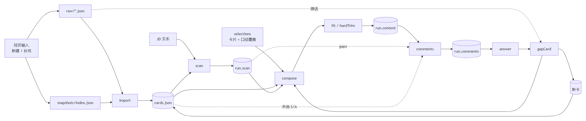

# 输入流程与数据落点（INPUT FLOW）

> 目的：把"用户能输入什么、在什么时间块输入、输入长什么样、存到哪、怎么处理、被谁消费"一次讲清。
> 配套：[输入审计](./INPUT-AUDIT.md)（现状缺口）、[核心链路](./MODEL-CHAIN.md)（阶段细节与提示词）、[数据契约](./DATA-CONTRACT.md)
> 状态标记：✅ 已实现可用 / ⚠️ 部分可用 / ❌ 能力有但入口缺失

---

## 0. 时间块划分

| 时间块 | 什么时候发生 | 主要动作 | 主要落盘 |
| --- | --- | --- | --- |
| **T0 知识库** | 开始做简历之前 / 任何时候补充经历 | 建库、补充经历、重建卡片 | `raw/`、`snapshots/`、`v2/cards.json` |
| **T1 岗位与口径** | 选定目标岗位 | 输入 JD、确认 Hook 层级与表达骨架 | `v2/runs/<id>.json` 的 `scan` |
| **T2 选卡与编译** | 扫描后、生成前 | 选哪些卡、覆盖口径、生成正文 | `run.selections`、`run.content` |
| **T3 评论提问** | 正文生成后 | 系统给出可补强方向 | `run.comments` |
| **T4 回答与回流** | 看到评论后 | 回答 → 补卡 → 重编译 → 知识库 +1 卡 | `cards.json`、`run.comments`、`run.content` |

---

## 1. 时间块主流程图


（SVG 源文件：`images/input-timeline.svg`）

---

## 2. 时间块明细

### T0 知识库

| 项 | 内容 |
| --- | --- |
| 触发 | 第一次建库；或想补充/新增一段经历 |
| 用户输入 | ① **已有经历补充**：选中 `experience_id` + 一段自由文本（讲细节/补充结果）<br>② **新建经历**：一段自由文本（概述这段经历） |
| 系统输入 | 已有经历正文（`documentFor()` 读快照）、全部经历清单 `catalog` |
| 输入形式 | 自由文本（Markdown/口语都可以），`message` 字段 |
| 处理 | `check_extension`（判断内容是否属于当前经历，拒绝无关输入）→ `wiki_update`（整理进 Markdown、拆故事/片段、更新经历类型） |
| 存到哪 | `raw/raw_<id>.json`（原话）+ `snapshots/<rev>/index.json`（节点/关系）+ `snapshots/<rev>/wiki/*.md`（正文） |
| 输出 | 新快照版本号；经历正文更新 |
| **关键依赖** | **写经历只更新 raw/snapshots，不会自动更新 `v2/cards.json`**；要重新建卡必须再跑 `import`（当前是全量重建） |
| 现状 | ❌ `workbench.updateWiki/createWikiExperience` 存在，但 API/CLI 没有入口 |

### T1 岗位与口径

| 项 | 内容 |
| --- | --- |
| 触发 | 选好目标岗位，准备生成简历 |
| 用户输入 | ① **JD 文本**（必填）<br>② **Hook 层级**：L1 功能直白 / L2 行业术语 / L3 架构权衡（可选，默认用扫描推荐）<br>③ **正文骨架**：XYZ 成果 / CAR 痛点 / PAR 流程（可选，默认用扫描推荐）<br>④ **JD 核心句** `jd_focus`（可选，默认用扫描提炼） |
| 系统输入 | 全量经历与卡片强槽位（`cards.json`） |
| 输入形式 | JD = 长文本；层级/骨架 = 枚举选择；`jd_focus` = 短文本 |
| 处理 | `scan(jd)` → `PROMPT_SCAN` 输出 `jd_analysis{jd_focus,hook_level,body_pattern}` + 经历排序 + 选卡 + gaps |
| 存到哪 | `v2/runs/<run_id>.json` → `scan` |
| 输出 | 推荐口径 + 推荐选卡 + 匹配理由 + 缺口 |
| 现状 | ⚠️ JD ✅；层级/骨架/`jd_focus` 目前只能在 T2 用 `selections[].strategy` 覆盖，`scan` 不接收这些参数，CLI 也没有参数 |

### T2 选卡与编译

| 项 | 内容 |
| --- | --- |
| 触发 | 扫描完成、确认选卡后 |
| 用户输入 | ① **选哪些卡**（每段经历一组 `card_ids`，按卡片 `step_order` 排序）<br>② **口径覆盖**（可选）：`hook_level / body_pattern / jd_focus` |
| 系统输入 | 经历主干、卡片 6 槽位、scan 给出的 `match_reason`、推荐口径 |
| 输入形式 | 结构化 JSON：`selections: [{ exp_id, card_ids, strategy? }]` |
| 处理 | 每段经历一次 `PROMPT_COMPILE`（1 卡 1 bullet）→ `PROMPT_FIT`（字数/风格归一化，最多 3 轮）→ 仍超限 `hardTrim` |
| 存到哪 | `run.selections` + `run.content`（`experiences[].project_background/bullets[].checks`） |
| 输出 | 简历正文（背景总述 + 每条 `【hook】正文` + 溯源原话） |
| 现状 | ✅ API 可传 selections + strategy；CLI 只能 `--select-file` 或自动用扫描推荐，没有直接参数 |

### T3 评论提问

| 项 | 内容 |
| --- | --- |
| 触发 | 正文生成后 |
| 用户输入 | 无需输入（可选：是否生成评论） |
| 系统输入 | `run.content.bullets` + `run.scan.gaps` + 未选中的 S/A 卡 + JD |
| 处理 | `PROMPT_COMMENTS`：找"当前简历没体现、但该经历本可深挖"的方向，锚定到具体 bullet |
| 存到哪 | `run.comments: [{comment_id, bullet_id, exp_id, question, reason, resolved}]` |
| 输出 | 最多 4 条评论（每条锚定一个 bullet） |
| 现状 | ✅ API/CLI 可用；无"点击"界面（前端已删） |

### T4 回答与回流

| 项 | 内容 |
| --- | --- |
| 触发 | 用户回答某条评论 |
| 用户输入 | ① **选哪条评论**：`comment_id`（枚举/选择）<br>② **回答内容**：自由文本（具体做法/数字/口径） |
| 系统输入 | 该经历 raw 原话（`rawTextFor`，缺失回退 `exp.raw_text`）+ 缺口问题 |
| 处理 | `PROMPT_GAPCARD`：证据不足 → `insufficient + 追问`（不改库）；足够 → 新卡（6 槽位，重新分级 S/A/B）→ 写入 cards → 只重编译该经历 |
| 存到哪 | 新卡：`cards.json`（`source=gap`）；评论：`run.comments[].resolved/new_card_id`；正文：`run.content` |
| 输出 | 新卡 + 该段新增 bullet + 评论标已解决 |
| 现状 | ✅ API/CLI 可用；无"点击"界面；追问只支持再调一次，不是多轮对话 |

---

## 3. 数据落点与依赖



（SVG 源文件：`images/input-artifacts.svg`）

| 数据 | 写入者 | 读取者 | 关键字段 |
| --- | --- | --- | --- |
| `raw/raw_*.json` | T0 经历输入 | import、T4 gapCard | `experience_id`、`messages[].content` |
| `snapshots/<rev>/index.json` | T0 经历输入 | import | `revision`、`nodes[]`、`relations[]` |
| `snapshots/<rev>/wiki/*.md` | T0 经历输入 | import、T4 raw 兜底 | Markdown 正文 |
| `v2/cards.json` | import、T4 gap | scan/compose/comments/gap/graph | `experiences[]`、`cards[]`（6 槽位 + `quality_grade` + `raw_quote` + `is_verified`） |
| `v2/runs/<id>.json` | scan/compose/comments/gap | CLI/API、测试、复盘 | `scan` / `selections` / `content` / `comments` |
| `profile.json` | 用户维护 | 旧版渲染 | 核心链路**不读** |

**依赖要点**
1. `cards.json` 是 T1–T4 的唯一事实源；
2. T0 写经历后必须 `import` 才能进 `cards.json`（当前全量重建）；
3. T4 补卡会直接改 `cards.json`，所以之后 scan 能看到新卡；
4. 重建 `cards.json` 会使旧 run 变 stale（引用被删卡片），历史 run 需归档或只校验当前版本。

---

## 4. 每个输入的目标契约

### T0-1 已有经历补充

```text
CLI:  node prototype/cli.mjs wiki-input --exp exp_xxx --message "..."
API:  POST /api/wiki/input { "experience_id": "exp_xxx", "message": "..." }
形式: 自由文本
校验: experience 必须存在且 active；message 非空
处理: check_extension → wiki_update
落盘: raw + snapshots（不直接写 cards）
下游: 需要 import 重建 cards
现状: ❌（函数在 workbench.mjs，未暴露）
```

### T0-2 新建经历

```text
CLI:  node prototype/cli.mjs wiki-create --message "..."
API:  POST /api/wiki/create { "message": "..." }
形式: 自由文本
校验: message 非空；不指定 experience_id
落盘: 新 experience 节点 + raw + snapshot
现状: ❌
```

### T0-3 建卡 import（系统输入）

```text
CLI:  node prototype/cli.mjs import
API:  POST /api/v2/import {}
输入: raw/*.json + snapshots/<rev>/index.json
处理: PROMPT_INGEST → normalizeCards → grade()
落盘: v2/cards.json（全量重建）
现状: ✅
```

### T1-1 JD

```text
CLI:  node prototype/cli.mjs scan --jd-file 回归集/jd-01-市场部实习生.md
      （或 --jd "..."）
API:  POST /api/v2/scan { "jd": "..." }
形式: 长文本（≥20 字）
处理: PROMPT_SCAN
落盘: run.scan
现状: ✅
```

### T1-2 / T1-3 / T1-4 口径选择（Hook 层级 / 正文骨架 / JD 核心句）

```text
目标 CLI: node prototype/cli.mjs scan --jd-file ... --hook-level L2 --body-pattern CAR --jd-focus "..."
目标 API: POST /api/v2/scan { "jd": "...", "hook_level": "L2", "body_pattern": "CAR", "jd_focus": "..." }
形式: 枚举（L1/L2/L3、XYZ/CAR/PAR）+ 短文本
处理目标: 作为"锁定值"传给 PROMPT_SCAN；扫描结果里保留用户选择
落盘: run.scan.jd_analysis（并标记 source=user|model）
现状: ⚠️ 只有 T2 的 compose 覆盖可用；scan 不接收
```

### T2-1 选卡

```text
CLI:  node prototype/cli.mjs compose --run v2run_xxx --select-file selections.json
      selections.json: [{"exp_id":"exp_x","card_ids":["c1","c2"],"strategy":{...}}]
API:  POST /api/v2/compose { "run_id": "...", "selections": [ ... ] }
形式: 结构化 JSON
校验: exp 必须存在；card_id 必须属于该 exp；空选卡跳过该段
落盘: run.selections + run.content
现状: ✅ API；⚠️ CLI 无直接参数（只能文件）
```

### T2-2 口径覆盖

```text
位置: selections[].strategy = { "jd_focus": "", "hook_level": "L2", "body_pattern": "CAR" }
优先级: selections.strategy > run.scan.jd_analysis > 旧字段 recommended_strategy > 默认 L2/CAR
落盘: 编译时写入 run.content.experiences[].strategy
现状: ✅（藏在 selections JSON 里）
```

### T3 评论

```text
CLI:  node prototype/cli.mjs comments --run v2run_xxx
API:  POST /api/v2/comments { "run_id": "..." }
输入: run.content + scan.gaps + 未选 S/A 卡 + JD（系统内部组装）
落盘: run.comments
现状: ✅
```

### T4-1 / T4-2 回答与补卡

```text
CLI:  node prototype/cli.mjs gap --run v2run_xxx --comment cm_1 --answer "..."
API:  POST /api/v2/gap { "run_id": "...", "comment_id": "cm_1", "answer": "..." }
形式: comment_id（选择）+ answer（自由文本）
校验: comment 必须存在；answer 不能为空
分支: insufficient → 返回追问、不改库；足够 → 新卡 + 重编译该段 + resolved
落盘: cards.json（新卡 source=gap）、run.comments、run.content
现状: ✅
```

---

## 5. 实施清单（把输入补齐）

| 优先级 | 任务 | 产出 | 验收 |
| --- | --- | --- | --- |
| P0 | 暴露 T0 经历输入 | CLI `wiki-input/wiki-create`；API `/api/wiki/input|create` | 输入一段经历 → raw/snapshot 更新；再 import → cards 增加 |
| P1 | 暴露 T1 口径选择 | CLI/API 接收 `hook_level/body_pattern/jd_focus` | 指定 L3/XYZ 后 scan 返回并写回用户选择；compose 生效 |
| P1 | 简化 T2 选卡 | CLI `--cards` 或 `--experiences` 过滤 | 不用手写 JSON 也能选卡 |
| P2 | 增量建卡 | 只重建受影响经历，而不是全量 import | 补经历后不丢其它卡 |
| P2 | 多轮追问 | gap insufficient 后继续读回答（最多 2 轮） | 一次对话补出合格卡 |
| P3 | 输入校验层 | 统一 `assertInput()`（类型/枚举/长度/引用） | 非法输入返回明确错误码 |
