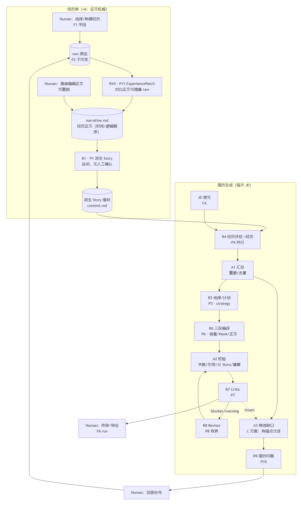

# INPUT-FOLLOW · v6 定稿设计

> 唯一设计基准。v6 核心后端已实现于 `feat/input-follow-v5`；旧 Story Markdown 模型只作兼容，见 §13。
> 生成方法论见 §14。

---

## 0. 前提

1. 单人、手动、文字输入；不做语音、不做自动判断新经历、不做重复检测。
2. 经历库规模小：一份简历 3–4 段经历，每段约 4 条 bullet。
3. 高保真优先：宁可少写、宁可提问，不编造。
4. **v6 全程不需要人工确认**：AI 直接应用 ExperiencePatch；人可编辑经历正文、可撤销。
5. raw 不可变；经历正文是权威；Story 是派生视图，不是权威。
6. 小规模下全量读取内容，不做索引/过滤/BM25/向量。
7. 不用自主 Agent：固定 Workflow + 固定角色 + 有界修订。

---

## 1. 总流程图



（SVG：`images/final-flow-v6.svg`）

图例：

| 标记 | 含义 |
| --- | --- |
| **F1–F6** | 字段/数据结构 |
| **P1–P11** | 提示词契约 |
| **R0–R10** | 角色（Human / AI 固定角色） |
| **A1–A3** | 确定性算法节点 |

- **F1** 经历字段：`type / name / role / time`
- **F2** raw：不可变原话
- **F3** `narrative.md`：经历正文（时间/逻辑顺序的自然段）
- **F4** JD 原文
- **F5** 派生 Story / 证据
- **F6** run：一次生成的完整留痕

主链：

```
Human 输入
  → raw（不可变）
  → R10/P11 ExperiencePatch
  → 自动写 narrative.md
  → R1/P1 自动派生 Story
  → content.md（生成缓存，非权威）
  → R4 并行评估 → A1 覆盖 → R5 计划/strategy
  → R6 三区编译 → A2 校验 → R7 Critic → R8 有界修订 → A2 复验
  → Human 终审/导出
```

问题链：

```
经历问题：A3 → P2 → 回答 → raw → P11 → 正文 → 重新派生
简历问题：A1/A3 → P10（C 方案）→ 气泡/评论 → 回答 → raw → P11 → 正文 → 重新生成
```

---

## 2. 数据与权威


（SVG：`images/final-authority-v6.svg`）

| 层 | 内容 | 谁写 | 权威 |
| --- | --- | --- | --- |
| **raw** | 每次输入的逐字原话 | 用户 | ✅ 事实来源，不可变 |
| **narrative.md** | 按时间/逻辑顺序组织的经历正文（自然段） | AI 自动 Patch；人可编辑/撤销 | ✅ 经历内容权威 |
| **派生 Story** | 从正文按规则抽取的 6 槽卡片 + raw_quotes | AI 自动派生 | ❌ 可重建缓存 |
| **content.md** | 派生 Story 的 Markdown 缓存（供生成） | 系统写 | ❌ 派生 |
| **runs / questions / debug** | 生成、提问、审计产物 | 系统 | ❌ |

规则：

1. AI 不直接改 `narrative.md`？**v6 允许自动 Patch 直接写正文**；但必须保留 raw、operation、source_quotes，允许撤销。
2. AI 不得编造 raw 中没有的事实；Patch 中 `source_quotes` 必须逐字命中本次 raw。
3. 人可直接编辑 `narrative.md`；编辑后重新派生 Story。
4. **不保存逐行 revision/provenance 到 Markdown**；版本用 Git（可选），Patch 日志存 sidecar/debug。
5. raw_quotes 是防幻觉锚点；派生 Story 必须逐字可回查。
6. 不要求人工确认 Story 列表；派生 Story 只做生成材料，保留只读预览供审计。

---

## 3. 经历字段

| 字段 | 必填 | 说明 |
| --- | --- | --- |
| `type` | ✅ | `campus` 学校校园经历 / `project` 项目经历 / `internship` 实习经历 |
| `name` | ✅ | 实习=企业名；项目=项目名；校园=学校/组织名 |
| `role` | ❌ | 岗位/职务；不参与检索、不参与 reason；仅展示/背景可用 |
| `time` | ❌ | 选填；项目可无；自由文本，不推断 |
| `exp_id` | 内部 | `exp_xxx` |

展示行：`name · role · time`，缺项省略。  
不设 `summary` 字段；不设 `status`、`quality_grade`、`capabilities`。

---

## 4. 经历正文与派生 Story

### 4.1 经历正文（权威）

- 一段经历 = 一个 `narrative.md`；
- 正文按**时间/逻辑顺序**的自然段书写，不要求条目/槽位/Story 标题；
- 新内容由 P11 根据时间/顺序词插入到正确位置；判断不了就进 `unresolved` 提问，不猜；
- 没有明确时间：默认追加到末尾；用户可编辑/拖动重排；
- 正文段落可以有 `source_raw_ids`（存在 Patch 日志 sidecar，不写进正文）；
- 人可直接编辑正文；编辑后自动重新派生 Story。

`narrative.md` 结构：

```markdown
---
experience_id: exp_x
type: project
name: 扣子校园推广
role: 校园大使        # 可选
time: 2025-10 ~ 2025-11 # 可选
---

## 经历正文

2025 年 10 月，我主动沟通校外资源，获得扣子平台校园推广机会，并自己对接、推进项目。

最初线上建了三个群，发现进群到注册的转化不理想；后来重做配图、把三个群收敛为两个，注册转化率从约 20% 提升到 85%。

线下受学校政策限制，我持续与老师沟通、安排沟通顺序，最终通过同学联系到机器人社团，在“百团大战”联合开展活动。
```

### 4.2 ExperiencePatch（P11）

P11 输入：新 raw + 当前正文 + 历史 raw（排除本次）。  
输出 operations：

```json
{
  "operations": [{
    "op": "append_after|insert_before|insert_after|replace_span|merge_into",
    "target_paragraph_id": "p_1",
    "text": "组织后的自然段（只能来自 raw 的事实）",
    "source_raw_ids": ["raw_x"],
    "source_quotes": ["逐字原话"],
    "reason": "为什么放这里"
  }],
  "unresolved": [{ "reason": "顺序不确定/指代不明", "question": "..." }]
}
```

规则：

1. 已被正文覆盖 → 不新增；
2. 旧正文可补充 → `merge_into` / `replace_span`；
3. 新事件/新阶段 → `insert_before` / `append_after`；
4. 位置只依据显式时间/顺序词；不猜；
5. `source_quotes` 必须逐字来自本次 raw，否则该 operation 丢弃并记录 skipped；
6. 自动应用，不人工确认；保留 raw + operations 日志，可撤销；
7. 两次未确认的 Patch 不覆盖：v6 自动应用后再处理下一次输入；如 base 已变，重新对比当前正文。

### 4.3 派生 Story（非权威）

- 输入：当前 `narrative.md` 全文（+ raw 引用）；
- 切分：一个 Story = 一个子目标/决策 + 本人动作 + 闭环结果/交付；新问题/新阶段/独立决策处切；
- 输出：6 槽 + `ownership`/`scope` + `raw_quotes` + 可选父/子（最大深度 2）；
- 完全 AI 自动，不人工确认；
- 不满足准入（缺动作/结果/自包含）→ Fragment，不生成 bullet；
- 正文改动 → 重新派生；旧 Story 不保证稳定存在；
- `content.md` 是派生 Story 的 Markdown 缓存，供 R4/R5/R6 读取；不是权威。

### 4.4 父子层级（可选）

- 默认平铺；
- 只有“总目标跨多个独立子目标”时，父 Story 做总述，子 Story 做细节；父不生成 bullet、不作证据；
- 最大深度 2；子 quote 必须落在父范围；同一 quote 只挂一个叶子；
- 层级由 AI 在派生时决定，不人工确认。

---

## 5. Markdown 语法

### 5.1 `narrative.md`（权威）

- front matter：`experience_id/type/name/role/time`；
- `## 经历正文`；
- 自然段，段间空行；不要求 `## Story`；
- 没有固定槽位；不要写条目化模板；
- 可手改；手改后调用 `derive`。

### 5.2 `content.md`（派生缓存，非权威）

- 由 P1 从正文派生后自动写入；
- 使用旧 Story Markdown 结构（front matter + `## Story`），供生成读取；
- 不要求用户编辑；如要改内容，改 `narrative.md` 后重新派生；
- 旧 v5 的 `input/confirm` 手改路径只用于兼容，不是 v6 主路径。

---

## 6. 角色与算法

| ID | 角色 | 类型 | 职责 | 不做什么 |
| --- | --- | --- | --- | --- |
| R0 | Human | 人 | 新建/选择经历、输入、编辑正文、回答、终审 | 不需要确认 Story 列表 |
| R10 | Experience Merger | AI | raw + 正文 + 历史 → ExperiencePatch，自动合并 | 不写 Story、不编事实 |
| R1 | Story Extractor | AI | 从正文自动派生 Story（6 槽 + quotes + 父子） | 不写正文、不要求人工确认 |
| R2 | Experience Questioner | AI | 正文缺什么/顺序不清/指代不明/口径缺失 → 问题 | 不补内容、不问泛泛 |
| R3 | JD Note | AI（可选） | 带逐字 quote 的 JD 阅读笔记 | 不做 must 门禁、不选材 |
| R4 | Experience Evaluator | AI（每经历并行） | JD + 该经历全部 Story → use/hold/drop + 证据/缺失 | 不跨经历、不打分、不选最终组合 |
| R5 | Selector/Planner | AI | 3–4 段、每段约 4 条、顺序、strategy | 不编事实、不写正文 |
| R6 | Composer | AI | 三区：背景（可选）/Hook/正文 + 技术栈（可选） | 不改事实、不跨 Story 拼造 |
| R7 | Critic | AI | 整份评审，输出 issues | 不改稿 |
| R8 | Revisor | AI（有界） | 只按 issues 修订，最多 1 轮 | 不扩大范围、不新增事实 |
| R9 | Resume Question Planner | AI | C 方案：有锚点才问，无锚点只进 Critic | 不改写已选 bullet |
| A1 | Aggregator | 算法 | 合并 R4、去重、覆盖统计 | 不做语义判断 |
| A2 | Validator | 算法 | schema/引用/字数/父 Story/重复/JD quote 校验 | 不改写 |
| A3 | Question Candidate Detector | 算法 | 从正文缺口/R4 matched/missing/覆盖出候选 | 不做提问措辞、不编事实 |

没有自主 Agent：全部单轮、固定 I/O；R8 是有界修订，不是自主循环。

---

## 7. 提示词契约

### P11 · R10 ExperiencePatch

**输入**：经历字段 + 当前正文 + 本次 raw + 历史 raw（排除本次）。  
**输出**：`{operations[], unresolved[]}`（见 §4.2）。  
**硬规则**：

1. 只能使用 raw/正文中的事实；不得新增数字、工具、结果、时间；
2. 正文为空时视为初始录入，直接把 raw 按时间/逻辑拆成自然段；
3. 已有内容已覆盖 → 不新增；
4. 位置只依据显式时间/顺序词；判断不了进 unresolved；
5. 每个 operation 带 `source_raw_ids`/`source_quotes`，quote 逐字来自本次 raw；
6. 自然段，不写条目/槽位/Story 标题；
7. 自动应用，不输出“请确认”。

### P1 · R1 Story Extractor（派生）

**输入**：`narrative.md` 正文（+ raw 引用）。  
**输出**：

```json
{
  "stories": [{
    "temp_id": "s1", "parent_temp_id": null, "order": 1,
    "title": "", "summary": "",
    "ownership": "", "scope": "",
    "slots": { "stage": "", "module": "", "problem": "", "workflow": "", "tech_link": "", "outcome": "" },
    "raw_quotes": ["逐字原话"],
    "boundary_reason": "", "flags": []
  }],
  "fragments": [{ "temp_id": "f1", "body": "", "reason": "" }],
  "unassigned_details": []
}
```

硬规则：

- 只能从正文取事实；`unassigned_details` 必须存在且为空；
- 一个 Story = 子目标 + 动作 + 闭环结果/交付；
- 六槽尽量填，缺写“未提及”，不作为拒绝依据；
- 没有时间不写时间；不推断；
- 不设固定数量；按事件边界切；
- 父/子仅总目标跨子目标时使用，最大深度 2；
- 自动派生，不要求人工确认；产出写 `content.md` 缓存。

### P2 · R2 Experience Questioner

**输入**：正文 + Story + raw。  
**输出**：`{questions:[{story_id,missing,basis_quote,question,expected_answer,priority}]}`。  
规则：只基于已有内容；一个问题一个维度；优先顺序/缺口/矛盾/口径；全部输出，不设上限；UI 只展示 3 条；不替用户回答。

### P3 · R3 JD Note（可选）

输入 JD；输出带 `jd_quote` 的笔记；不设 must 门禁、不选材；匹配仍以 JD 原文为准。

### P4 · R4 Experience Evaluator

输入：JD + 该经历全部 Story（含父/子）。  
输出：`{experience_id,recommendation:use|hold|drop,matched[],missing[],reason}`。  
规则：只读本经历；`jd_quote` ∈ JD、`story_quote` ∈ Story；父 Story 只作背景；不编证据；不选组合。

### P5 · R5 Selector/Planner

输入：所有 R4 结果 + A1 覆盖 + 配置（3–4 段、每段约 4 条）。  
输出：

```json
{
  "strategy": { "hook_level": "L1|L2|L3", "body_pattern": "XYZ|CAR|PAR", "jd_focus": "" },
  "experiences": [{ "experience_id": "", "why": "", "bullets": [{ "story_id": "", "jd_quote": "", "order": 1 }] }],
  "global_order": [], "dropped": []
}
```

规则：选 3–4 段；每段 3–4 条；同经历按时间/文档顺序；同主题成组；不编事实；不足少写不硬凑。

### P6 · R6 Composer（三区）

输入：JD + 单段经历 + 选中 Story + 计划 + strategy + config。  
输出：

```json
{ "experience_id": "", "project_background": "", "tech_stack": [], "bullets": [{ "story_id": "", "jd_quote": "", "hook": "", "content": "", "evidence_quote": "" }] }
```

规则（详见 §14）：

- 项目背景可选，40–60 字；`show_background=false` 不输出；
- Hook 4–12 字符，全篇同一 L1/L2/L3 水位，禁止空词；
- 正文 50–70 字，全篇同一 XYZ/CAR/PAR；单点聚焦、第一句扣 Hook、结尾落数字/交付/状态；
- 技术栈可选，数组每项 ≤40 字；`show_tech_stack=true` 才输出；
- 不跨 Story 拼造；不编数字；不评价性收尾。

### P7 · R7 Critic

输入：JD + 草稿 + 覆盖 + 计划。  
输出 `issues[]`（类型/严重度/位置/问题/建议）。  
检查：覆盖、重复、顺序/主题、事实/引用、字数、Hook 水位、句式、背景/技术栈、夸大、标点。只出问题不改稿。

### P8 · R8 Revisor

输入：草稿 + blocker/warning issues。  
输出：修订稿 + `{applied_issue_ids, remaining}`。  
规则：只修 issues；不新增事实；缺证据只能删/弱化；最多 1 轮；修不掉交人工。

### P10 · R9 Resume Question Planner（C 方案）

输入：JD + 当前简历 + 全库 Story + 覆盖 + A3 候选 + Critic issues。  
输出：问题（target 可以是 experience 或 story；action `add_story|add_bullet`）。  
规则：

- 已选 bullet 视为可信，不要求改措辞/风格；
- 有锚点才问：未选 direct/adjacent Story、已选未展开 Story、经历级锚点；
- 无锚点：不生成问题，只进 Critic `coverage` issue；
- 必须引用 JD 原文 + 当前依据；
- 全部输出，UI 只展示 3 条；不设 must 门禁。

---

## 8. 端到端时序

### 8.1 经历输入

| 步 | 谁 | 输入 | 处理 | 输出 |
| --- | --- | --- | --- | --- |
| 1 | R0 | — | 新建/选择经历，填 type+name（role/time 可选） | 经历 |
| 2 | R0 | 文字 | 输入增量 raw | `raw/` |
| 3 | R10 | 正文 + 新 raw + 历史 raw | P11 Patch | operations/unresolved |
| 4 | 系统 | operations | 自动应用 | `narrative.md` |
| 5 | R1 | 正文 | P1 派生 Story | `content.md` 缓存 |
| 6 | A2 | 派生 Story | quote/结构校验 | issues（阻断/警告） |
| 7 | R2 | 正文/Story | P2 经历问题 | questions（全部，UI 3） |

### 8.2 简历生成

| 步 | 谁 | 输入 | 处理 | 输出 |
| --- | --- | --- | --- | --- |
| 8 | R0 | JD | 输入 | run.jd |
| 9 | R4 ×经历 | JD + 该经历 Story | P4 并行 | use/hold/drop + 证据/缺失 |
| 10 | A1 | R4 | 合并/去重/覆盖 | coverage |
| 11 | R5 | coverage + 配置 | P5 | strategy + 3–4 段计划 |
| 12 | R6 | 计划 + Story | P6 三区 | 背景（可选）/Hook/正文/技术栈（可选） |
| 13 | A2 | 草稿 | 校验 | issues |
| 14 | R7 | 草稿 + JD | P7 | issues |
| 15 | R8 | blocker/warning | P8 一轮 | 修订稿 + applied/remaining |
| 16 | A2 | 修订稿 | 复验 | issues |
| 17 | A3/R9 | 覆盖 + 草稿 + 全库 | C 方案 | 简历问题 |
| 18 | R0 | 草稿 + issues + 问题 | 终审/导出 | run |

---

## 9. 评估与选择

- R4 每经历并行，只回答“这段经历对这份 JD 值不值得用、有哪些证据、缺什么”；
- A1 只合并/去重/统计覆盖，不打分；
- R5 决定 3–4 段、每段条数、strategy；
- R7 Critic 整份评审；R8 有界修订；R0 终审；
- 不用 S/A/B、capabilities、加权分。

---

## 10. 问题引擎（C 方案）

### 10.1 目的

| 类型 | 目的 |
| --- | --- |
| 经历问题 | 补正文/顺序/口径，让派生 Story 更完整 |
| 简历问题 | 增加简历覆盖；不改已选可信 bullet |

### 10.2 依据

经历问题：`story_incomplete`、`contradiction`、`vague_action`、`timeline_unknown`。  
简历问题：

| basis | 依据 | 动作 |
| --- | --- | --- |
| `adjacent_unselected` | 未选 direct/adjacent Story | add_bullet |
| `unrealized_potential` | 已选未展开/证据不足的 Story | add_bullet |
| `coverage_missing` | JD 覆盖 none/弱 + 经历级锚点（R4 use/matched/missing） | add_story（target=experience） |

**C 方案（已定）**：

1. 有锚点 → 允许提问，target 可以是 experience 或 story；
2. 无锚点（全库无相关经历/Story）→ **不生成问题**，只进 Critic `coverage` issue；
3. 无锚点不是被忽略，必须出现在 Critic issues。

### 10.3 生成/更新

- A3 候选 → P2/P10 → A2 校验 → Question Store；
- 全部输出，不设上限；UI 只取 `candidate/asked` 前 3；
- 触发：经历 Patch/正文编辑后；简历 compose+Critic 后；回答后；
- 不按键触发；`evidence_rev` 变化 → 旧问题 `expired`；已回答 `answered`；用户可 `dismiss`；
- 回答 → raw → P11 → 正文 → 重新派生/生成；不全局重来。

### 10.4 存储

`questions/experience-<id>.json`、`questions/resume-<run>.json`；不写 Markdown。

---

## 11. 调试与测试

- `debug/<timestamp>-<node>.json`：P1/P2/P10/P11/generate 已接；R4–R8 尚未逐节点 token/耗时留痕；
- `npm test`：17/17 通过（v2 + v6）；
- v6 测试覆盖：自动 ingest（无确认）、C 候选、三区/可选板块、问题状态、旧 Story 兼容；
- 真实 v6 smoke：3 段经历、10 bullets、7 条问题；策略 L2/PAR；有 1 条 content 45 字 error（不自动补字）。

---

## 12. 待确认

1. 教育背景/profile 是否纳入本流程（当前不在范围）；
2. 只有 2 段可写经历时是否允许降级出稿（当前 `library<3` 硬失败）；
3. 旧 Story 数据迁移工具；
4. 前端/气泡 UI（当前只有 CLI）；
5. P3 JD Note 是否接线（当前只有 prompt）；
6. 逐节点 debug 完整化；
7. 真实内容过短时：人工重写，还是允许 R8 用 Story 事实扩写。

---

## 13. 附录：v5 旧 Story Markdown 模型（兼容，不是 v6 主路径）

旧模型：

- `content.md` 直接由人工确认 Story 列表后写入；
- front matter + `## Story` + 六槽 + `raw_quotes`；
- `input` → Draft → `confirm`；人类逐张确认；
- 手改 Markdown 优先；
- 旧 `extract.mjs`/`confirmDraft`/`mergeWithCurrent` 仍保留，仅用于兼容/旧数据。

v6 新经历不使用该模型：权威是 `narrative.md`，Story 自动派生。

---

## 14. 简历生成方法论：三区结构（项目背景 / Hook / 正文）

> 本节是生成阶段（R5/R6/A2）的写作规则，必须与 P5/P6 提示词和 A2 校验一致。
> 目标：让每条经历都是"总起句 + 视觉锚点 + 高密度事实"，而不是一条条平铺的 bullet。

### 14.1 三区总览

| 分区 | 物理位置 | 字数/长度 | 作用 |
| --- | --- | --- | --- |
| **项目背景区** | 经历标题（项目/实习名称 + 时间）下方、Bullet 列表上方 | 1–2 句，**40–60 字** | 一段经历的总起句，放宏观定位，给 Bullet 腾出事实空间 |
| **Hook 关键词** | 每条 Bullet 最开头，用 `【】` 括起来 | **4–12 字符** | HR 扫读的视觉锚点、面试官提问的题眼 |
| **经历正文** | Hook 后面 | **50–70 字/条** | 用高密度硬事实证明 Hook 的含金量 |

三条硬性纪律：

1. **单卡单点聚焦（Focus Pinning）**：一张卡有 6 个槽位，也只围绕 `match_reason` 指出的 **1 个核心切入点**展开，主动舍弃次要枝节，把字数压在 50–70；
2. **互文咬合**：正文第一句必须紧扣左侧 Hook 的概念词展开解释，不能标题党；
3. **反八股收尾**：禁止"体现了……能力 / 确保了……效果 / 保障了……"等评价性废话收尾；结尾必须落在具体数字、交付物或系统状态改变上。

### 14.2 第一分区：项目背景区

**编写公式：**

```
[目标业务场景/痛点] + [你的阶段跨度与主导定位] + [整体产品形态与核心闭环]
```

规则：
- 只写宏观定位，不写具体 Bullet 细节；
- 把"从 0 到 1 独立搭建""全栈闭环落地""面对高频碎片化办公痛点"这类定位词全部收拢到这里，禁止塞进每条 Bullet；
- 1–2 句，40–60 字；必须是完整通顺的句子，不得为压字数截断成病句；
- 背景是**可选板块**：`show_background=false` 时整段不输出。

示例：

> 面向个人高频碎片记录场景，从 0 到 1 独立完成桌面端 AI 待办工具的设计与开发，构建本地化存储与自然语言任务解析的产品闭环。（59 字）

### 14.3 第二分区：Hook 关键词

规则：
- 位置：每条 Bullet 开头，`【Hook】正文`；
- 长度 4–12 字符；
- Hook 必须来自 Story 的真实动作/机制，不得编造；
- 全篇**同一专业水位、同一词性风格**，不允许一条英文架构词、下一条口语白话；
- 禁止中文互联网空洞造词：闭环、赋能、矩阵、抓手、生态、全景、体系等；
- 映射真实行业术语，允许 1–3 个精准英文短词或中英混排。

三级专业水位（全局锁定）：

| 层级 | 适用 | 示例 |
| --- | --- | --- |
| **L1 功能直白层** | 非技术岗/传统业务岗 | 【语音转待办】【本地数据存储】【报名表设计】 |
| **L2 行业标准术语层（默认）** | AI 应用 PM/策略 PM/AI 落地岗 | 【Local-First 存储】【Rule-Based 规则约束】【Structured Output 校验】 |
| **L3 架构与工程权衡层** | 大厂核心 AI 平台/Agent 架构/强技术向 PM | 【Zero-Backend 端侧架构】【Deterministic Guardrails】 |

### 14.4 第三分区：经历正文

只使用三种正交骨架，全局锁定一种：

#### XYZ 成果导向型

- 语序：量化结果/核心交付物 → 实现该结果的关键机制与动作 →（可选）口径；
- 示例：
  > 【Structured Output 校验】将复杂语音指令的字段解析准确率稳定至 98% 以上，通过设计强约束 JSON Schema 映射规则并接入 DeepSeek API 实现。

#### CAR 痛点破局型

- 语序：具体卡点/工程约束 → 方案权衡（放弃 A 选 B）→ 落地解法 → 结果；
- 示例：
  > 【Local-First 存储】针对个人工具面临的服务器备案繁琐与运维成本约束，放弃云端部署，采用 Tauri + 本地 SQLite 构建离线存储，实现毫秒级唤起。

#### PAR 流程链路型

- 语序：业务前提 → 输入 → 核心处理节点 → 交付输出/效率变化；
- 示例：
  > 【Rule-Based 规则约束】围绕口语任务提取场景，搭建"非结构化语音输入 → 四维时间规则映射 → 标准待办落库"处理管线，消除相对时间漏检。

正文规则：
- 50–70 字/条；
- 第一句紧扣 Hook；
- 只讲一个抓手；
- 结尾落在数字/交付物/系统状态；
- 不得跨 Story 拼造事实，不得新增数字。

### 14.5 全局策略如何确定

R5（Planner）在扫描 JD 时一次性锁定：

```json
{
  "strategy": {
    "hook_level": "L1|L2|L3",
    "body_pattern": "XYZ|CAR|PAR",
    "jd_focus": "JD 最核心考核句（≤60字）"
  }
}
```

- 全篇所有经历共用同一 `hook_level` 与 `body_pattern`，不得混级/混骨架；
- 默认 `hook_level=L2`、`body_pattern=CAR`；
- JD 是传统业务/非技术岗 → L1；AI 应用/产品岗 → L2；核心平台/架构岗 → L3；
- JD 强调量化结果 → XYZ；强调痛点/权衡 → CAR；强调端到端流程 → PAR。

### 14.6 可选板块：背景与技术栈

项目/实习下有两个可选板块，按需展示：

| 板块 | 开关 | 内容 |
| --- | --- | --- |
| 项目背景 | `show_background`（默认 true） | 40–60 字总起句 |
| 技术栈 | `show_tech_stack`（默认 false） | 数组，每项 ≤40 字："技术/工具 + 用途"；不得堆名词 |

技术栈放在 Bullet 之后、作为项目下的补充块；不参与 Hook/正文计数。

### 14.7 最终渲染效果

```
极简桌面端 AI 待办软件 · 独立产品与开发 2026.08 - 2026.11
项目背景：面向个人高频碎片记录场景，从 0 到 1 独立完成桌面端 AI 待办工具的设计与开发，构建本地化存储与自然语言任务解析的产品闭环。

【Local-First 存储】 针对个人工具面临的服务器备案繁琐与运维成本约束，放弃云端部署，采用 Tauri + 本地 SQLite 构建离线存储，实现全局快捷键毫秒级唤起。

【Rule-Based 规则约束】 围绕复杂口语指令解析场景，搭建“非结构化语音 → 四维时间规则映射 → 标准待办落库”管线，消除跨周期与相对时间漏检。

【Structured Output 校验】 解决大模型返回格式漂移导致的渲染异常，设计强约束 JSON Schema 映射规则并接入 DeepSeek API，保障非结构化语音到待办项的稳定转化。
```

### 14.8 验收规则（A2 / Critic）

| 项 | 规则 |
| --- | --- |
| 背景 | 若展示：40–60 字；可选板块关闭时允许缺失 |
| Hook | 4–12 字符；全篇同一 L1/L2/L3 水位 |
| 正文 | 50–70 字；单点聚焦；第一句扣 Hook；无评价性收尾 |
| 句式 | 全篇同一 XYZ/CAR/PAR |
| 事实 | 数字/工具/结果必须来自 Story；不得跨 Story 拼造 |
| 技术栈 | 可选；每项 ≤40 字；只写技术与用途 |
| 输出 | 每条 bullet 带 `story_id`、`jd_quote`、`evidence_quote` |
