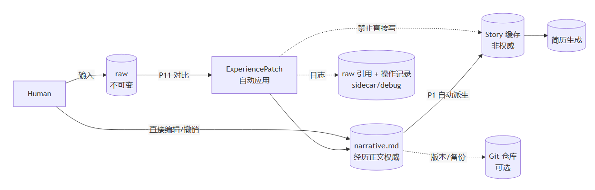

# INPUT-FOLLOW · v6 定稿设计

> 唯一设计基准。v6 核心后端已实现于 `feat/input-follow-v5`；旧 Story Markdown 模型只作兼容，见 §13。
> 生成方法论见 §14。

---

## 0. 前提

1. 单人、手动、文字输入；不做语音、不做自动判断新经历、不做重复检测。
2. 经历库规模小：一份简历 3–4 段经历，每段约 4 条 bullet。
3. 高保真优先：宁可少写、宁可提问，不编造。
4. **v6 全程不需要人工确认**：AI 直接应用 ExperiencePatch；人可编辑经历正文、可撤销。
5. raw 不可变；经历正文是权威；Story 是派生视图，不是权威。
6. 小规模下全量读取内容，不做索引/过滤/BM25/向量。
7. 不用自主 Agent：固定 Workflow + 固定角色 + 有界修订。

---

## 1. 总流程图


（SVG：`images/final-flow-v6.svg`）

图例：

| 标记 | 含义 |
| --- | --- |
| **F1–F6** | 字段/数据结构 |
| **P1–P11** | 提示词契约 |
| **R0–R10** | 角色（Human / AI 固定角色） |
| **A1–A3** | 确定性算法节点 |

- **F1** 经历字段：`type / name / role / time`
- **F2** raw：不可变原话
- **F3** `narrative.md`：经历正文（时间/逻辑顺序的自然段）
- **F4** JD 原文
- **F5** 派生 Story / 证据
- **F6** run：一次生成的完整留痕

主链：

```
Human 输入
  → raw（不可变）
  → R10/P11 ExperiencePatch
  → 自动写 narrative.md
  → R1/P1 自动派生 Story
  → content.md（生成缓存，非权威）
  → R4 并行评估 → A1 覆盖 → R5 计划/strategy
  → R6 三区编译 → A2 校验 → R7 Critic → R8 有界修订 → A2 复验
  → Human 终审/导出
```

问题链：

```
经历问题：A3 → P2 → 回答 → raw → P11 → 正文 → 重新派生
简历问题：A1/A3 → P10（C 方案）→ 气泡/评论 → 回答 → raw → P11 → 正文 → 重新生成
```

---

## 2. 数据与权威



（SVG：`images/final-authority-v6.svg`）

| 层 | 内容 | 谁写 | 权威 |
| --- | --- | --- | --- |
| **raw** | 每次输入的逐字原话 | 用户 | ✅ 事实来源，不可变 |
| **narrative.md** | 按时间/逻辑顺序组织的经历正文（自然段） | AI 自动 Patch；人可编辑/撤销 | ✅ 经历内容权威 |
| **派生 Story** | 从正文按规则抽取的 6 槽卡片 + raw_quotes | AI 自动派生 | ❌ 可重建缓存 |
| **content.md** | 派生 Story 的 Markdown 缓存（供生成） | 系统写 | ❌ 派生 |
| **runs / questions / debug** | 生成、提问、审计产物 | 系统 | ❌ |

规则：

1. AI 不直接改 `narrative.md`？**v6 允许自动 Patch 直接写正文**；但必须保留 raw、operation、source_quotes，允许撤销。
2. AI 不得编造 raw 中没有的事实；Patch 中 `source_quotes` 必须逐字命中本次 raw。
3. 人可直接编辑 `narrative.md`；编辑后重新派生 Story。
4. **不保存逐行 revision/provenance 到 Markdown**；版本用 Git（可选），Patch 日志存 sidecar/debug。
5. raw_quotes 是防幻觉锚点；派生 Story 必须逐字可回查。
6. 不要求人工确认 Story 列表；派生 Story 只做生成材料，保留只读预览供审计。

---

## 3. 经历字段

| 字段 | 必填 | 说明 |
| --- | --- | --- |
| `type` | ✅ | `campus` 学校校园经历 / `project` 项目经历 / `internship` 实习经历 |
| `name` | ✅ | 实习=企业名；项目=项目名；校园=学校/组织名 |
| `role` | ❌ | 岗位/职务；不参与检索、不参与 reason；仅展示/背景可用 |
| `time` | ❌ | 选填；项目可无；自由文本，不推断 |
| `exp_id` | 内部 | `exp_xxx` |

展示行：`name · role · time`，缺项省略。  
不设 `summary` 字段；不设 `status`、`quality_grade`、`capabilities`。

---

## 4. 经历正文与派生 Story

### 4.1 经历正文（权威）

- 一段经历 = 一个 `narrative.md`；
- 正文按**时间/逻辑顺序**的自然段书写，不要求条目/槽位/Story 标题；
- 新内容由 P11 根据时间/顺序词插入到正确位置；判断不了就进 `unresolved` 提问，不猜；
- 没有明确时间：默认追加到末尾；用户可编辑/拖动重排；
- 正文段落可以有 `source_raw_ids`（存在 Patch 日志 sidecar，不写进正文）；
- 人可直接编辑正文；编辑后自动重新派生 Story。

`narrative.md` 结构：

```markdown
---
experience_id: exp_x
type: project
name: 扣子校园推广
role: 校园大使        # 可选
time: 2025-10 ~ 2025-11 # 可选
---

## 经历正文

2025 年 10 月，我主动沟通校外资源，获得扣子平台校园推广机会，并自己对接、推进项目。

最初线上建了三个群，发现进群到注册的转化不理想；后来重做配图、把三个群收敛为两个，注册转化率从约 20% 提升到 85%。

线下受学校政策限制，我持续与老师沟通、安排沟通顺序，最终通过同学联系到机器人社团，在“百团大战”联合开展活动。
```

### 4.2 ExperiencePatch（P11）

P11 输入：新 raw + 当前正文 + 历史 raw（排除本次）。  
输出 operations：

```json
{
  "operations": [{
    "op": "append_after|insert_before|insert_after|replace_span|merge_into",
    "target_paragraph_id": "p_1",
    "text": "组织后的自然段（只能来自 raw 的事实）",
    "source_raw_ids": ["raw_x"],
    "source_quotes": ["逐字原话"],
    "reason": "为什么放这里"
  }],
  "unresolved": [{ "reason": "顺序不确定/指代不明", "question": "..." }]
}
```

规则：

1. 已被正文覆盖 → 不新增；
2. 旧正文可补充 → `merge_into` / `replace_span`；
3. 新事件/新阶段 → `insert_before` / `append_after`；
4. 位置只依据显式时间/顺序词；不猜；
5. `source_quotes` 必须逐字来自本次 raw，否则该 operation 丢弃并记录 skipped；
6. 自动应用，不人工确认；保留 raw + operations 日志，可撤销；
7. 两次未确认的 Patch 不覆盖：v6 自动应用后再处理下一次输入；如 base 已变，重新对比当前正文。

### 4.3 派生 Story（非权威）

- 输入：当前 `narrative.md` 全文（+ raw 引用）；
- 切分：一个 Story = 一个子目标/决策 + 本人动作 + 闭环结果/交付；新问题/新阶段/独立决策处切；
- 输出：6 槽 + `ownership`/`scope` + `raw_quotes` + 可选父/子（最大深度 2）；
- 完全 AI 自动，不人工确认；
- 不满足准入（缺动作/结果/自包含）→ Fragment，不生成 bullet；
- 正文改动 → 重新派生；旧 Story 不保证稳定存在；
- `content.md` 是派生 Story 的 Markdown 缓存，供 R4/R5/R6 读取；不是权威。

### 4.4 父子层级（可选）

- 默认平铺；
- 只有“总目标跨多个独立子目标”时，父 Story 做总述，子 Story 做细节；父不生成 bullet、不作证据；
- 最大深度 2；子 quote 必须落在父范围；同一 quote 只挂一个叶子；
- 层级由 AI 在派生时决定，不人工确认。

---

## 5. Markdown 语法

### 5.1 `narrative.md`（权威）

- front matter：`experience_id/type/name/role/time`；
- `## 经历正文`；
- 自然段，段间空行；不要求 `## Story`；
- 没有固定槽位；不要写条目化模板；
- 可手改；手改后调用 `derive`。

### 5.2 `content.md`（派生缓存，非权威）

- 由 P1 从正文派生后自动写入；
- 使用旧 Story Markdown 结构（front matter + `## Story`），供生成读取；
- 不要求用户编辑；如要改内容，改 `narrative.md` 后重新派生；
- 旧 v5 的 `input/confirm` 手改路径只用于兼容，不是 v6 主路径。

---

## 6. 角色与算法

| ID | 角色 | 类型 | 职责 | 不做什么 |
| --- | --- | --- | --- | --- |
| R0 | Human | 人 | 新建/选择经历、输入、编辑正文、回答、终审 | 不需要确认 Story 列表 |
| R10 | Experience Merger | AI | raw + 正文 + 历史 → ExperiencePatch，自动合并 | 不写 Story、不编事实 |
| R1 | Story Extractor | AI | 从正文自动派生 Story（6 槽 + quotes + 父子） | 不写正文、不要求人工确认 |
| R2 | Experience Questioner | AI | 正文缺什么/顺序不清/指代不明/口径缺失 → 问题 | 不补内容、不问泛泛 |
| R3 | JD Note | AI（可选） | 带逐字 quote 的 JD 阅读笔记 | 不做 must 门禁、不选材 |
| R4 | Experience Evaluator | AI（每经历并行） | JD + 该经历全部 Story → use/hold/drop + 证据/缺失 | 不跨经历、不打分、不选最终组合 |
| R5 | Selector/Planner | AI | 3–4 段、每段约 4 条、顺序、strategy | 不编事实、不写正文 |
| R6 | Composer | AI | 三区：背景（可选）/Hook/正文 + 技术栈（可选） | 不改事实、不跨 Story 拼造 |
| R7 | Critic | AI | 整份评审，输出 issues | 不改稿 |
| R8 | Revisor | AI（有界） | 只按 issues 修订，最多 1 轮 | 不扩大范围、不新增事实 |
| R9 | Resume Question Planner | AI | C 方案：有锚点才问，无锚点只进 Critic | 不改写已选 bullet |
| A1 | Aggregator | 算法 | 合并 R4、去重、覆盖统计 | 不做语义判断 |
| A2 | Validator | 算法 | schema/引用/字数/父 Story/重复/JD quote 校验 | 不改写 |
| A3 | Question Candidate Detector | 算法 | 从正文缺口/R4 matched/missing/覆盖出候选 | 不做提问措辞、不编事实 |

没有自主 Agent：全部单轮、固定 I/O；R8 是有界修订，不是自主循环。

---

## 7. 提示词契约

### P11 · R10 ExperiencePatch

**输入**：经历字段 + 当前正文 + 本次 raw + 历史 raw（排除本次）。  
**输出**：`{operations[], unresolved[]}`（见 §4.2）。  
**硬规则**：

1. 只能使用 raw/正文中的事实；不得新增数字、工具、结果、时间；
2. 正文为空时视为初始录入，直接把 raw 按时间/逻辑拆成自然段；
3. 已有内容已覆盖 → 不新增；
4. 位置只依据显式时间/顺序词；判断不了进 unresolved；
5. 每个 operation 带 `source_raw_ids`/`source_quotes`，quote 逐字来自本次 raw；
6. 自然段，不写条目/槽位/Story 标题；
7. 自动应用，不输出“请确认”。

### P1 · R1 Story Extractor（派生）

**输入**：`narrative.md` 正文（+ raw 引用）。  
**输出**：

```json
{
  "stories": [{
    "temp_id": "s1", "parent_temp_id": null, "order": 1,
    "title": "", "summary": "",
    "ownership": "", "scope": "",
    "slots": { "stage": "", "module": "", "problem": "", "workflow": "", "tech_link": "", "outcome": "" },
    "raw_quotes": ["逐字原话"],
    "boundary_reason": "", "flags": []
  }],
  "fragments": [{ "temp_id": "f1", "body": "", "reason": "" }],
  "unassigned_details": []
}
```

硬规则：

- 只能从正文取事实；`unassigned_details` 必须存在且为空；
- 一个 Story = 子目标 + 动作 + 闭环结果/交付；
- 六槽尽量填，缺写“未提及”，不作为拒绝依据；
- 没有时间不写时间；不推断；
- 不设固定数量；按事件边界切；
- 父/子仅总目标跨子目标时使用，最大深度 2；
- 自动派生，不要求人工确认；产出写 `content.md` 缓存。

### P2 · R2 Experience Questioner

**输入**：正文 + Story + raw。  
**输出**：`{questions:[{story_id,missing,basis_quote,question,expected_answer,priority}]}`。  
规则：只基于已有内容；一个问题一个维度；优先顺序/缺口/矛盾/口径；全部输出，不设上限；UI 只展示 3 条；不替用户回答。

### P3 · R3 JD Note（可选）

输入 JD；输出带 `jd_quote` 的笔记；不设 must 门禁、不选材；匹配仍以 JD 原文为准。

### P4 · R4 Experience Evaluator

输入：JD + 该经历全部 Story（含父/子）。  
输出：`{experience_id,recommendation:use|hold|drop,matched[],missing[],reason}`。  
规则：只读本经历；`jd_quote` ∈ JD、`story_quote` ∈ Story；父 Story 只作背景；不编证据；不选组合。

### P5 · R5 Selector/Planner

输入：所有 R4 结果 + A1 覆盖 + 配置（3–4 段、每段约 4 条）。  
输出：

```json
{
  "strategy": { "hook_level": "L1|L2|L3", "body_pattern": "XYZ|CAR|PAR", "jd_focus": "" },
  "experiences": [{ "experience_id": "", "why": "", "bullets": [{ "story_id": "", "jd_quote": "", "order": 1 }] }],
  "global_order": [], "dropped": []
}
```

规则：选 3–4 段；每段 3–4 条；同经历按时间/文档顺序；同主题成组；不编事实；不足少写不硬凑。

### P6 · R6 Composer（三区）

输入：JD + 单段经历 + 选中 Story + 计划 + strategy + config。  
输出：

```json
{ "experience_id": "", "project_background": "", "tech_stack": [], "bullets": [{ "story_id": "", "jd_quote": "", "hook": "", "content": "", "evidence_quote": "" }] }
```

规则（详见 §14）：

- 项目背景可选，40–60 字；`show_background=false` 不输出；
- Hook 4–12 字符，全篇同一 L1/L2/L3 水位，禁止空词；
- 正文 50–70 字，全篇同一 XYZ/CAR/PAR；单点聚焦、第一句扣 Hook、结尾落数字/交付/状态；
- 技术栈可选，数组每项 ≤40 字；`show_tech_stack=true` 才输出；
- 不跨 Story 拼造；不编数字；不评价性收尾。

### P7 · R7 Critic

输入：JD + 草稿 + 覆盖 + 计划。  
输出 `issues[]`（类型/严重度/位置/问题/建议）。  
检查：覆盖、重复、顺序/主题、事实/引用、字数、Hook 水位、句式、背景/技术栈、夸大、标点。只出问题不改稿。

### P8 · R8 Revisor

输入：草稿 + blocker/warning issues。  
输出：修订稿 + `{applied_issue_ids, remaining}`。  
规则：只修 issues；不新增事实；缺证据只能删/弱化；最多 1 轮；修不掉交人工。

### P10 · R9 Resume Question Planner（C 方案）

输入：JD + 当前简历 + 全库 Story + 覆盖 + A3 候选 + Critic issues。  
输出：问题（target 可以是 experience 或 story；action `add_story|add_bullet`）。  
规则：

- 已选 bullet 视为可信，不要求改措辞/风格；
- 有锚点才问：未选 direct/adjacent Story、已选未展开 Story、经历级锚点；
- 无锚点：不生成问题，只进 Critic `coverage` issue；
- 必须引用 JD 原文 + 当前依据；
- 全部输出，UI 只展示 3 条；不设 must 门禁。

---

## 8. 端到端时序

### 8.1 经历输入

| 步 | 谁 | 输入 | 处理 | 输出 |
| --- | --- | --- | --- | --- |
| 1 | R0 | — | 新建/选择经历，填 type+name（role/time 可选） | 经历 |
| 2 | R0 | 文字 | 输入增量 raw | `raw/` |
| 3 | R10 | 正文 + 新 raw + 历史 raw | P11 Patch | operations/unresolved |
| 4 | 系统 | operations | 自动应用 | `narrative.md` |
| 5 | R1 | 正文 | P1 派生 Story | `content.md` 缓存 |
| 6 | A2 | 派生 Story | quote/结构校验 | issues（阻断/警告） |
| 7 | R2 | 正文/Story | P2 经历问题 | questions（全部，UI 3） |

### 8.2 简历生成

| 步 | 谁 | 输入 | 处理 | 输出 |
| --- | --- | --- | --- | --- |
| 8 | R0 | JD | 输入 | run.jd |
| 9 | R4 ×经历 | JD + 该经历 Story | P4 并行 | use/hold/drop + 证据/缺失 |
| 10 | A1 | R4 | 合并/去重/覆盖 | coverage |
| 11 | R5 | coverage + 配置 | P5 | strategy + 3–4 段计划 |
| 12 | R6 | 计划 + Story | P6 三区 | 背景（可选）/Hook/正文/技术栈（可选） |
| 13 | A2 | 草稿 | 校验 | issues |
| 14 | R7 | 草稿 + JD | P7 | issues |
| 15 | R8 | blocker/warning | P8 一轮 | 修订稿 + applied/remaining |
| 16 | A2 | 修订稿 | 复验 | issues |
| 17 | A3/R9 | 覆盖 + 草稿 + 全库 | C 方案 | 简历问题 |
| 18 | R0 | 草稿 + issues + 问题 | 终审/导出 | run |

---

## 9. 评估与选择

- R4 每经历并行，只回答“这段经历对这份 JD 值不值得用、有哪些证据、缺什么”；
- A1 只合并/去重/统计覆盖，不打分；
- R5 决定 3–4 段、每段条数、strategy；
- R7 Critic 整份评审；R8 有界修订；R0 终审；
- 不用 S/A/B、capabilities、加权分。

---

## 10. 问题引擎（C 方案）

### 10.1 目的

| 类型 | 目的 |
| --- | --- |
| 经历问题 | 补正文/顺序/口径，让派生 Story 更完整 |
| 简历问题 | 增加简历覆盖；不改已选可信 bullet |

### 10.2 依据

经历问题：`story_incomplete`、`contradiction`、`vague_action`、`timeline_unknown`。  
简历问题：

| basis | 依据 | 动作 |
| --- | --- | --- |
| `adjacent_unselected` | 未选 direct/adjacent Story | add_bullet |
| `unrealized_potential` | 已选未展开/证据不足的 Story | add_bullet |
| `coverage_missing` | JD 覆盖 none/弱 + 经历级锚点（R4 use/matched/missing） | add_story（target=experience） |

**C 方案（已定）**：

1. 有锚点 → 允许提问，target 可以是 experience 或 story；
2. 无锚点（全库无相关经历/Story）→ **不生成问题**，只进 Critic `coverage` issue；
3. 无锚点不是被忽略，必须出现在 Critic issues。

### 10.3 生成/更新

- A3 候选 → P2/P10 → A2 校验 → Question Store；
- 全部输出，不设上限；UI 只取 `candidate/asked` 前 3；
- 触发：经历 Patch/正文编辑后；简历 compose+Critic 后；回答后；
- 不按键触发；`evidence_rev` 变化 → 旧问题 `expired`；已回答 `answered`；用户可 `dismiss`；
- 回答 → raw → P11 → 正文 → 重新派生/生成；不全局重来。

### 10.4 存储

`questions/experience-<id>.json`、`questions/resume-<run>.json`；不写 Markdown。

---

## 11. 调试与测试

- `debug/<timestamp>-<node>.json`：P1/P2/P10/P11/generate 已接；R4–R8 尚未逐节点 token/耗时留痕；
- `npm test`：17/17 通过（v2 + v6）；
- v6 测试覆盖：自动 ingest（无确认）、C 候选、三区/可选板块、问题状态、旧 Story 兼容；
- 真实 v6 smoke：3 段经历、10 bullets、7 条问题；策略 L2/PAR；有 1 条 content 45 字 error（不自动补字）。

---

## 12. 待确认

1. 教育背景/profile 是否纳入本流程（当前不在范围）；
2. 只有 2 段可写经历时是否允许降级出稿（当前 `library<3` 硬失败）；
3. 旧 Story 数据迁移工具；
4. 前端/气泡 UI（当前只有 CLI）；
5. P3 JD Note 是否接线（当前只有 prompt）；
6. 逐节点 debug 完整化；
7. 真实内容过短时：人工重写，还是允许 R8 用 Story 事实扩写。

---

## 13. 附录：v5 旧 Story Markdown 模型（兼容，不是 v6 主路径）

旧模型：

- `content.md` 直接由人工确认 Story 列表后写入；
- front matter + `## Story` + 六槽 + `raw_quotes`；
- `input` → Draft → `confirm`；人类逐张确认；
- 手改 Markdown 优先；
- 旧 `extract.mjs`/`confirmDraft`/`mergeWithCurrent` 仍保留，仅用于兼容/旧数据。

v6 新经历不使用该模型：权威是 `narrative.md`，Story 自动派生。

---

## 14. 简历生成方法论：三区结构（项目背景 / Hook / 正文）

> 本节是生成阶段（R5/R6/A2）的写作规则，必须与 P5/P6 提示词和 A2 校验一致。
> 目标：让每条经历都是"总起句 + 视觉锚点 + 高密度事实"，而不是一条条平铺的 bullet。

### 14.1 三区总览

| 分区 | 物理位置 | 字数/长度 | 作用 |
| --- | --- | --- | --- |
| **项目背景区** | 经历标题（项目/实习名称 + 时间）下方、Bullet 列表上方 | 1–2 句，**40–60 字** | 一段经历的总起句，放宏观定位，给 Bullet 腾出事实空间 |
| **Hook 关键词** | 每条 Bullet 最开头，用 `【】` 括起来 | **4–12 字符** | HR 扫读的视觉锚点、面试官提问的题眼 |
| **经历正文** | Hook 后面 | **50–70 字/条** | 用高密度硬事实证明 Hook 的含金量 |

三条硬性纪律：

1. **单卡单点聚焦（Focus Pinning）**：一张卡有 6 个槽位，也只围绕 `match_reason` 指出的 **1 个核心切入点**展开，主动舍弃次要枝节，把字数压在 50–70；
2. **互文咬合**：正文第一句必须紧扣左侧 Hook 的概念词展开解释，不能标题党；
3. **反八股收尾**：禁止"体现了……能力 / 确保了……效果 / 保障了……"等评价性废话收尾；结尾必须落在具体数字、交付物或系统状态改变上。

### 14.2 第一分区：项目背景区

**编写公式：**

```
[目标业务场景/痛点] + [你的阶段跨度与主导定位] + [整体产品形态与核心闭环]
```

规则：
- 只写宏观定位，不写具体 Bullet 细节；
- 把"从 0 到 1 独立搭建""全栈闭环落地""面对高频碎片化办公痛点"这类定位词全部收拢到这里，禁止塞进每条 Bullet；
- 1–2 句，40–60 字；必须是完整通顺的句子，不得为压字数截断成病句；
- 背景是**可选板块**：`show_background=false` 时整段不输出。

示例：

> 面向个人高频碎片记录场景，从 0 到 1 独立完成桌面端 AI 待办工具的设计与开发，构建本地化存储与自然语言任务解析的产品闭环。（59 字）

### 14.3 第二分区：Hook 关键词

规则：
- 位置：每条 Bullet 开头，`【Hook】正文`；
- 长度 4–12 字符；
- Hook 必须来自 Story 的真实动作/机制，不得编造；
- 全篇**同一专业水位、同一词性风格**，不允许一条英文架构词、下一条口语白话；
- 禁止中文互联网空洞造词：闭环、赋能、矩阵、抓手、生态、全景、体系等；
- 映射真实行业术语，允许 1–3 个精准英文短词或中英混排。

三级专业水位（全局锁定）：

| 层级 | 适用 | 示例 |
| --- | --- | --- |
| **L1 功能直白层** | 非技术岗/传统业务岗 | 【语音转待办】【本地数据存储】【报名表设计】 |
| **L2 行业标准术语层（默认）** | AI 应用 PM/策略 PM/AI 落地岗 | 【Local-First 存储】【Rule-Based 规则约束】【Structured Output 校验】 |
| **L3 架构与工程权衡层** | 大厂核心 AI 平台/Agent 架构/强技术向 PM | 【Zero-Backend 端侧架构】【Deterministic Guardrails】 |

### 14.4 第三分区：经历正文

只使用三种正交骨架，全局锁定一种：

#### XYZ 成果导向型

- 语序：量化结果/核心交付物 → 实现该结果的关键机制与动作 →（可选）口径；
- 示例：
  > 【Structured Output 校验】将复杂语音指令的字段解析准确率稳定至 98% 以上，通过设计强约束 JSON Schema 映射规则并接入 DeepSeek API 实现。

#### CAR 痛点破局型

- 语序：具体卡点/工程约束 → 方案权衡（放弃 A 选 B）→ 落地解法 → 结果；
- 示例：
  > 【Local-First 存储】针对个人工具面临的服务器备案繁琐与运维成本约束，放弃云端部署，采用 Tauri + 本地 SQLite 构建离线存储，实现毫秒级唤起。

#### PAR 流程链路型

- 语序：业务前提 → 输入 → 核心处理节点 → 交付输出/效率变化；
- 示例：
  > 【Rule-Based 规则约束】围绕口语任务提取场景，搭建"非结构化语音输入 → 四维时间规则映射 → 标准待办落库"处理管线，消除相对时间漏检。

正文规则：
- 50–70 字/条；
- 第一句紧扣 Hook；
- 只讲一个抓手；
- 结尾落在数字/交付物/系统状态；
- 不得跨 Story 拼造事实，不得新增数字。

### 14.5 全局策略如何确定

R5（Planner）在扫描 JD 时一次性锁定：

```json
{
  "strategy": {
    "hook_level": "L1|L2|L3",
    "body_pattern": "XYZ|CAR|PAR",
    "jd_focus": "JD 最核心考核句（≤60字）"
  }
}
```

- 全篇所有经历共用同一 `hook_level` 与 `body_pattern`，不得混级/混骨架；
- 默认 `hook_level=L2`、`body_pattern=CAR`；
- JD 是传统业务/非技术岗 → L1；AI 应用/产品岗 → L2；核心平台/架构岗 → L3；
- JD 强调量化结果 → XYZ；强调痛点/权衡 → CAR；强调端到端流程 → PAR。

### 14.6 可选板块：背景与技术栈

项目/实习下有两个可选板块，按需展示：

| 板块 | 开关 | 内容 |
| --- | --- | --- |
| 项目背景 | `show_background`（默认 true） | 40–60 字总起句 |
| 技术栈 | `show_tech_stack`（默认 false） | 数组，每项 ≤40 字："技术/工具 + 用途"；不得堆名词 |

技术栈放在 Bullet 之后、作为项目下的补充块；不参与 Hook/正文计数。

### 14.7 最终渲染效果

```
极简桌面端 AI 待办软件 · 独立产品与开发 2026.08 - 2026.11
项目背景：面向个人高频碎片记录场景，从 0 到 1 独立完成桌面端 AI 待办工具的设计与开发，构建本地化存储与自然语言任务解析的产品闭环。

【Local-First 存储】 针对个人工具面临的服务器备案繁琐与运维成本约束，放弃云端部署，采用 Tauri + 本地 SQLite 构建离线存储，实现全局快捷键毫秒级唤起。

【Rule-Based 规则约束】 围绕复杂口语指令解析场景，搭建“非结构化语音 → 四维时间规则映射 → 标准待办落库”管线，消除跨周期与相对时间漏检。

【Structured Output 校验】 解决大模型返回格式漂移导致的渲染异常，设计强约束 JSON Schema 映射规则并接入 DeepSeek API，保障非结构化语音到待办项的稳定转化。
```

### 14.8 验收规则（A2 / Critic）

| 项 | 规则 |
| --- | --- |
| 背景 | 若展示：40–60 字；可选板块关闭时允许缺失 |
| Hook | 4–12 字符；全篇同一 L1/L2/L3 水位 |
| 正文 | 50–70 字；单点聚焦；第一句扣 Hook；无评价性收尾 |
| 句式 | 全篇同一 XYZ/CAR/PAR |
| 事实 | 数字/工具/结果必须来自 Story；不得跨 Story 拼造 |
| 技术栈 | 可选；每项 ≤40 字；只写技术与用途 |
| 输出 | 每条 bullet 带 `story_id`、`jd_quote`、`evidence_quote` |

---

# 15. 输入 → 增量输入 → 派生 Story（实现细节）

> 本节是 §4/§8 的详细展开，给实现、调试和复测用；不改变前面契约。

## 15.1 第一层：raw

- 每次用户输入都单独存一份 raw：`raw/<raw_id>.json`；
- raw 只追加，不修改；
- 字段：`{ raw_id, experience_id, text, at }`；
- 所有后续 Patch/Story/引用都必须能回溯到 raw 的逐字 quote。

## 15.2 第二层：经历正文 narrative.md

### 首次输入

```
appendRaw
→ P11（正文为空）
→ operations（按时间/逻辑拆成自然段）
→ 自动应用到 narrative.md
→ P1 从正文派生 Story
→ content.md（派生缓存）
```

约束：

- 首次输入时，P11 不能因为“历史 raw 里有相同内容”而拒绝；正文为空 = 初始录入；
- 正文可以有标题、时间、身份等元信息，但不得把同一句角色重复写两遍；
- 元信息放 front matter 或首段一次即可；不要在正文里重复“担任副主席/实习生”等。

### 增量输入

```
appendRaw（新 raw）
→ P11 输入：当前正文 + 新 raw + 历史 raw（排除本次）
→ 判断四类：
    A. 已覆盖 → 不新增
    B. 旧正文可补充 → merge_into / replace_span
    C. 新事件/新阶段 → insert_before / append_after
    D. 顺序/指代不确定 → unresolved 提问
→ 自动应用（不人工确认）
→ 重新派生 Story（全量）
```

硬规则：
1. `source_quotes` 必须逐字来自**本次** raw；不满足的 operation 丢弃并记 `skipped`；
2. 位置只依据显式时间/顺序词；判断不了进 `unresolved`；
3. 同一事实不重复写；同一段 raw 不产生两个同义段落；
4. 新增内容按时间/逻辑放；没有时间默认追加；
5. 不新增数字、工具、结果、时间；只重组 raw 已有事实。

### 当前实现的实际观察（2026-11-25）

测试经历：`exp_74645d5065a74df4`（学业发展中心），raw 327 字。

| 输入 | 字数 | P11 applied | unresolved | 正文段数 | 重复段落 |
| --- | ---: | ---: | ---: | ---: | ---: |
| 第一次（标题+时间+第一段） | 204 | 1 | 0 | 3 | 0 |
| 第二次（6场/12天/AI工具） | 121 | 1 | 0 | 4 | 0 |

结论：**增量合并成功，无重复段落、无事实丢失、无未决**；但首次正文出现“担任副主席”重复两次，需要 P11 去重。

## 15.3 第三层：派生 Story

### 输入/输出

- 输入：`narrative.md` 全文；
- 输出：`stories[]` + `fragments[]` + `unassigned_details[]`；
- 自动写入 `content.md` 缓存；**不人工确认**。

Story 字段：

```json
{
  "story_id": "story_...",
  "parent_story_id": null,
  "order": 1,
  "title": "≤30 字",
  "summary": "",
  "ownership": "",
  "scope": "",
  "slots": {
    "stage": "", "module": "", "problem": "",
    "workflow": "", "tech_link": "", "outcome": ""
  },
  "raw_quotes": ["逐字原话"],
  "flags": []
}
```

### 切分规则

一个 Story = **一个子目标/决策 + 本人动作 + 闭环结果/交付 + 自包含**。

必须拆：
- 新的子问题/卡点；
- 新阶段/里程碑；
- 独立技术/产品决策；
- 同一大功能下，解决的问题/手段不同（如“语音转文字”vs“时间解析”）。

必须合：
- 同一决策的补充原因、参数微调；
- 同一结果的多个连续动作；
- 同一职责的重复描述。

不设固定张数；一段核心经历通常 3–8 张；不足就少，不硬凑。

### 准入/降级

- 满足“子目标+动作+结果/交付+自包含+原话” → Story；
- 缺结果/缺动作/只是背景/只是职责列表 → Fragment；
- 角色/荣誉/挂名但无本人动作 → Fragment 或弱 Story（必须标 flags）；
- `problem`/`tech_link` 可以“未提及”，不因此拒绝，但会降低 CAR/技术链路适配度。

### 父子层级

- 默认平铺；
- 仅当总目标跨多个独立子目标时使用父/子；最大深度 2；
- 父只做背景/总述，不生成 bullet、不作证据；
- 子 quote 必须落在父覆盖范围；同一 quote 只挂一个叶子。

### 质量 flags（派生时）

允许的 flags：
`missing_problem`、`missing_outcome`、`missing_metric`、`vague_action`、`possible_duplicate`、`weak_ownership`、`task_list_not_story`。

要求：**缺什么就标什么**；不能只标 `missing_outcome`，却缺 `problem/tech_link` 不标。

## 15.4 真实输出的质量问题（当前基线）

### 做得好的

- 增量正文没有重复、没有丢事实；
- raw_quotes 全部可回查（第一次 4/4，第二次 6/6）；
- 新事实（6 场、12 天、AI 工具）都正确进入正文和 Story；
- 输出 JSON 结构稳定，可落盘。

### 还不够好的

1. **正文首段角色重复**：  
   “担任副主席”在同一段出现两次。
2. **Story 粒度不稳定**：  
   第一次 4 条，第二次 5 条；第一次的“公众号/报名/对接”三条，第二次被合并成“日常运营与内容制作”一条。  
   原因：每次正文变化后全量重新派生，没有稳定合并策略。
3. **过度合并**：  
   “日常运营与内容制作”包含内容、流程、数据、沟通四类动作，更像职责列表，不像一个决策/结果链，写 bullet 时难以单点聚焦。
4. **角色/起点被当 Story**：  
   “主动联系老师任副主席”没有明确卡点和可验证结果，准入偏弱。
5. **问题槽位缺失但 flags 不完整**：  
   5 条 Story 中 4 条缺 problem、3 条缺 tech_link；只有“AI 工具”一条标了 missing_outcome。
6. **缺少“卡点/权衡”**：  
   raw 本身是任务叙述，P1 只能填 problem=未提及；后续 CAR 句式会缺素材，需要问题引擎补问。

---

## 15.5 问题解决与分析

> 本节回答：当前“输入 → 增量 → 派生 Story”为什么会出现结构漂移；这不是单个 prompt 措辞问题，而是**数据模型 + 派生机制**的问题。

### 15.5.1 现状、根因、资料、业务流程与实现方式

#### 一、现状：流程存在，但“判断”没有真正落地

当前实现：

1. `ingest` → `appendRaw`；
2. P11 输出 `operations[]`（append/insert/replace/merge）→ 自动应用；
3. 每次 ingest 后，`deriveStories` 都把**整篇 narrative.md** 重新交给 P1；
4. P1 输出一份全新的 `stories[]`；
5. `content.md` 被整份覆盖，Story 重新分配随机 `story_id`。

也就是说：

- P11 是**增量**的（只改正文）；
- P1 是**全量重写**的（每次重新切分、重新编号、重新命名）；
- P1 的输入里**没有已有 Story**，没有 `story_id`、没有 diff、没有“保留/更新/合并”的判断；
- 所谓“新 Story / 旧 Story 补充”的判断，实际只存在于 P11 的 prompt 文案里，P1 并没有执行这个判断。

两次输入的真实结果就是证据：

- 第一次：4 条 Story；
- 第二次：5 条 Story；
- 第一次的“公众号内容 / 报名打卡 / 对接协调”三条，第二次被合并成“日常运营与内容制作”一条；
- Story ID、标题、边界都变了。

这证明：**当前不是“增量更新 Story”，而是“每次重新生成 Story”。**

#### 二、提示词层面的问题

当前 P11/P1 的提示词主要是：

- 输出 schema；
- 一些“只能使用事实/不要编造”的约束；
- 对“新事件/旧正文补充”的笼统描述。

缺的是**严格决策规范**：

1. 没有决策表：什么情况算“同一 Story”、什么算“新 Story”、什么算“合并”、什么算“拆分”；
2. 没有优先级：多个规则冲突时（例如“新阶段”与“同一决策补充”）谁优先；
3. 没有 identity：P1 不知道上一版 Story 的 `story_id`，无法输出“更新 story_x”；
4. 没有 idempotency：同一输入跑两次，Story 数量和边界都可能不同；
5. 没有变更范围：P1 不知道哪几段正文变了，只能全量重读；
6. 没有校验：没有“已有 Story 是否被无故删除/重命名/合并”的检查。

所以这不是“再补几句 prompt”能解决的；**prompt 没有承载一个可执行的判断算法**。

#### 三、第一性原理：这是“派生视图维护”问题，不是“每次生成”问题

把系统拆开看：

```
raw（事件日志，事实）
  → narrative.md（投影 1：经历正文）
  → Story（投影 2：生成用卡片）
  → content.md（投影 3：Markdown 缓存）
```

- raw 是**事实**，只追加；
- narrative / Story / content 都是**派生视图**；
- 派生视图的正确更新方式是 **增量维护（incremental maintenance）**：
  - 找出输入变化；
  - 只重算受影响部分；
  - 保留未变化的 identity；
  - 输出可比较的 diff。

当前做法是：**输入一变化，就把整张视图删掉重建**。  
这必然导致：

1. **非确定性**：LLM 每次切分/命名/合并都可能不同；
2. **身份丢失**：Story ID 重新生成，下游引用、问题、选材无法稳定对应；
3. **不可比较**：无法判断“这次改动是变好还是只是变了”；
4. **成本浪费**：全量重读、全量重写；
5. **错误放大**：一次全量重写把上一次的好结果也覆盖掉。

更底层的原因：

> **没有把 Story 当成“有稳定身份、可增量维护的实体”，而是当成“每次 prompt 的输出文本”。**

#### 四、资料结论（简要）

1. **增量视图维护（Differential Dataflow / Shared Arrangements）**  
   将数据看成持续到达的更新，维护物化视图时按**记录级更新**处理，保留多版本状态，而不是每次重算整个集合。  
   参考：[Shared Arrangements: practical inter-query sharing for streaming dataflows](https://ar5iv.labs.arxiv.org/html/1812.02639)

2. **Event Sourcing / CQRS**  
   raw 作为 append-only 事件日志，narrative/Story 是可重放的 projection；projection 需要**幂等**、**稳定 key**、**可回放**。  
   参考：[Event Sourcing + CQRS](https://pkg.go.dev/github.com/quintans/eventsourcing@v0.32.0)

3. **增量知识图谱/实体融合**  
   增量构建知识图谱时，关键不是重新抽全图，而是：新实体识别、与已有实体对齐、冲突合并、保留稳定 ID。  
   参考：[ID-GraphRAG: Incremental Construction Framework](https://dl.acm.org/doi/10.1007/978-981-92-2856-0_11)、[Multi-source knowledge graph construction through LLM-assisted incremental fusion](https://www.sciencedirect.com/science/article/pii/S2667305326000499)

4. **结论**  
   这些不是简历领域专用研究，但工程模式高度一致：  
   **事件日志 + 稳定 key + 增量投影 + 对账/合并**，而不是“全量重写”。

---

#### 五、先拆成两个问题，不能混在一起

当前讨论里其实混了两个层次的问题：

**问题 A：业务流程设计（新内容进来后，经历正文和 Story 怎么更新）**

- 输入：新 raw、已有正文、已有 Story；
- 要决定：覆盖/补充/新事件/新 Story/旧 Story 更新/合并/拆分/删除；
- 要保证：事实可追溯、顺序正确、Story 身份稳定、增量可对账；
- 这属于**数据/状态维护**问题。

关键词/检索方向：

- incremental view maintenance / materialized view maintenance
- event sourcing / CQRS / projection replay
- change data capture / diff
- entity resolution / identity resolution / stable identifiers
- incremental knowledge graph construction / knowledge fusion
- story segmentation / event segmentation / narrative event chains

**问题 B：实现方式（用 Workflow、Agent 还是其他）**

- 是一条固定流水线，还是让模型自己决定下一步？
- 谁控制流程、谁有工具权限、出错时能否回滚/审计、成本是否可预测；
- 这属于**控制流/架构**问题。

关键词/检索方向：

- workflow vs agent / agentic workflow
- deterministic orchestration vs autonomous agent
- bounded agent / tool allowlist / max steps
- observability / trace / replay / unit economics
- human-in-the-loop / earned autonomy

**两者关系：**

> A 决定“数据怎么变、Story 怎么保持身份”；B 决定“由谁来执行这些步骤”。  
> **A 没设计好，换 Agent 只会把不确定性和 ID 漂移放大；B 没选对，固定 Workflow 也能做，只是长尾语义判断会差。**

因此顺序应是：**先画清楚 A 的业务状态机，再决定 B 用 Workflow、Agent 还是混合。**

**资料结论：**

- 增量视图维护（Differential Dataflow / Shared Arrangements）说明：派生视图应按**记录级更新 + 多版本状态**维护，而不是整表重算；  
  参考：[Shared Arrangements](https://ar5iv.labs.arxiv.org/html/1812.02639)
- Event Sourcing / CQRS 说明：raw 是事件日志，narrative/Story 是 projection，需要**稳定 key、幂等、可回放**；  
  参考：[Event Sourcing + CQRS](https://pkg.go.dev/github.com/quintans/eventsourcing@v0.32.0)
- 增量知识图谱/实体融合说明：关键是**实体对齐、冲突合并、保留稳定 ID**，不是每次重抽全图；  
  参考：[ID-GraphRAG](https://dl.acm.org/doi/10.1007/978-981-92-2856-0_11)、[LLM-assisted incremental KG fusion](https://www.sciencedirect.com/science/article/pii/S2667305326000499)
- Workflow/Agent 选择：Anthropic 明确区分“预定代码路径的 workflow”和“模型自己决定下一步的 agent”，建议**先最简单、只在需要时增加复杂度**；决策框架则用四个问题判断：步骤能否预先枚举、错误影响范围、可观测性、单位成本。  
  参考：[Anthropic: Building effective agents](https://www.anthropic.com/research/building-effective-agents)、[Workflow or Agent?](https://rexblack.com/resources/writing/workflow-or-agent)

---

#### 六、业务流程设计（增量维护）

目标：保留 v6 的“无人工确认 + 正文权威”，同时把 Story 从“每次重写”改成“稳定实体 + 增量维护”。

#### 1. 数据模型：raw / narrative / Story Registry

```
raw/                  append-only 事件日志
narrative.md          正文投影（段落有稳定 ID）
story_registry.json    Story 身份注册表（id/key/status/version）
content.md            生成缓存（从 registry 渲染）
```

`story_registry` 每项至少：

```json
{
  "story_id": "story_stable_xxx",
  "story_key": "exp_x|raw_quote_hash|decision_anchor",
  "experience_id": "exp_x",
  "status": "active|merged|split|removed",
  "version": 3,
  "source_paragraph_ids": ["p_2"],
  "source_raw_quotes": ["..."],
  "updated_at": "..."
}
```

#### 2. 稳定身份：`story_key`

不要让 LLM 每次重新发明 ID。用**事实锚点**生成稳定 key：

```
story_key = hash(
  experience_id
  + 主 raw_quote 归一化
  + 决策/动作的主语与对象
)
```

- 同一事实在不同版本 → 同一 `story_key`；
- 文本改写不影响 key；
- key 冲突/相似 → 进入合并审核（自动或规则）。

#### 3. 增量派生协议

每次 ingest：

```
P11 更新 narrative，输出 changed_paragraph_ids
  → 计算 diff：新增/修改/删除的段落
  → P1-Update 输入：
       当前 narrative
       + 已有 story_registry
       + changed_paragraph_ids
  → 输出 operations：
       create / update / merge / split / delete
       每个操作必须带 story_id 或 story_key
  → 应用到 registry + content.md
  → 校验：无孤儿、无重复、quote 合法、ID 稳定
```

关键：**P1-Update 不再输出“完整 Story 列表”，只输出“对已有 Story 的变更”。**

#### 4. 提示词升级：从“输出 schema”变成“决策规范”

P1-Update 的 prompt 必须有：

1. **决策表**：
   - 同一 `story_key` 且只补充结果 → `update`；
   - 同一 `story_key` 且边界变化 → `merge` / `split`；
   - 无匹配 key 且满足准入 → `create`；
   - 原 Story 不再有正文依据 → `delete`（必须说明）。
2. **优先级**：先匹配已有 key，再判断合并/拆分，最后才 create；禁止“先全量重写再对齐”。
3. **保守原则**：能 update 不 create，能 merge 不 split；不确定时保留旧 Story 并标记 `needs_review`（不人工确认，但可审计）。
4. **输出约束**：每个 operation 必须带 `story_id/key`、`source_paragraph_ids`、`source_quotes`；禁止改无关 Story。
5. **幂等性**：同一 narrative + registry，两次运行输出应一致（temperature 0 或规则兜底）。

#### 5. 全量重写只作为“修复模式”

- 正常增量：P1-Update；
- registry 损坏/大量冲突/首次迁移：才允许全量 rebuild；
- rebuild 必须与旧 registry 对账，输出新增/删除/合并报告，而不是直接覆盖。

#### 6. 校验与指标

每次增量后检查：

- `orphan_story`：引用的段落不存在；
- `duplicate_story`：同 key 多 active；
- `unstable_id`：未变更内容对应 ID 变化；
- `silent_delete`：旧 Story 消失但无 delete 操作；
- `quote_pass`：source_quotes 逐字命中；
- `story_stability`：前后版本 Jaccard；
- `over_merge`：一条 Story 包含 ≥3 类独立动作。

#### 7. 落地顺序

1. 先加 `story_registry` 和稳定 `story_key`（不改生成）；
2. 把 P1 改成 P1-Update（带已有 Story + changed paragraphs）；
3. 加 diff/对账校验；
4. 全量 rebuild 只保留为修复命令；
5. 用 §17/§18 指标复测，对比 Story 稳定性/过度合并/重复。

---

**一句话结论：**  
当前问题不是“prompt 写得不够好”，而是 **把 Story 当成了每次生成的文本，而不是有稳定身份、可增量维护的投影**。解决方向是 **raw 事件日志 + narrative 投影 + story registry + 增量对账**，而不是继续优化“全量重写”的 prompt。

#### 七、实现方式：Workflow / Agent / 混合

**短结论：适合做“受限的经历维护 Agent”，不适合放开自主管理整个经历库，也不能用它替代数据层的稳定身份设计。**

#### 为什么看起来适合 Agent

输入 → 维护经历/Story 这件事确实是：

- 有状态：要读已存在的正文、Story registry、raw 历史；
- 多步：判断新内容是否覆盖、插入、合并、拆分；
- 语义模糊：故事的角度、方向、边界没有唯一答案；
- 需要工具：读文件、diff、匹配已有 Story、写 Patch、校验、提问；
- 需要循环：一次判断不够，要“看→改→验”。

这些正是 Agent（工具循环 + 状态）擅长的地方。

#### 为什么不能直接交给自主 Agent

1. **根因不是“谁来想”，是“有没有稳定身份和增量维护”**：  
   换成一个自主 Agent 全量重写 Story，ID 漂移、结构抖动只会更严重。
2. **无人工确认 + 自主写库 = 风险叠加**：  
   没有人工兜底时，Agent 的误合并/误删必须有确定性校验拦住，不能靠“再让 Agent 想想”。
3. **不可审计**：  
   多步自主决策难以复现，出问题不知道是哪一步改了 Story。
4. **成本/延迟**：  
   每次输入都跑一个开放循环，比固定 P11/P1 更贵。

#### 推荐架构：确定性底座 + 一个受限 Curator Agent

```
raw / narrative / story_registry      （确定性数据层）
        ↑ 只读工具 / 受控写入工具
Experience Curator Agent（每个经历一个）
  tools:
    - read_narrative
    - diff_changed_paragraphs
    - match_existing_story
    - propose_patch
    - derive_story_update
    - validate_patch
    - ask_question
  max_steps: 3~5
  output: patch + story operations + questions
        ↓
确定性 Validator（quote/ID/无孤儿/无重复）
        ↓
应用 Patch / 更新 registry
```

原则：

- Agent **只能调工具**，不能直接任意改写 Markdown/Registry；
- Agent 的每一步输出都要过 Validator；
- Agent 负责“语义判断”（合并/拆分/角度/提问），确定层负责“身份/引用/幂等/审计”；
- 不做多 Agent 辩论；最多两个独立提案 + 确定性对账，避免标准漂移。

#### 和现有 Workflow 的关系

| 环节 | 建议 |
| --- | --- |
| P11 正文 Patch | 保留确定性 prompt；Agent 可决定何时调用 |
| P1-Update Story | 改为带 registry/diff 的受控工具；Agent 可决定 create/update/merge/split |
| A3/P2/P10 问题 | 保留算法 + prompt；Agent 可决定是否追问 |
| 全量 rebuild | 只作为修复模式，Agent 不默认调用 |

**结论：不是“用 Agent 替换 Workflow”，而是“Workflow 做确定性维护，Agent 做局部语义决策”。**

#### 分版本落地（一次只优化一个点）

1. **v6.1（先做，不引入 Agent）**：story registry + 稳定 story_key + P1-Update；解决全量重写/ID 漂移。  
2. **v6.2（再引入 Agent）**：Experience Curator Agent 只做“合并/拆分/角度/追问”的受限循环，工具复用 P11/P1/A3。  
3. **v6.3（对比）**：同一测试集跑 Workflow vs Curator Agent，比较 story_stability、over_merge、quote_pass、成本；只有指标不退化才保留 Agent。

---

#### 八、三阶段提示词（可直接落库）

> 变量统一用 `{{...}}` 表示，由代码替换为 JSON；所有生成调用 `temperature=0`（评估器可用 0）。
> 原则：一个 prompt 只做一件事；ID/哈希由代码算，不让模型“发明”；输出必须过 Validator。

##### 8.1 阶段一 · P11：经历正文增量合并

```text
# Role
你是「经历正文增量合并器」（P11）。你的唯一任务：把本次新增 raw 合并进已有经历正文 narrative.md。

# Input
{
  "experience": { "type": "", "name": "", "role": "", "time": "" },
  "narrative": {
    "paragraphs": [{ "paragraph_id": "p_1", "text": "" }]
  },
  "new_raw": "本次新增的用户原话",
  "history_raw": ["历史 raw，已排除本次"]
}

# 任务
对比 new_raw 与 narrative，决定：
A. 已被正文覆盖（重复/同义）→ 不新增；
B. 旧正文可补充（结果/口径/动作细节）→ merge_into / replace_span；
C. 新事件/新阶段 → insert_before / insert_after / append_after；
D. 顺序/指代不确定 → unresolved，不猜。

# 硬规则
1. 只能使用 new_raw / narrative 中的事实；不得新增数字、工具、结果、时间。
2. 每个 operation 必须带 source_quotes，且 quote 逐字来自 new_raw；否则不要输出该 operation。
3. 位置只依据显式时间/顺序词（之前/之后/后来/当时）；无法判断放 unresolved。
4. 正文是自然段，不写条目、槽位、Story 标题。
5. 不重复写同一事实；同一段 raw 不产生两个同义段落。
6. 首次录入（narrative.paragraphs 为空）时，直接把 raw 按时间/逻辑拆成自然段，不要因为 history_raw 有相同内容而拒绝。
7. 自动应用，不要求人工确认；最多输出 5 个 operation。

# Output（只返回 JSON）
{
  "operations": [
    {
      "op": "append_after|insert_before|insert_after|replace_span|merge_into",
      "target_paragraph_id": "p_1",
      "text": "组织后的自然段",
      "source_raw_ids": ["raw_x"],
      "source_quotes": ["逐字原话"],
      "reason": "为什么放这里"
    }
  ],
  "unresolved": [
    { "reason": "顺序不确定/指代不明", "question": "具体问题" }
  ]
}
```

##### 8.2 阶段一 · P1-Update：只更新受影响的 Story

```text
# Role
你是「Story Registry 增量维护器」（P1-Update）。你的任务不是重新生成全部 Story，而是根据变更段落，对已有 registry 做最小变更。

# Input
{
  "experience": { "experience_id": "", "type": "", "name": "" },
  "narrative": {
    "paragraphs": [{ "paragraph_id": "p_1", "text": "" }]
  },
  "changed_paragraph_ids": ["p_2"],
  "story_registry": [
    {
      "story_id": "story_xxx",
      "story_key": "exp_x|anchor_hash",
      "title": "",
      "status": "active",
      "version": 3,
      "source_paragraph_ids": ["p_2"],
      "source_raw_quotes": ["逐字原话"],
      "slots": { "stage": "", "module": "", "problem": "", "workflow": "", "tech_link": "", "outcome": "" },
      "ownership": "", "scope": ""
    }
  ]
}

# 决策表（按顺序执行，命中即停）
1. 新证据与某 active story 的 source_raw_quotes / story_key 匹配：
   - 只补充结果/口径/动作细节 → update（保留 story_id）
   - 同一 key 出现两个可合并 Story → merge
   - 一个 Story 在变更段落里出现 ≥2 个独立子目标/结果链 → split
2. 无匹配，但满足 Story 准入（子目标 + 本人动作 + 闭环结果/交付 + 自包含 + 原话）→ create
3. 旧 Story 的 source_paragraph_ids 全部被删除/替换，且新段落没有对应证据 → delete
4. 无法判断 → unresolved，保留旧 Story，不猜

# 硬规则
1. 已有 story_id 必须复用；不得重新编号、不得改无关 Story。
2. 只输出发生变化的 Story；未变化的不要输出。
3. 不输出完整正文；只输出对 registry 的 operations。
4. 新 Story 不生成 story_id / story_key：只给 anchor_quotes + source_paragraph_ids，由代码计算 key。
5. 不得跨 Story 拼事实；不得新增数字/工具/结果。
6. 能 update 不 create，能 merge 不 split；不确定保留旧 Story。
7. 最多处理 changed_paragraph_ids 涉及的内容；不要重读未变段落。
8. 不要求人工确认，但输出必须可审计。

# Story 准入门槛
- 一个子目标/决策边界；
- 本人动作（不是纯背景/团队）；
- 闭环结果/交付（定性也可）；
- 自包含；
- 至少 1 条 raw_quotes 逐字命中正文；
- 不满足 → 进 fragments，不输出 create。

# Output（只返回 JSON）
{
  "operations": [
    {
      "op": "create",
      "anchor_quotes": ["逐字原话"],
      "source_paragraph_ids": ["p_2"],
      "story": { "title": "", "summary": "", "ownership": "", "scope": "", "slots": {} },
      "reason": ""
    },
    {
      "op": "update",
      "story_id": "story_xxx",
      "patch": { "title": "", "summary": "", "ownership": "", "scope": "", "slots": {} },
      "source_paragraph_ids": ["p_2"],
      "reason": ""
    },
    {
      "op": "merge",
      "story_ids": ["story_a", "story_b"],
      "target_story_id": "story_a",
      "reason": ""
    },
    {
      "op": "split",
      "story_id": "story_a",
      "parts": [
        { "anchor_quotes": ["..."], "source_paragraph_ids": ["p_2"], "story": { "title": "", "slots": {} } }
      ],
      "reason": ""
    },
    {
      "op": "delete",
      "story_id": "story_x",
      "reason": ""
    }
  ],
  "unresolved": [
    { "reason": "", "question": "" }
  ]
}
```

##### 8.3 阶段二 · Curator Agent system prompt

```text
# Role
你是「经历库 Curator Agent」。你只负责一个经历的增量维护：判断新 raw 应如何进入正文，以及如何更新已有 Story。

# Goal
在不全量重写、不编造事实、不破坏既有 Story 身份的前提下，产出：
1) 正文 Patch；
2) Story Registry operations；
3) 需要用户补充的问题（只记录，不要求即时确认）。

# Tools（只能使用这些）
- read_experience(experience_id)
  → { experience, narrative, registry, raw_index }
- diff_narrative(experience_id, base_rev)
  → { changed_paragraph_ids, added, removed }
- find_story_candidates(experience_id, anchors)
  → [{ story_id, story_key, title, score, reason }]
- propose_patch(experience_id, operations)
  → { ok, errors }
- propose_story_operations(experience_id, operations)
  → { ok, errors }
- validate(experience_id, patch_operations, story_operations)
  → { ok, errors }
- record_question(experience_id, question)
  → { ok }
- finish(result)
  → 结束

# 工作循环（最多 4 步）
1. 必须调用 read_experience；
2. 必须调用 diff_narrative 获取变更范围；
3. 必须调用 find_story_candidates 检查已有 Story；
4. 生成 patch/story operations，调用 validate；
5. validate 失败 → 修正一次；仍失败 → finish(status="needs_review")；
6. 不得跳过 validate 直接 finish。

# 硬规则
- 不得直接写 Markdown/Registry，只能通过 propose_* 工具；
- 不得全量 rebuild；不得删除未受影响的 Story；
- 不得新增 raw/narrative 中没有的事实；
- 不确定时 record_question + 保留旧 Story；
- 不询问用户“是否确认”，只记录问题；
- 最终必须 finish，输出严格 JSON。

# Output（finish 的参数）
{
  "experience_id": "",
  "patch_operations": [],
  "story_operations": [],
  "questions": [],
  "status": "ok|needs_review",
  "notes": ""
}
```

##### 8.4 阶段三 · Workflow vs Agent 评估器 prompt

```text
# Role
你是经历库变更评估员。只评估，不改写。输入同一 raw/正文的两个输出 A、B（A=Workflow，B=Agent），按同一 rubric 打分。

# Input
{
  "raw": "",
  "narrative": "",
  "output_a": {},
  "output_b": {},
  "metrics_a": {},
  "metrics_b": {}
}

# Rubric（1–5 分，必须给理由）
1. 事实保真：是否只使用 raw/正文事实；
2. Story 准入：是否满足“子目标+动作+结果+自包含”；
3. 粒度：是否过度合并/过度拆分；
4. 身份稳定：已有 Story 是否保留 ID；
5. 可审计：每个操作是否有 quote/paragraph 依据；
6. 变更最小性：是否只改受影响内容。

# 规则
- 不因为文风/长度偏好加分；
- 以 metrics 为硬约束，rubric 只解释差异；
- 必须交换 A/B 顺序再评一次，两次不一致则标 inconsistent；
- 不编造理由；没有证据写“无法判断”。

# Output
{
  "winner": "A|B|tie|inconsistent",
  "scores": { "A": { "fact": 0, "admission": 0, "granularity": 0, "stability": 0, "audit": 0, "minimality": 0 }, "B": {} },
  "reasons": [],
  "blockers": []
}
```

##### 8.5 提示词工程检查清单

| 检查 | 要求 |
| --- | --- |
| 单一职责 | P11 只改正文；P1-Update 只改 Story；Curator 只编排 |
| 输入显式 | 所有材料放 JSON；不把“当前正文”混在自然语言里 |
| ID 不由模型生成 | story_id/story_key 由代码计算 |
| 变更范围 | 必须传 changed_paragraph_ids / registry |
| 输出 schema | 只返回 JSON，禁止解释性文字 |
| 幂等 | temperature=0；同一输入重复运行输出一致 |
| 保守策略 | 不确定保留旧 Story，不 create/delete |
| 可审计 | 每个 operation 带 source_quotes / source_paragraph_ids |
| 可验证 | 输出必须过 Validator 才能落盘 |

---

#### 九、三方案实测记录（2026-11-25）

同一经历、同一两次输入，真实模型对比：

| 指标 | 全量重写 | Registry + P1-Update | Curator（有界） |
| --- | ---: | ---: | ---: |
| 首次 Story | 4 | 4 | 4 |
| 二次 Story | 6 | 6 | 7 |
| 旧 Story ID 保留 | 0/4 | **4/4** | **4/4** |
| ID Jaccard | 0 | 0.667 | 0.571 |
| 标题 Jaccard | 0 | 0.667 | 0.571 |
| 二次槽位填充 | 0.750 | 0.778 | **0.810** |
| 二次 quote 命中 | 7/7 | 7/7 | 7/7 |

**结论：**

1. **全量重写不可接受**：4 条旧 Story ID 全部变化，标题 Jaccard=0；
2. **Registry 明显改善身份稳定**：旧 4 条 ID 全部保留，新增 2 条事件型 Story；
3. **Curator 更细但未必更好**：新增 AI 工具 Story 缺 outcome，属于弱 Story；槽位填充最高；
4. 三个方案的旧 Story 仍偏“职责块”，准入/粒度需要进一步约束。

完整报告：[STORY-QUALITY-REPORT.md](./STORY-QUALITY-REPORT.md)


# 16. 修改记录

| 日期 | 版本/提交 | 改动 | 结果 |
| --- | --- | --- | --- |
| 2026-11-24 | `f19229f` | 按 INPUT-FOLLOW 从 0 实现 v5 核心链路 | 16/16 测试通过 |
| 2026-11-25 | `75f76bd` | 修复二次确认 Fragment 合并时 `norm` 未导入崩溃 | 加回归测试 |
| 2026-11-25 | `b41ce37` | v6：经历正文自动 merge、无人工确认、Story 自动派生；接入三区/Hook/句式方法论 | 17/17 测试；3 段真实 smoke 生成 10 bullets |
| 2026-11-25 | `4d7ea93` | INPUT-FOLLOW 收敛为 v6 单一模型；重画流程图 | 文档不再保留旧确认模型 |
| 2026-11-25 | `c8db9d5` | v6 图片改新文件名，避免同名旧图缓存 | 文档图与内容一致 |
| 2026-11-25 | `67c779a` | 新增两次增量输入真实 smoke | 首次 4 Story / 第二次 5 Story；无重复段落 |
| 本次 | §15–§22 | 输入/增量/派生细节、三阶段提示词、三方案实测、三指标验收（多骨架/纯度/忠实度）、下一方向、参考资料 | 作为复测基线 |

---

# 17. 核心指标（复测必须验证）

## 17.1 输入/Patch

| 指标 | 定义 | 目标 |
| --- | --- | --- |
| `patch_applied` | 每次 ingest 成功应用的 operation 数 | 首次 >0；增量 >0 |
| `patch_skipped` | 因 quote 不匹配/空文本丢弃的 operation 数 | 0 |
| `patch_unresolved` | 顺序/指代不确定的问题数 | 0；若有必须展示 |
| `narrative_duplicate_paragraphs` | 正文重复段落数 | 0 |
| `narrative_role_duplication` | 角色/身份在同一段重复次数 | 0 |
| `raw_fact_retention` | raw 关键事实是否进入正文（人工抽查） | 100% |

## 17.2 Story 诊断指标（辅助，不是验收）

| 指标 | 定义 | 目标 |
| --- | --- | --- |
| `story_count` | 每段经历派生 Story 数 | 3–8；不足不硬凑 |
| `quote_pass_rate` | Story raw_quotes 在正文/raw 中逐字命中率 | 100% |
| `slot_fill_rate` | 6 槽非空/非“未提及”比例 | ≥0.75 |
| `story_admission_rate` | 满足“决策/动作/结果/自包含”的 Story 比例（人工抽样） | ≥0.8 |
| `over_merge_count` | 包含 ≥3 类独立动作的 Story 数（人工） | 0 |
| `story_stability` | 两次派生 Story 标题/quote 的 Jaccard | 当前偏低；目标 ≥0.6 |
| `flag_completeness` | 缺槽位是否都有对应 flags | 100% |
| `task_list_story_rate` | 纯职责列表被当 Story 的比例 | 0 |

## 17.3 下游可用性

| 指标 | 定义 | 目标 |
| --- | --- | --- |
| `evidence_quote_pass_rate` | 生成 bullet 的 evidence_quote 可回查率 | 100% |
| `content_length_compliance` | 50–70 字比例 | ≥90% |
| `hook_length_compliance` | 4–12 字符比例 | 100% |
| `structure_errors` | 背景/条数/父 Story/重复等 A2 错误 | 0 |
| `question_coverage` | 有锚点缺口是否产出问题 | 有锚点 → 有问题；无锚点 → Critic issue |

## 17.4 当前基线（复测对比用）

| 指标 | 第一次 | 第二次 |
| --- | ---: | ---: |
| Story 数 | 4 | 5 |
| 槽位填充率 | 0.833 | 0.733 |
| quote 命中 | 4/4 | 6/6 |
| 重复段落 | 0 | 0 |
| patch applied/skipped/unresolved | 1/0/0 | 1/0/0 |
| 正文段数 | 3 | 4 |

注意：当前基线**不是目标值**；它是“改动前对照”，尤其 Story 稳定性/过度合并明显未达标。

---

## 17.5 Story 验收三指标（最终，替代旧指标）

> 旧指标（slot_fill、Story 数、ID Jaccard）只保留为诊断/维护指标，不再作为 Story 质量验收标准。
> 以下三条才是 Story 是否可用的验收线。

### 17.5.1 指标 1：多骨架正交拆解率（Multi-Skeleton Projection）

**测试方式：**

拿同一张 Story，分别用：

- **CAR（痛点破局）**：卡点/约束 → 方案权衡（放弃 A 选 B）→ 落地解法 → 结果；
- **PAR（流程链路）**：业务前提 → 输入 → 核心处理节点 → 交付输出/效率变化；

各编译一条 bullet，并要求两条都提炼 **L2 级行业标准 Hook**（4–12 字符）。

**Pass：**

- 两条都能写出来；
- 两个 Hook 达到 L2（不是“流程卡点”“落地破局”这类泛词）；
- CAR 聚焦“为什么这么权衡”，PAR 聚焦“输入→处理→输出”，信息焦点明显不同；
- 两条都成立、不编造；
- evidence_quote 逐字可回查。

**Fail：**

- 切换骨架就写不出来（CAR 为 null）；
- 两种骨架写出来几乎同一句话；
- Hook 达不到 L2；
- 为了写 CAR/PAR 编造权衡、工具、结果。

### 17.5.2 指标 2：粒度纯度（Single-Topic Purity）

**测试方式：**

检查一张 Story 是否只围绕一个核心决策/子问题；测试编译时看 `focus_angle` 是否稳定。

**Pass：**

- 一个核心决策/子问题；
- CAR 和 PAR 的 `focus_angle` 指向同一件事；
- 不包含两个独立技术/业务动作。

**Fail：**

- 一条 Story 同时包含两个独立动作/问题；
- 模型在 `focus_angle` 上犹豫、两种骨架指向不同主题；
- 需要拆成两张卡。

### 17.5.3 指标 3：原话零幻觉溯源率（Faithfulness）

**测试方式：**

在完成“多骨架编译”后，把生成的 bullet 反向对照最原始 raw：经过“入库提取 + 策略编译”两次 LLM 转换后，数字、工具、结果、归属、口径是否仍然忠实。

**Pass：**

- 数字/百分比/规模都能在 raw/Story 中找到；
- 工具、归属、结果没有畸变；
- 没有新增 raw 未提及的权衡、背景、结果；
- 溯源率 **100%**。

**Fail：**

- 出现 raw 没有的数字/工具/结果；
- 把 A 事件的工具/结果挪到 B 事件；
- 为了句式补“放弃 A 选 B”等未发生的权衡。

### 17.5.4 实测结果（Registry / Full / Curator）

同一批真实 Story 跑三指标：

| 方案 | Story | 多骨架通过 | 纯度 | 忠实度 |
| --- | ---: | ---: | ---: | ---: |
| full-rewrite | 6 | 0/6 | 6/6 | 3/6 |
| registry-update | 6 | 0/6 | 6/6 | 1/6 |
| curator-loop | 7 | 0/7 | 7/7 | 2/7 |

**解读：**

- **多骨架 0 通过**：多数 Story 没有 problem/权衡，CAR 直接 null；有 CAR 的 Hook 也达不到 L2；
- **纯度全过**：Story 颗粒度小，单主题没问题；但这不代表内容有价值；
- **忠实度很低**：测试编译阶段出现“放弃通用工具”“可复用活动执行链路”等 raw 未提及的表述，还有工具归属错位（飞书表格只用于单词活动，却被写进报名流程）；
- 说明：**slot_fill 0.75–0.81 完全不能代表 Story 可用**。

### 17.5.5 验收规则

一张 Story 只有同时满足：

1. 多骨架 Pass；
2. 纯度 Pass；
3. 忠实度 Pass；

才允许作为“优质卡”进入选材。

否则：

- 多骨架 Fail → **残缺卡**：不进主选材；要么补 problem/动作细节，要么只作辅助；
- 纯度 Fail → **拆卡**；
- 忠实度 Fail → **拒绝**（不得进入生成）。

### 17.5.6 测试脚本

`prototype/eval/story-projection-eval.mjs --scheme registry-update`

输出：

- 每条 Story 的 CAR/PAR、Hook、focus_angle、判定；
- 汇总多骨架/纯度/忠实度通过数；
- 报告在 `prototype/eval/reports/story-projection-*`。


# 18. 固定测试集（复测必须用同一套）

## 18.1 经历库

来源：`沙盒数据-真实语料-v3/v2/cards.json`（真实数据，不提交到公开仓库）。

7 段经历：

| exp_id | 类型 | 标题 | raw 字数 |
| --- | --- | --- | ---: |
| `exp_74645d5065a74df4` | campus | 学业发展中心活动组织与运营 | 327 |
| `exp_d50a9529b632446a` | campus | 扣子平台校园推广 | 708 |
| `exp_5a658e3efb144562` | internship | 成都梦想科技产品部门实习 | 513 |
| `exp_b7c1b5a21acf49d8` | internship | 索尼中国 HRG 部门实习 | 835 |
| `exp_642a44a57bf84af7` | campus | 抖音校园 WowLand 推广 | 164 |
| `exp_5d4fb766dd414965` | campus | 校内 AI 创新部门负责人 | 94 |
| `exp_87e94b1c84884de3` | other | 其他实践与校园身份 | 112 |

## 18.2 两份 JD

| JD | 方向 | 用途 |
| --- | --- | --- |
| `回归集/jd-01-市场部实习生.md` | 内容运营 + 数据 | 校园经历/内容运营选材 |
| `回归集/jd-02-AI产品实习生.md` | AI 产品/文档 | 跨经历合并、文档/结构化能力 |

固定模型：`deepseek-flash`，`temperature` 按各 P 提示词；换模型必须单独记录。

## 18.3 两次增量输入固定样本

用 `exp_74645d5065a74df4` 的 raw，按空行切分：

- 第一次：chunks `0..2`（标题/时间/第一段，204 字）；
- 第二次：chunk `3`（6场/12天/AI工具，121 字）；
- 不允许第二次包含第一次内容（否则不是增量测试）。

脚本：`prototype/eval/two-input-smoke.mjs`。

## 18.4 复测命令

```bash
cd repo
npm test
node prototype/eval/two-input-smoke.mjs
node prototype/eval/v6-real-smoke.mjs
```

- `two-input-smoke`：验证增量正文 + Story 派生 + 质量指标；
- `v6-real-smoke`：3 段真实经历自动 ingest + 生成，检查三区/问题/长度；
- 报告在 `prototype/eval/reports/`，不提交公开仓库。

## 18.5 复测判定

必须同时满足：

1. `patch_skipped=0`；`narrative_duplicate_paragraphs=0`；
2. `quote_pass_rate=100%`；`slot_fill_rate ≥ 0.75`；
3. `structure_errors=0`；`content_length_compliance ≥ 90%`；
4. 有锚点缺口能出问题，无锚点只进 Critic；
5. Story 稳定性不低于本次基线，且过度合并不增加；
6. 人工抽样 5 条 Story：至少 4 条满足“决策/动作/结果/自包含”。

## 18.6 基线记录的局限

- 样本小（1 段两次增量 + 3 段生成），不能当统计显著性结论；
- Story 质量指标中 `story_admission_rate`/`over_merge`/`stability` 需人工抽样；
- 真实 API 输出有随机性，复测需固定模型、温度、提示词版本，并记录 run id。

# 19. 测试记录（第一次 / 第三次）

## 19.1 第一次：两次增量输入基线

| 项 | 第一次 | 第二次 |
| --- | ---: | ---: |
| 输入字数 | 204 | 121 |
| P11 applied / skipped / unresolved | 1 / 0 / 0 | 1 / 0 / 0 |
| 正文段数 | 3 | 4 |
| Story 数 | 4 | 5 |
| 槽位填充率 | 0.833 | 0.733 |
| quote 命中 | 4/4 | 6/6 |
| 重复段落 | 0 | 0 |

**观察：**增量正文合并成功、无重复、事实可回查；但第二次 Story 把第一次的 3 条职责 Story 合并成 1 条，粒度不稳定；首段“担任副主席”重复。

## 19.2 第三次：三方案对照

| 指标 | 全量重写 | Registry + P1-Update | Curator（有界） |
| --- | ---: | ---: | ---: |
| 首次 Story | 4 | 4 | 4 |
| 二次 Story | 6 | 6 | 7 |
| 旧 Story ID 保留 | 0/4 | **4/4** | **4/4** |
| ID Jaccard | 0 | 0.667 | 0.571 |
| 标题 Jaccard | 0 | 0.667 | 0.571 |
| 槽位填充 | 0.750 | 0.778 | **0.810** |
| quote 命中 | 7/7 | 7/7 | 7/7 |

**观察：**

- 全量重写：旧 ID 全丢，标题全变，不能用于持续维护；
- Registry：旧 4 条 ID 全保留，新增 2 条事件型 Story，维护性最好；
- Curator：保留旧 ID，新增 3 条（多拆 AI 工具），但新增的 AI 工具 Story 缺 outcome，属于弱 Story。

完整报告：[STORY-QUALITY-REPORT.md](./STORY-QUALITY-REPORT.md)

## 19.3 第三次之后的“Story → bullet”再测试

用同一批 Story，按两份 JD 做下游可用性评估（LLM judge + P6 实际生成）：

| 方案 | 平均可写性 | 独立角度 | 证据强度 | strong 比例 | P6 生成（JD-01 / JD-02） |
| --- | ---: | ---: | ---: | ---: | --- |
| full-rewrite | 2.67 | 2.67 | 2.50 | 0.17 | 3 条 / 3 条 |
| registry-update | 2.50 | 2.50 | 2.50 | 0.00 | 3 条 / 3 条（1 条长度错误） |
| curator-loop | 2.71 | 2.71 | 2.29 | 0.14 | 3 条（1 错） / 3 条（2 错） |

**关键发现：**

- 结构指标（slot_fill、ID 稳定）与下游可用性**不是一回事**；
- 三方案的下游可写性都只有 2.5–2.7/5，strong 比例 0–17%；
- 真正得分高的只有“6 场分享会”“12 天打卡/飞书表格”这类**有动作 + 有结果**的 Story；
- “主动联系老师任副主席”“公众号日常运营”“对接协调”等职责型 Story 得分 2–3；
- “AI 工具辅助”得分 2，属技能碎片；
- 说明：Registry/Curator 解决了“身份稳定”，但**没有解决 Story 本身是否值得写进简历**。

报告：`prototype/eval/reports/story-utility-20261125134307/`（本地，未提交真实内容）

---

# 20. 评价标准重定义：从“填满槽位”到“能否支撑简历 bullet”

## 20.1 第一性原理

Story 不是最终产物，它只是中间资产。它的价值不是：

- 槽位填满；
- quote 存在；
- ID 稳定；
- 数量 5–8。

而是：

> **能否在目标 JD 下，稳定地支撑一条真实、具体、不重复、有证据的 bullet。**

所以评价必须分层：

| 层 | 指标 | 说明 |
| --- | --- | --- |
| **资产质量** | `bullet_worthiness` | 这条 Story 能否写出好 bullet |
| | `distinct_angle` | 是否提供独立角度，不是重复另一条 |
| | `evidence_strength` | 动作/结果/归属/范围/原话是否足够 |
| | `admission` | strong / weak / fragment |
| **维护质量** | ID 稳定、无孤儿、无重复、变更最小 | Registry 方案的核心价值 |
| **下游质量** | P6 生成成功率、长度/引用合规、bullet 质量 | Story 的真实用途 |
| **成本/可审计** | token、调用数、可回放 | 工程约束 |

**结论：**

- `slot_fill` 高 ≠ Story 好；
- `ID 稳定` 只说明维护好，不说明内容值得写；
- 以后复测必须同时看**资产质量 + 下游质量 + 维护质量**，不能只看一个。

## 20.2 新的评价 rubric（建议固定）

### Story 资产质量（1–5）

1. **可写性**：能否针对一个 JD 写出具体 bullet；
2. **独立角度**：是否与同经历其他 Story 不重复；
3. **证据强度**：动作、结果、归属、范围、原话；
4. **准入**：strong / weak / fragment；
5. **可复用**：换一个相近 JD 是否仍能写。

### 维护质量

- 旧 ID 保留率；
- ID Jaccard / 标题 Jaccard；
- 孤儿、重复、静默删除；
- 变更最小性（是否只改受影响内容）。

### 下游质量

- P6 生成成功率；
- 长度/Hook/背景合规；
- evidence_quote 命中；
- 生成 bullet 的 JD 相关性/具体性（LLM judge + 人工抽样）。

## 20.3 指标之外的根因

这次再测试说明：

1. **不是所有低分都怪 prompt**：raw 本身缺 problem/结果/口径，Story 只能写成职责；
2. **prompt 也没把质量门槛写死**：P1/P1-Update 让“职责列表”通过准入；
3. **评价指标之前选错了**：槽位填充/数量是过程指标，不是价值指标；
4. **Registry 只解决维护，不解决内容质量**：身份稳定后，弱 Story 仍然是弱 Story。

---

### 20.4 三指标实测：旧标准为什么误导

实测同一批 Story 的三指标：

| 方案 | 多骨架 | 纯度 | 忠实度 | 旧指标（槽位填充） |
| --- | ---: | ---: | ---: | ---: |
| full-rewrite | 0/6 | 6/6 | 3/6 | 0.750 |
| registry-update | 0/6 | 6/6 | 1/6 | 0.778 |
| curator-loop | 0/7 | 7/7 | 2/7 | 0.810 |

**结论：**

1. **槽位填充 0.75–0.81，但多骨架全部失败**：slot_fill 高只能说明字段被填了，不能说明能写出 CAR/PAR、也不能说明是 L2 Hook；
2. **纯度全过**：Story 切得小，单主题没问题；但单主题不等于有价值；
3. **忠实度很低**：测试编译阶段出现了 raw 未提及的权衡/结果/工具归属，说明“提取 → 编译”两次转换后仍会失真；
4. **三指标才是验收线**：多骨架 Fail = 残缺卡；纯度 Fail = 拆卡；忠实度 Fail = 拒绝。

**为什么会出现这个结果：**

- raw 本身缺 problem/结果/口径 → P1 无法填出 CAR 需要的“权衡”，只能 null；
- P1 准入只看“有动作/有结果”，没有把“能否写 CAR/PAR”作为门槛；
- P6 测试编译为了凑句式，会补“放弃通用工具”等未发生的权衡 → 忠实度失败；
- L2 Hook 需要行业术语映射，不是“流程卡点/落地破局”这类泛词；
- 所以问题不只在 prompt，而在：**Story 准入标准 + 测试编译约束 + 忠实度校验**三者都要改。

**新验收顺序：**

1. 先用三指标筛 Story；
2. 再谈 Registry/Agent 维护；
3. 不达标的 Story 不进入选材，不用槽位填充率掩盖。


# 21. 下一方向

按优先级：

1. **先改评价，再改 prompt**：把 `bullet_worthiness / distinct_angle / evidence_strength / admission` 作为 P1/P1-Update 的显式输出/校验字段；
2. **P1/P1-Update 加质量门槛**：
   - 只有职责/背景、没有结果/决策 → 不 create，进 Fragment；
   - 有结果但缺口径 → create + 问题；
   - 有动作+结果+归属 → strong；
   - 加 3–5 个 few-shot：好 Story / 职责列表 / 弱结果 / 单一技能碎片；
3. **两段式生成**：
   - 先输出边界 + 每段“能否写 bullet”的判断；
   - 再对 strong 段填槽位；
4. **Registry 继续保留**：先解决维护，再解决质量；
5. **Curator 暂不扩大**：在 Registry 上做质量 Critic，而不是先上自主 Agent；
6. **人工 golden set**：每方案抽 5–10 条 Story，人工评 1–5，校准 LLM judge；
7. **表达层 SOTA**：Story 至少能支撑 XYZ/CAR/PAR 之一；否则降级。

---

# 22. 参考资料与检索记录

## 22.1 业务流程 / 增量维护

- [Event Segmentation](https://pmc.ncbi.nlm.nih.gov/articles/PMC3314399/)：事件边界在子目标完成/目标变化处，事件是层级结构。
- [Dense X Retrieval](https://ar5iv.labs.arxiv.org/html/2312.06648)：检索单元要 distinct、minimal、self-contained；proposition 太细，event-level 更适合 bullet。
- [Shared Arrangements / Differential Dataflow](https://ar5iv.labs.arxiv.org/html/1812.02639)：增量视图维护按记录级更新、多版本状态，不整表重算。
- [Event Sourcing + CQRS](https://pkg.go.dev/github.com/quintans/eventsourcing@v0.32.0)：raw 是事件日志，projection 需要稳定 key、幂等、可回放。
- [ID-GraphRAG](https://dl.acm.org/doi/10.1007/978-981-92-2856-0_11)：增量知识图谱的实体对齐、稳定 ID、增量构建。
- [LLM-assisted incremental KG fusion](https://www.sciencedirect.com/science/article/pii/S2667305326000499)：多源知识图谱的 LLM 增量融合。

## 22.2 Workflow / Agent

- [Anthropic: Building effective agents](https://www.anthropic.com/research/building-effective-agents)：workflow = 预定义代码路径；agent = 模型自己决定下一步；先最简单、按需增加复杂度。
- [Workflow or Agent? A Decision Framework](https://rexblack.com/resources/writing/workflow-or-agent)：四个判断问题：步骤能否枚举、错误爆炸半径、可观测性、单位成本；earned autonomy。

## 22.3 检索关键词清单

- 增量/身份：incremental view maintenance、materialized view maintenance、event sourcing、CQRS、change data capture、entity resolution、identity resolution、stable identifiers、incremental knowledge graph、knowledge fusion。
- 切分/粒度：event segmentation、narrative event chains、story segmentation、proposition-based chunking、self-contained unit。
- 架构选择：workflow vs agent、agentic workflow、bounded agent、tool allowlist、max steps、observability、trace/replay、unit economics、earned autonomy。

## 22.4 备注

- 上述资料不是“简历 Story”专用研究，而是可迁移的工程/认知规范；
- 简历领域没有统一 SOTA，最终仍需用真实 JD + 人工抽样评估；
- LLM judge 只能做方向性对比，不能替代人工 ground truth。
