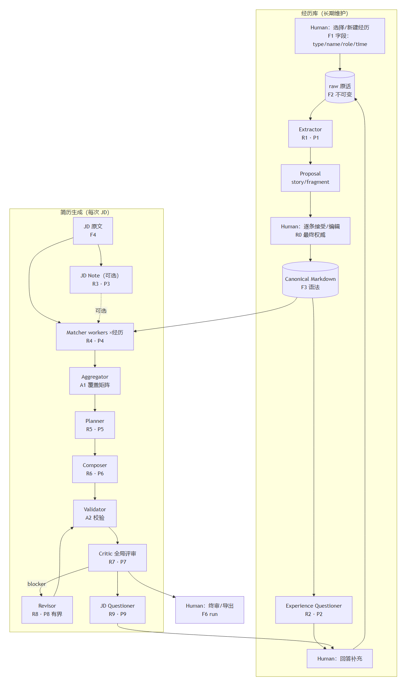

# INPUT-FOLLOW · 定稿设计（v3）

> 这份文档**只保留讨论后确定的新方案**，不再包含旧版状态机、过滤、BM25/向量、加权评分等已废弃内容。
> 旧稿 `INPUT-FLOW.md` 第 6–11 节仅作历史记录，实现以本文为准。
> 状态：设计定稿（尚未改代码）。

---

## 0. 前提（这些前提决定了设计，不要脱离它们）

1. **单人、手动、文字输入**；不做语音、不做自动判断新经历、不做重复检测。
2. 经历库规模小：每份简历选 3–4 段经历，每段约 4 条 bullet；全库通常几十个 story。
3. **高保真优先**：宁可少写，不编造；宁可问用户，不猜。
4. **AI 只做整理和提问**，不补写事实；AI 产出永远是提案。
5. 正文以 **Markdown** 为人工权威载体；raw 不可变；提案不进入正文。
6. **不用索引/过滤/BM25/向量**：小规模下全量读取 story 内容更可靠。
7. **不用自主 Agent**：流程固定，用 Workflow + 固定角色节点 + 有界修订。

---

## 1. 总流程图（标出字段 / 提示词 / 角色 / 算法）



（SVG 源：`images/final-flow.svg`）

图例：

| 标记 | 含义 |
| --- | --- |
| **F1–F6** | 关键字段/数据结构 |
| **P1–P9** | 提示词契约 |
| **R0–R9** | 角色（Human / AI 固定角色） |
| **A1–A2** | 确定性算法节点（非 LLM） |

字段标记：
- **F1 经历字段**：`type / name / role / time`
- **F2 raw**：不可变原话
- **F3 Markdown 语法**：front matter + `## Story` + `## 素材片段`
- **F4 JD 原文**：直接给匹配用
- **F5 证据/覆盖**：`jd_quote / story_id / quote / support`
- **F6 run**：一次生成的完整留痕（计划、草稿、评审、问题）

---

## 2. 数据与权威（人改 vs AI 改）


（SVG 源：`images/final-authority.svg`）

### 2.1 四层数据

| 层 | 内容 | 谁写 | 是否权威 | 说明 |
| --- | --- | --- | --- | --- |
| **raw** | 用户每次输入的原话 | Human | 事实来源 | 只追加，不修改 |
| **Proposal** | AI 整理出的 story/fragment 提案 | AI | ❌ | 带 base_rev、prompt 版本、出处；未接受不进正文 |
| **Markdown** | 经历正文（front matter + story + 素材片段） | Human（接受提案/手改） | ✅ | 唯一正文事实源 |
| **Run** | 一次 JD 生成的证据/计划/草稿/评审/问题 | 系统 | ❌ | 可重跑，不影响知识库 |

补充：**revision + provenance** 记录每次改动（谁、何时、基于哪个提案、基于哪条 raw），但**不改正文内容**。

### 2.2 权威规则

1. **AI 永远不直接写 Markdown**；只产出 Proposal。
2. 用户**逐条接受/编辑**提案；接受的内容才进入 Markdown。
3. 用户直接手改 Markdown = 新 revision，AI 后续以**当前 Markdown** 为基线重新提案。
4. 提案基于旧版本、而用户已改 → 提案作废/需重算；**不做自动合并**。
5. 不做整篇 accept/reject：建议是句/段级，降低审查负担。
6. 用户手改后，旧的 quote 可能不再逐字匹配 → provenance 标 `stale`，只提示，不阻挡。

---

## 3. 经历字段（F1）

只保留简历真正需要的：

| 字段 | 必填 | 类型 | 说明 |
| --- | --- | --- | --- |
| `type` | ✅ | 枚举 | `campus` 学校校园经历 / `project` 项目经历 / `internship` 实习经历 |
| `name` | ✅ | string | 实习=企业名；项目=项目名；校园=学校/组织名 |
| `role` | ❌ | string | 岗位/职务/角色；**不参与检索，不参与 reason**；仅展示/背景可选使用 |
| `time` | ❌ | string | 选填；项目可以没有；展示用，不推断 |
| `exp_id` | 内部 | string | `exp_xxx` |
| `revision` | 内部 | int | 正文版本 |

明确不要的字段：`summary`、`status`、`skills`、`story_ids`、`company/position` 重复字段。  
简历展示行：`name · role · time`，缺项省略。

---

## 4. Markdown 语法（F3）

### 4.1 结构

```markdown
---
experience_id: exp_x
type: project          # campus | project | internship
name: 扣子校园推广
role: 校园大使          # 可选
time: 2025-10 ~ 2025-11 # 可选
---

## 背景
（可选，自由文本）

## Story: 设计三层社群
<!-- story_id: story_001; source: raw_001 -->
（自由叙述；可分段）

## Story: 转化率优化
<!-- story_id: story_002; source: raw_001 -->
（自由叙述）

## 素材片段
（不够成为 story 的细节/背景，不生成 bullet）
```

### 4.2 规则

1. Story 粒度 = **一个决策 / 行动 / 结果链**；完整流程就拆成多个 story。
2. **顺序 = 文档顺序**；不编号；不按字段排序。
3. 时间只来自用户显式写的 `time` 或正文；**不推断**；没有时间就按文档顺序。
4. 同一经历下的 story 天然属于同一经历；**不推断"系列"**。需要表达阶段，用 story 标题/正文写清楚。
5. `## 素材片段` 不参与 bullet；用户可手动提升为 story。
6. Story 标题唯一、非空、不带序号；正文可自由写，不强制六槽位。
7. 保存/抽取时做**格式校验**：front matter 必填、ID 唯一、story 标题非空；不因"缺结果/缺数字"拒绝保存（这些是问题，不是错误）。

---

## 5. 角色定义（R0–R9）与算法（A1–A2）

| ID | 角色 | 类型 | 职责 | 明确不做 |
| --- | --- | --- | --- | --- |
| R0 | Human | 人 | 新建/选择经历、输入、逐条接受/编辑提案、回答补充、终审 | — |
| R1 | Extractor | AI | raw → story/fragment 提案（含出处、待确认项） | 不编事实、不写正文、不改已有内容 |
| R2 | Experience Questioner | AI | 经历补充后，找完整度/含糊/矛盾点，生成问题 | 不补内容、不问泛泛问题 |
| R3 | JD Note | AI（可选） | 把 JD 拆成带逐字 quote 的阅读笔记（调试/审计） | 不设 must 门禁、不选材、替代不了原文 |
| R4 | Matcher worker | AI（每经历一个） | 原始 JD + 该经历全部 story → 证据候选 | 不跨经历、不选材、不打总分 |
| R5 | Planner | AI | 根据覆盖与 story，定 3–4 段 / 每段约 4 条 / 顺序 / 背景计划 | 不编事实、不直接写 bullet |
| R6 | Composer | AI | 单条 bullet + 项目背景（约 40 字） | 不改事实、不补数字、不跨 story 编造 |
| R7 | Critic | AI（固定角色） | 评审整份简历，输出 issues | 不改稿、不新增事实 |
| R8 | Revisor | AI（固定角色） | 只按 issues 修订，最多 1–2 轮 | 不扩大修改范围、不新增事实 |
| R9 | JD Questioner | AI | 覆盖弱/无证据时生成补充问题 | 不补内容、不设 must 门禁 |
| A1 | Aggregator | 算法 | 合并 worker 证据、去重、覆盖统计、经历排序 | 不做语义判断 |
| A2 | Validator | 算法 | schema/引用/字数/顺序/重复校验 | 不改写内容 |

**没有自主 Agent**：以上全部是单轮、固定 I/O 的节点；R7/R8 是角色化评审与有界修订，不是会自己规划下一步的 Agent。

---

## 6. 节点契约与提示词（P1–P9）

> 以下"提示词契约"是硬约束；实际 prompt 按此编写，版本号随实现记录。

### P1 · R1 Extractor

- **输入**：`raw`（本次新增原话）+ 当前 Markdown + 经历字段。
- **输出**：Proposal
  ```json
  {
    "base_rev": 3,
    "stories": [{ "title": "", "body": "", "source_raw_ids": ["raw_x"], "time": "", "confidence": "high|medium|low" }],
    "fragments": [{ "body": "", "reason": "为什么不足以成为 story" }],
    "questions": ["可选：需要用户确认的点"]
  }
  ```
- **提示词必须包含**：
  1. 只能使用 raw/当前 Markdown 中的事实，不得补充未出现的数字、工具、角色、结果；
  2. story 粒度 = 一个决策/行动/结果链；完整流程拆成多个 story；
  3. 没有明确时间就不写时间；不推断顺序；顺序沿用原文/文档；
  4. 每条 story 必须能追到 raw 原话（引用/出处）；不确定的内容标 `confidence=low` 或放 questions；
  5. 不得把"参与"改写为"主导"，不得改数字口径；
  6. 只输出提案，不输出"已修改后的整篇文档"。
- **失败处理**：JSON 解析失败重试 1 次；仍失败不落盘，提示用户。

### P2 · R2 Experience Questioner

- **输入**：当前 Markdown + 该经历 raw（可选）。
- **输出**：
  ```json
  { "questions": [{ "story_id": "story_x", "missing": ["result","metric","ownership","scope"], "basis_quote": "原文依据", "question": "具体问题", "expected_answer": "metric + period" }] }
  ```
- **提示词必须包含**：
  1. 只基于已有内容提问，不假设事实；
  2. 一次只问一个维度；问题必须能对应到具体 story 和缺失项；
  3. 优先问"回答后会改变 bullet 质量"的点（结果、数字口径、本人动作、范围、矛盾）；
  4. 最多 3 条；不问"还有吗/多补充点"这类泛问题；
  5. 不得替用户补答案。
- **触发时机**：经历补充后（用户点"帮我看看还缺什么"或系统在保存后建议）。

### P3 · R3 JD Note（可选）

- **输入**：JD 原文。
- **输出**：
  ```json
  { "notes": [{ "jd_quote": "逐字引用", "topic": "", "kind": "职责|要求|加分|背景", "importance_hint": "high|medium|low", "confidence": "high|medium|low" }] }
  ```
- **提示词必须包含**：
  1. 每一条必须逐字引用 JD；
  2. 只做阅读笔记，不设 must/nice 硬门禁；
  3. 不做选材、不做匹配；
  4. 原文优先：匹配阶段仍以 JD 原文为准。
- **用途**：调试/审计/人工浏览；可跳过。

### P4 · R4 Matcher worker

- **输入**：JD 原文 + **该经历全部 story**（含标题/正文/时间/role 等字段，role 只做上下文不参与判断）+ 该经历字段。
- **输出**：
  ```json
  {
    "experience_id": "exp_x",
    "candidates": [
      { "jd_quote": "逐字引用", "story_id": "story_x", "story_quote": "逐字引用",
        "support": "direct|adjacent|none", "ownership": "led|co_led|executed|participated|observed|unknown",
        "note": "为什么能/不能支撑" }
    ],
    "missing_signals": [{ "jd_quote": "", "reason": "该经历没有相关证据" }]
  }
  ```
- **提示词必须包含**：
  1. 只读本经历，不引用其他经历；
  2. `jd_quote` 必须在 JD 原文中，`story_quote` 必须在该 story 原文中；
  3. 可以输出多条候选；没有证据就输出 `missing_signals`；
  4. 不做选材、不给经历打总分；
  5. 不因 role 字段加分/减分；role 不参与判断；
  6. 不补事实；不确定标 `none`。
- **并行**：每经历一个 worker；上下文只装该经历，避免一次读全库。

### P5 · R5 Planner

- **输入**：A1 的覆盖矩阵 + 各经历 story 概要（必要时原文）+ 用户配置（3–4 段、每段约 4 条、风格）。
- **输出**：
  ```json
  {
    "experiences": [{ "experience_id": "", "why": "", "bullets": [{ "story_id": "", "jd_quote": "", "primary_requirement": "", "order": 1 }], "background": { "needed": true, "cover": ["背景","目标","角色","范围"] } }],
    "global_order": ["exp_x","exp_y"],
    "dropped_experiences": [{ "experience_id": "", "reason": "" }]
  }
  ```
- **提示词必须包含**：
  1. 选 3–4 段；每段约 4 条；不足就少写，不硬凑；
  2. 同一经历内按显式时间或文档顺序；同主题成组；不混排；
  3. 每条 bullet 绑定一个 story + 一个主 JD 引用；
  4. 不编事实；不写 bullet 正文（只做计划）；
  5. 说明选择/舍弃理由，便于人工审查。

### P6 · R6 Composer

- **输入**：单条计划（story 原文 + jd_quote(s) + 风格）+ 可选项目背景计划。
- **输出**：
  ```json
  { "bullets": [{ "story_id": "", "jd_quote": "", "hook": "", "content": "约40字", "evidence_quote": "" }],
    "background": "可选，固定格式" }
  ```
- **提示词必须包含**：
  1. 事实/数字只能来自该 story；不得跨 story 拼事实；
  2. 约 40 字（区间实现时定）；一条只讲一个核心；
  3. 风格（Hook 层级/正文骨架）只影响措辞，不改事实；
  4. 禁止评价性收尾、空话、编造数字；
  5. 必须带 `evidence_quote`（来自 story 原文）。

### P7 · R7 Critic

- **输入**：JD 原文 + 整份草稿 + 覆盖矩阵 + 计划。
- **输出**：
  ```json
  { "issues": [{ "type": "coverage|duplication|ordering|evidence|length|style|overclaim|background",
                  "severity": "blocker|warning|note",
                  "location": { "experience_id": "", "bullet_id": "" },
                  "problem": "", "suggestion": "" }] }
  ```
- **提示词必须包含**：
  1. 只出 issues，不改稿、不重写；
  2. 逐项检查：覆盖、重复、顺序/主题、事实/引用、字数/风格、背景格式、夸大；
  3. 每条 issue 指出位置、问题、建议；没有证据的指控不要写；
  4. 不引入新事实。

### P8 · R8 Revisor

- **输入**：草稿 + Critic issues（只允许修 blocker/warning）。
- **输出**：修订后的草稿 + `{applied_issue_ids, remaining}`。
- **提示词必须包含**：
  1. 只修 issues 指明的问题；不改无关内容；
  2. 不得新增事实/数字；缺证据只能删/弱化，不能补；
  3. 最多 1 轮（可配置 2 轮），修不掉保留 issue 交人工；
  4. 输出 diff/修改说明。

### P9 · R9 JD Questioner

- **输入**：JD 原文 + 覆盖矩阵 + 已选 bullet（或草稿）。
- **输出**：
  ```json
  { "questions": [{ "jd_quote": "", "experience_id": "", "story_id": "", "missing": ["metric","scope"], "basis": "现有 bullet/原文", "question": "", "expected_answer": "" }] }
  ```
- **提示词必须包含**：
  1. 只针对"重要且覆盖弱/无证据"的要求；
  2. 必须引用 JD 原文和现有 bullet/story；
  3. 一次一个维度；最多 3 条；
  4. 不假设事实、不替用户回答；回答会写入 raw，重新走 P1 提案。

### A1 · Aggregator（算法）

1. 合并所有 worker 的 `candidates`；
2. 去重（同 story + 同 jd_quote 保留最强 support）；
3. 统计每条 JD 引用的覆盖：`direct/adjacent/none`；
4. 经历排序：覆盖条数 → 唯一 story 数 → 文档顺序；不打加权总分；
5. 输出 `coverage` 与 `experience_rank`，供 Planner/Questioner 使用。

### A2 · Validator（算法）

1. schema：必填字段、枚举值、ID 存在；
2. 引用：`jd_quote` ∈ JD 原文；`story_quote/evidence_quote` ∈ story 原文或 raw；
3. 字数：bullet 目标区间、背景固定格式；
4. 重复：同故事同证据的 bullet 标重复；
5. 输出 `issues[]`（与 Critic 同一 schema），不改稿。

---

## 7. 端到端时序与落盘

| 步 | 谁 | 输入 | 处理 | 输出/落盘 |
| --- | --- | --- | --- | --- |
| 1 | R0 Human | — | 新建/选择经历，填 type+name（role/time 选填） | Experience（front matter） |
| 2 | R0 Human | 文字 | 输入一段经历内容 | `raw/` 追加 |
| 3 | R1 Extractor | raw + 当前 Markdown | P1 | Proposal（不落正文） |
| 4 | R0 Human | Proposal | 逐条接受/编辑/忽略 | Markdown 新 revision + provenance |
| 5 | R2 Questioner | Markdown | P2 | 问题（缺结果/口径/动作/矛盾） |
| 6 | R0 Human | 问题 | 回答 | 新 raw → 回步骤 3 |
| 7 | R0 Human | JD 文本 | 输入 JD | run 的 `jd_raw` |
| 8 | R3（可选） | JD | P3 | JD Note（可跳过） |
| 9 | R4 workers | JD + 各经历 story | P4（并行） | 证据候选 |
| 10 | A1 | 候选 | 合并/去重/覆盖 | coverage + 经历排序 |
| 11 | R5 Planner | coverage | P5 | 计划（3–4 段/条数/顺序/背景） |
| 12 | R6 Composer | 计划 | P6 | 草稿（bullets + 背景） |
| 13 | A2 Validator | 草稿 | 校验 | issues |
| 14 | R7 Critic | 草稿 + JD + coverage | P7 | issues |
| 15 | R8 Revisor（条件） | 草稿 + blocker issues | P8（≤1–2 轮） | 修订稿 + diff |
| 16 | R9 Questioner（条件） | coverage/草稿 | P9 | 问题 |
| 17 | R0 Human | 草稿 + issues | 终审/导出 | run 完成 |

**落盘**：
- `raw/raw_<id>.json`：`{raw_id, experience_id, text, at}`；
- `snapshots/<rev>/` 或 Markdown 目录：front matter + story 正文；
- `proposals/<proposal_id>.json`：提案、base_rev、prompt 版本、状态；
- `runs/<run_id>.json`：`jd_raw, jd_note?, evidence, coverage, plan, draft, issues, revisions, questions`；
- `debug/<run_id>/<node>.json`：每节点的输入/输出/prompt 版本/token/耗时。

---

## 8. 评价机制：为什么不用自主 Agent

1. **单经历**：R4 worker 已有固定评价字段（support/ownership/quote）；
2. **全局**：A1 汇总 + R7 Critic 以固定 rubric 评审整份简历；
3. **修订**：R8 只按 issues 修，最多 1–2 轮；
4. **人工终审**：最终内容必须人确认。

不用 Agent 的原因：
- 步骤固定，不需要自主规划；
- 审计要求高，Agent 的自主选择难复现；
- 多 Agent 讨论会带来标准漂移、成本、延迟；
- 若担心单次评审偏差，可用同一 Critic 跑两次取并集/人工复核，而不是 Agent 互辩。

---

## 9. 问题机制（补充问题到底是什么）

- **两种触发**：
  1. 经历补充后（R2）：缺结果、数字口径、本人动作、范围、矛盾；
  2. JD 生成后（R9）：重要要求覆盖弱/无证据。
- **问题对象**：必须带 `{scope, experience_id, story_id, missing[], basis_quote, question, expected_answer}`。
- **提问门槛**：回答会改变 bullet 质量；否则不问。
- **回答路径**：回答 → 新 raw → R1 提案 → 用户接受 → 更新 Markdown → 局部重跑 R4/R5/R6（不全局重来）。
- **禁止**：泛问、诱导编造、把问题答案直接写进正文。

---

## 10. 调试与验收（落地时按此检查）

### 10.1 每个节点必须留痕

`debug/<run_id>/<R1..R9|A1|A2>.json` 记录：
```
{ node_id, prompt_id, prompt_version, model, input, output, validation, tokens, elapsed_ms, at }
```
便于逐节点回放和对比。

### 10.2 必测用例

1. 新建经历只填 title+type → 输入 → 抽取 → 接受；
2. 项目经历无时间；
3. 用户手改 story 后再抽取（提案不覆盖手改）；
4. 同一经历含完整流程（0→1、1→100）→ 抽成多个 story；
5. raw 含"参与"→ 不得被改成"主导"；
6. JD 覆盖缺失 → 问题生成 → 回答 → 局部重算；
7. Critic 报 blocker → Revisor 修订 → 仍不行交人工；
8. quote 不在原文 → Validator 拦截。

### 10.3 节点完整性验收

- R0–R9、A1–A2 是否都有输入/输出/落盘/失败分支；
- 是否有节点"只存在于文档、没有实现出口"；
- 每个 prompt 是否有版本与 schema 校验；
- 每个字段是否有明确写入者与读取者。

---

## 11. 待确认（少量）

1. `name` 与 `role` 的展示格式（`name · role · time`）是否 OK？
2. bullet 字数区间（约 40 字，建议 35–55）。
3. 项目背景的固定格式具体字段（背景/目标/角色/范围/结果）。
4. R8 Revisor 允许 1 轮还是 2 轮。
5. R7 Critic 是否跑两次取并集（默认单次+人工复核）。
