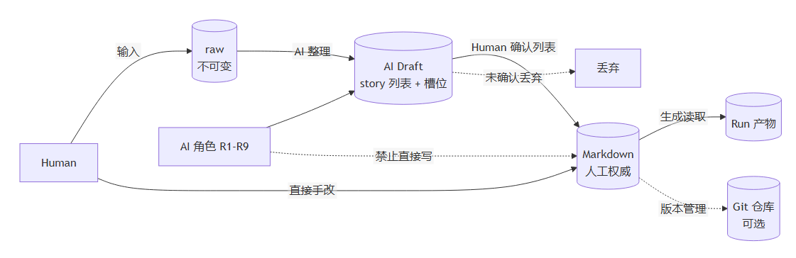

# INPUT-FOLLOW · 定稿设计（v4）

> 只保留本轮讨论后的新方案；旧状态机、过滤、BM25/向量、加权评分、能力标记、S/A/B 分级、固定故事密度、两遍抽取均已删除。
> 旧稿 `INPUT-FLOW.md` 第 6–11 节仅作历史记录，实现以本文为准。
> 状态：设计定稿（尚未改代码）。

---

## 0. 前提

1. **单人、手动、文字输入**；不做语音、不做自动判断新经历、不做重复检测。
2. 经历库规模小：一份简历 3–4 段经历，每段约 4 条 bullet。
3. **高保真优先**：宁可少写、宁可问用户，不编造。
4. AI 只做整理和提问；**AI 产出的草稿必须经人确认 Story 列表后才进入 Markdown**。
5. Markdown 是正文权威；raw 不可变；不保存逐行 revision/provenance。
6. 小规模下**全量读取故事内容**，不用索引/过滤/BM25/向量。
7. 不用自主 Agent：固定 Workflow + 固定角色 + 有界修订。

---

## 1. 总流程图


（SVG 源：`images/final-flow.svg`）

图例：

| 标记 | 含义 |
| --- | --- |
| **F1–F6** | 字段/数据结构 |
| **P1–P9** | 提示词契约 |
| **R0–R9** | 角色（Human / AI 固定角色） |
| **A1–A2** | 确定性算法节点（非 LLM） |

- **F1** 经历字段：`type / name / role / time`
- **F2** raw：不可变原话
- **F3** Markdown：front matter + Story/Fragment
- **F4** JD 原文
- **F5** 证据/覆盖（`jd_quote / story_id / quote / support`）
- **F6** run：一次生成的完整留痕

---

## 2. 数据与权威（人改 vs AI 改）



（SVG 源：`images/final-authority.svg`）

| 层 | 内容 | 谁写 | 是否权威 | 说明 |
| --- | --- | --- | --- | --- |
| **raw** | 用户输入的原话 | Human | 事实来源 | 只追加，不修改 |
| **AI Draft** | AI 整理出的 Story 列表 + 槽位 + Fragment | AI | ❌ | 只在内存/临时文件；未确认丢弃 |
| **Markdown** | 经历正文 | Human 确认/手改 | ✅ | 唯一正文事实源 |
| **Run** | JD 生成的证据/计划/草稿/评审/问题 | 系统 | ❌ | 可重跑 |

规则：

1. **AI 不直接写 Markdown**；只生成 AI Draft。
2. 人**确认 Story 列表**（不是逐句审 800 字），确认后写入 Markdown。
3. 人直接手改 Markdown = 直接生效；AI 不覆盖。
4. 不保存逐行 revision/provenance；版本管理交给 Git（可选/后续），正文不写这些字段。
5. AI Draft 里的 `raw_quotes` 必须逐字来自 raw，作为防幻觉锚点。

---

## 3. 经历字段（F1）

| 字段 | 必填 | 类型 | 说明 |
| --- | --- | --- | --- |
| `type` | ✅ | 枚举 | `campus` 学校校园经历 / `project` 项目经历 / `internship` 实习经历 |
| `name` | ✅ | string | 实习=企业名；项目=项目名；校园=学校/组织名 |
| `role` | ❌ | string | 岗位/职务；**不参与检索、不参与 reason**，仅展示/背景可用 |
| `time` | ❌ | string | 选填；项目可无；自由文本，不推断 |
| `exp_id` | 内部 | string | `exp_xxx` |

不设：`summary`、`status`、`skills`、`story_ids`、`quality_grade`、`capabilities`。
展示行：`name · role · time`，缺项省略。

---

## 4. Story 定义、准入与层级

### 4.1 定义

**Story = 从 raw 中提纯出来的、可独立理解的事件单元：一个子目标/决策 + 本人动作 + 闭环结果/交付 + 原话锚点。**

- Experience 是树干，记录经历字段/背景；
- Story 是枝叶，挂在经历下，用文档顺序/`order` 表示先后；
- **Fragment** 是不满足准入的细节/背景，不生成 bullet。

### 4.2 准入（Admission）

一张卡进入"可检索/可生成"集合，必须满足：

1. **一个子目标/决策边界**：新问题、新阶段或独立决策；
2. **本人动作**：不是纯团队/背景；
3. **闭环结果或可验证交付**：可以是定性交付，不强制数字；
4. **自包含**：不看相邻 story 也能理解（项目/角色/对象明确）；
5. **原话锚点**：`raw_quotes[]` 1–3 句，逐字来自 raw；
6. **人工确认**。

不满足 3/4 → Fragment，不硬凑 Story。

> 依据：事件切分研究认为边界在子目标完成/目标变化处；检索单元研究强调 self-contained / minimal / distinct。Story 是 event-level 单元，不是原子事实，也不是模板草稿。

### 4.3 人工确认怎么做（不逐句审）

AI 生成 Draft 后，界面/CLI 展示**Story 列表**，每行：

```
[✓] 标题（≤20字） | 一句话核心事实 | 原话：… | 提示：缺结果/缺数字/归属模糊/可能重复
```

操作：
- **全部确认**（列表看起来对）；
- 单卡：确认 / 合并 / 拆分 / 删除 / 编辑；
- 展开才看全文，默认不展开。

规则：
- 仅**有提示的卡**需要人工判断（缺结果、缺本人动作、可能重复、边界不清）；
- 无提示的卡默认通过，但仍可改；
- 确认是"是否作为 Story 入库"，不是"逐句审稿"。

**准入 = 进入检索/生成；机器的校验只负责结构与引用，语义是否自包含由人最终确认。**

### 4.4 质量提示（不存 S/A/B）

- 不存 `quality_grade`，不做 `capabilities`（XYZ/CAR/PAR 标记）。
- 只输出**提示标记**给人看：
  ```json
  { "flags": ["missing_metric", "vague_ownership", "possible_duplicate", "missing_outcome"] }
  ```
- 机器选择经历时不看这些标记，靠后续"经历评估"提示词判断是否使用。
- 六槽位是**描述字段**，尽量填全，但不作为准入条件；缺就写"未提及"，需要时进入问题机制。

### 4.5 层级：父 Story / 子 Story（可选）

**依据**：事件切分是层级结构（细事件聚合为粗事件）；子事件在时间上被父事件包含，父事件的定义可帮助识别子事件（[Event Segmentation](https://pmc.ncbi.nlm.nih.gov/articles/PMC3314399/)、[Detecting Subevents](https://aclanthology.org/P19-1471/)、[Weakly Supervised Subevent Knowledge Acquisition](https://aclanthology.org/2020.emnlp-main.430/)）。

**什么时候用**：
- 一个总目标/总结果**跨多个独立子目标**，每个子目标都有自己的动作/结果；
- 例：父"从 0 到 1 搭建校园推广体系"，子"设计三层社群""转化率优化""社团联合落地"；
- 父用于**整体背景/总述**，子用于**bullet**。

**什么时候不用（默认平铺）**：
- 子事件可以独立作为兄弟 story，读者不需要父节点也能理解；
- 强行加父只会多一层容器，不产生信息增益。

**字段**：

```json
{
  "story_id": "story_x",
  "parent_story_id": null,          // 父 story；顶层为 null
  "order": 1,                        // 同一父下顺序；顶层也用它
  "title": "",
  "summary": "",                     // 父节点必填；子节点可空
  "slots": { "stage": "", "module": "", "problem": "", "workflow": "", "tech_link": "", "outcome": "" },
  "raw_quotes": ["逐字原话"],
  "is_container": false,             // 有子节点时由程序推导
  "flags": []
}
```

**关系规则**：
1. 最大深度 2：父 → 子；不允许无限嵌套；
2. 父节点不生成 bullet；只用于背景/总述；子节点是检索与生成的叶子；
3. 子事件的 `raw_quotes` 必须落在父事件覆盖的 raw 范围内；父节点只保留总述性 quote；
4. 不重复计算：同一 evidence quote 只挂在一个叶子上；
5. 平铺结构的 `parent_story_id=null`，所有 story 都是叶子；
6. 层级由 AI 在 Draft 中**建议**，由人在 Story 列表中确认；不确认就按平铺处理。

### 4.6 一遍抽取（不做两遍）

- 只调用一次 P1：一次输出 Story 列表 + 6 槽位 + Fragment + 未分配细节；
- 不返回原文重新看：raw 本来就在库里；
- 防丢信息：P1 必须输出 `unassigned_details`（没被任何 Story/Fragment 覆盖的信息点），程序展示给人；
- 不设"目标 5–8 张"：**删掉固定密度**，按事件边界自然切；数量由 Raw 决定；
- 切太碎/太笼统由人确认列表时合并/拆分修正。

---

## 5. Markdown 语法（F3）

```markdown
---
experience_id: exp_x
type: project
name: 扣子校园推广
role: 校园大使          # 可选
time: 2025-10 ~ 2025-11 # 可选
---

## 背景
（可选）

## Story: 从0到1搭推广流程
<!-- story_id: story_1; parent: null; order: 1 -->
- 阶段：
- 模块：
- 问题/判断：
- 流程：
- 技术/方法：
- 结果：
- 原话：

### Story: 设计三层社群
<!-- story_id: story_2; parent: story_1; order: 1 -->
- 阶段：
- 模块：
- 问题/判断：
- 流程：
- 技术/方法：
- 结果：
- 原话：

## Story: 转化率优化
<!-- story_id: story_3; parent: null; order: 2 -->
…
```

规则：
1. 顺序 = 文档顺序；标题不带序号；同一父下用 `order`；
2. 没有时间就按文档顺序；不推断；不强制时间线；
3. 父 Story 的正文只写总述；子 Story 写细节；父不生成 bullet；
4. `## 素材片段` 放 Fragment，不生成 bullet；
5. 保存只校验格式/ID/引用，不因"缺结果"拒绝；缺结果只产生提示。

---

## 6. 角色与算法

| ID | 角色 | 类型 | 职责 | 明确不做 |
| --- | --- | --- | --- | --- |
| R0 | Human | 人 | 新建/选择经历、输入、确认 Story 列表、回答、终审 | — |
| R1 | Extractor | AI | raw → AI Draft（Story 列表 + 槽位 + Fragment + 未分配细节） | 不写 Markdown、不编事实、不设密度目标 |
| R2 | Experience Questioner | AI | 经历录入后找缺失/含糊/矛盾，生成问题 | 不补内容、不问泛泛 |
| R3 | JD Note | AI（可选） | 带逐字 quote 的 JD 阅读笔记 | 不做 must 门禁、不选材 |
| R4 | Experience Evaluator | AI（每经历并行） | 原始 JD + 该经历所有 Story → `use/hold/drop` + 证据 + 缺失 | 不跨经历、不打分、不选最终组合 |
| R5 | Selector/Planner | AI | 汇总各经历评估，决定 3–4 段、每段约 4 条、顺序、背景 | 不编事实、不写 bullet 正文 |
| R6 | Composer | AI | Story → bullet（约 40 字）+ 背景 | 不改事实、不跨 Story 拼造 |
| R7 | Critic | AI | 整份简历评审，输出 issues | 不改稿、不新增事实 |
| R8 | Revisor | AI（有界） | 只按 issues 修订，最多 1–2 轮 | 不扩大范围、不新增事实 |
| R9 | JD Questioner | AI | 覆盖弱/无证据时生成补充问题 | 不补内容、不设 must 门禁 |
| A1 | Aggregator | 算法 | 合并 R4 结果、去重、覆盖统计 | 不做语义判断 |
| A2 | Validator | 算法 | schema/引用/字数/顺序/重复校验 | 不改写 |

**没有自主 Agent**：R4 是并行 worker，R5 是汇总判断角色，R7/R8 是固定评审/有界修订，全部单轮、固定 I/O。

---

## 7. 节点契约与提示词（P1–P9）

### P1 · R1 Extractor（一遍抽取）

**输入**：raw + 当前 Markdown + 经历字段。
**输出**：

```json
{
  "stories": [{
    "temp_id": "s1", "parent_temp_id": null, "order": 1,
    "title": "", "summary": "",
    "slots": { "stage": "", "module": "", "problem": "", "workflow": "", "tech_link": "", "outcome": "" },
    "raw_quotes": ["逐字原话"],
    "boundary_reason": "为什么在这里切",
    "flags": []
  }],
  "fragments": [{ "temp_id": "f1", "body": "", "reason": "为什么不满足 Story 准入" }],
  "unassigned_details": [{ "text": "", "reason": "未归入任何 Story/Fragment" }],
  "questions": ["需要用户确认的点"]
}
```

**提示词硬规则**：

1. 只能使用 raw/当前 Markdown 中的事实；不得补数字、工具、角色、结果；
2. 只在"新问题/新阶段/独立决策 + 动作与结果"处切；同一决策的原因/参数不切；
3. Story 准入：一个子目标 + 本人动作 + 闭环结果/交付 + 自包含 + 原话；否则进 Fragment；
4. **没有固定数量目标**；不要为凑数拆分，也不要为省事合并不同子目标；
5. 没有明确时间就不写时间；顺序沿用原文；不推断；
6. 六槽位尽量填，缺就写"未提及"；不作为拒绝依据；
7. `raw_quotes` 1–3 句逐字；`boundary_reason` 必填；
8. 未归入任何 Story/Fragment 的信息必须放 `unassigned_details`，不得静默丢弃；
9. 只在必要时建议父/子层级：父要有跨子目标的总目标/总结果，且子事件独立；否则平铺；
10. 只输出 Draft，不输出"已修改的 Markdown"。

**失败**：JSON 解析失败重试 1 次；仍失败不落盘。

### P2 · R2 Experience Questioner

**输入**：Markdown + 该经历 raw（可选）。
**输出**：

```json
{ "questions": [{ "story_id": "", "missing": ["result","metric","ownership","scope"], "basis_quote": "", "question": "", "expected_answer": "" }] }
```

**提示词硬规则**：
1. 只基于已有内容提问；
2. 一次一个维度；绑定具体 story + 缺失项；
3. 只问"回答后会改变 bullet 质量"的点；
4. 最多 3 条；不问泛泛问题；
5. 不替用户回答、不假设事实。

### P3 · R3 JD Note（可选）

**输入**：JD 原文。
**输出**：

```json
{ "notes": [{ "jd_quote": "逐字引用", "topic": "", "kind": "职责|要求|加分|背景", "importance_hint": "high|medium|low", "confidence": "high|medium|low" }] }
```

**提示词硬规则**：
1. 每条必须逐字引用 JD；
2. 只做阅读笔记，不设 must/nice 门禁；
3. 不选材、不匹配；
4. 匹配阶段仍以原始 JD 为准。

### P4 · R4 Experience Evaluator（每经历并行）

**输入**：原始 JD + 该经历的**全部 Story**（含父/子、槽位、quotes）+ 经历字段（role 只做上下文，不参与判断）。
**输出**：

```json
{
  "experience_id": "exp_x",
  "recommendation": "use|hold|drop",
  "matched": [
    { "jd_quote": "逐字引用", "story_id": "", "story_quote": "逐字引用",
      "support": "direct|adjacent|none", "ownership": "led|co_led|executed|participated|observed|unknown",
      "note": "" }
  ],
  "missing": [{ "jd_quote": "", "reason": "该经历没有相关证据" }],
  "reason": "为什么 use/hold/drop"
}
```

**提示词硬规则**：
1. 只读本经历，不引用其他经历；
2. `jd_quote` ∈ JD 原文；`story_quote` ∈ 该 story 原文；
3. 输出 use/hold/drop 建议 + 依据；**不打分、不做 S/A/B、不做能力标记**；
4. 父 Story 只做背景/总述，不作为 evidence；证据必须来自叶子 Story；
5. 没有证据就输出 missing，不编；
6. 不选最终经历组合（交给 R5）。

### P5 · R5 Selector/Planner

**输入**：所有 R4 结果 + A1 覆盖统计 + 用户配置（3–4 段、每段约 4 条、风格）。
**输出**：

```json
{
  "experiences": [{ "experience_id": "", "why": "", "bullets": [{ "story_id": "", "jd_quote": "", "order": 1 }], "background": { "needed": true, "cover": [] } }],
  "global_order": [],
  "dropped": [{ "experience_id": "", "reason": "" }]
}
```

**提示词硬规则**：
1. 决定用哪些经历（3–4 段）与每段 bullet；理由必须引用 R4 证据；
2. 同一经历内按显式时间/文档顺序；同主题成组；不混排；
3. 每条 bullet 绑定一个叶子 Story + 一个主 JD 引用；
4. 不编事实、不写 bullet 正文；
5. 不足就少写，不硬凑 4 条。

### P6 · R6 Composer

**输入**：单条计划（Story 原文 + jd_quote + 风格）+ 背景计划。
**输出**：

```json
{ "bullets": [{ "story_id": "", "jd_quote": "", "hook": "", "content": "约40字", "evidence_quote": "" }], "background": "" }
```

**提示词硬规则**：
1. 事实只能来自该 Story；不跨 Story 拼造；
2. 约 40 字；一条一个核心；
3. 风格只影响措辞，不改事实；
4. 禁评价性收尾、空话、编数字；
5. 必须带 `evidence_quote`。

### P7 · R7 Critic

**输入**：JD 原文 + 草稿 + 覆盖统计 + 计划。
**输出**：

```json
{ "issues": [{ "type": "coverage|duplication|ordering|evidence|length|style|overclaim|background", "severity": "blocker|warning|note", "location": { "experience_id": "", "bullet_id": "" }, "problem": "", "suggestion": "" }] }
```

**提示词硬规则**：
1. 只出 issues，不改稿；
2. 检查覆盖、重复、顺序/主题、事实/引用、字数/风格、背景、夸大；
3. 每条 issue 指位置/问题/建议；无证据不指控；
4. 不引入新事实。

### P8 · R8 Revisor

**输入**：草稿 + Critic issues（blocker/warning）。
**输出**：修订稿 + `{applied_issue_ids, remaining}`。
**提示词硬规则**：
1. 只修 issues 指明的问题；
2. 不新增事实/数字；缺证据只能删/弱化；
3. 最多 1 轮（可配 2 轮）；修不掉交人工；
4. 输出 diff/修改说明。

### P9 · R9 JD Questioner

**输入**：JD 原文 + 覆盖统计 + 草稿。
**输出**：

```json
{ "questions": [{ "jd_quote": "", "experience_id": "", "story_id": "", "missing": ["metric","scope"], "basis": "", "question": "", "expected_answer": "" }] }
```

**提示词硬规则**：
1. 只针对"重要且覆盖弱/无证据"的要求；
2. 必须引用 JD 原文和现有 Story/bullet；
3. 一次一个维度；最多 3 条；
4. 不假设事实；回答写回 raw，重新走 P1。

### A1 · Aggregator（算法）

1. 合并 R4 的 matched/missing；
2. 去重（同 story + 同 jd_quote 保留最强 support）；
3. 统计每条 JD 引用的覆盖（direct/adjacent/none）；
4. 汇总每段经历的 use/hold/drop 与证据数；
5. 不做加权总分，不改写 R4 结论。

### A2 · Validator（算法）

1. schema/枚举/ID 存在；
2. `jd_quote` ∈ JD；`story_quote/evidence_quote` ∈ Story 原文或 raw；
3. 字数/背景格式；重复 bullet；
4. 父 Story 不得作为 bullet 证据；
5. 输出 issues（与 Critic 同 schema），不改稿。

---

## 8. 端到端时序

| 步 | 谁 | 输入 | 处理 | 输出/落盘 |
| --- | --- | --- | --- | --- |
| 1 | R0 | — | 新建/选择经历，填 type+name（role/time 选填） | front matter |
| 2 | R0 | 文字 | 输入经历内容 | `raw/` |
| 3 | R1 | raw+当前 Markdown | P1 一遍抽取 | AI Draft（Story 列表+槽位+Fragment+未分配） |
| 4 | R0 | Draft | 确认 Story 列表（全部/逐卡合并拆分丢弃） | Markdown 落盘 |
| 5 | R2 | Markdown | P2 | 问题（缺结果/口径/归属/矛盾） |
| 6 | R0 | 问题 | 回答 | 新 raw → 回步骤 3 |
| 7 | R0 | JD | 输入 | run.jd_raw |
| 8 | R3（可选） | JD | P3 | JD Note |
| 9 | R4 ×经历（并行） | JD+该经历 Story | P4 | use/hold/drop + 证据/缺失 |
| 10 | A1 | R4 结果 | 合并/去重/覆盖 | coverage |
| 11 | R5 | coverage | P5 | 计划（3–4 段/条数/顺序/背景） |
| 12 | R6 | 计划 | P6 | 草稿（bullets+背景） |
| 13 | A2 | 草稿 | 校验 | issues |
| 14 | R7 | 草稿+JD | P7 | issues |
| 15 | R8（条件） | 草稿+blocker | P8 | 修订稿+diff |
| 16 | R9（条件） | coverage/草稿 | P9 | 问题 |
| 17 | R0 | 草稿+issues | 终审/导出 | run 完成 |

**落盘**：
- `raw/raw_<id>.json`：`{raw_id, experience_id, text, at}`；
- Markdown：front matter + Story/Fragment；
- `runs/<run_id>.json`：`jd_raw, jd_note?, evidence, coverage, plan, draft, issues, revisions, questions`；
- `debug/<run_id>/<node>.json`：每节点输入/输出/prompt 版本/token/耗时。

---

## 9. 评估与选择（不搞能力分级）

- **R4 每经历并行**：只回答"这段经历对这份 JD 值不值得用、有哪些证据、缺什么"；
- **A1 汇总**：去重/覆盖，不算分；
- **R5 选择/计划**：另一个角色决定取哪 3–4 段、每段几条；
- **R7 Critic**：整份简历评审；
- **R8 Revisor**：有界修订；
- **R0 终审**。

不用 S/A/B、不用 capabilities、不用加权分：这些是给人看的提示，机器只需要"这段经历用不用 + 证据"的 prompt。

---

## 10. 问题机制

- 两种触发：经历录入后（R2）；JD 生成后（R9）。
- Gap/Question 必须带：`{scope, experience_id, story_id, missing[], basis_quote, question, expected_answer}`。
- 提问门槛：回答会改变 bullet 质量；否则不问。
- 回答 → 新 raw → P1 Draft → 人确认 Story 列表 → 更新 Markdown → 局部重跑 R4/R5/R6。
- 禁止：泛问、诱导编造、把答案直接写进正文。

---

## 11. 调试与测试

### 11.1 节点留痕

`debug/<run_id>/<R1..R9|A1|A2>.json`：
```
{ node_id, prompt_id, prompt_version, model, input, output, validation, tokens, elapsed_ms, at }
```

### 11.2 必测用例

1. 新建经历只填 type+name；
2. 项目无时间；
3. 用户手改 Story 后再抽取（不覆盖手改）；
4. 完整流程含 0→1 与 1→100（拆成多张叶子/父子）；
5. raw 写"参与"不得改"主导"；
6. `unassigned_details` 不为空时提示；
7. 父 Story 不作为 bullet 证据；
8. 同经历多 story 的 use/hold/drop 与最终选择一致；
9. quote 不在原文 → Validator 拦截；
10. Critic blocker → Revisor 修订 → 仍不行交人工。

### 11.3 验收

- 角色 R0–R9/A1–A2 都有输入/输出/落盘/失败分支；
- 每个字段有明确写入者/读取者；
- 每个 prompt 有版本/schema/校验；
- 不存在"只写在文档里、没有实现出口"的节点。

---

## 12. 待确认

1. Story 准入确认默认"全部确认 + 仅看有提示的卡"，是否可接受？
2. 父/子层级默认关闭（平铺），仅在总目标跨多个子目标时建议，是否同意？
3. 版本管理用 Git（可选远端 GitHub），正文不写 revision/provenance，是否同意？
4. bullet 字数：约 40，区间建议 35–55。
5. R8 Revisor 1 轮还是 2 轮；R7 Critic 单次+人工复核是否够。
