# 简历工作台 · 核心链路说明书

> 当前 `main`：只有模型链路 + 数据层，前端已移除。
> **本页所有流程图都已渲染成 PNG 内嵌**，任何 Markdown 查看器都能看到；每张图下方保留 Mermaid 源码（可折叠）。
> 配套：[`DATA-CONTRACT.md`](./DATA-CONTRACT.md)、[`MODEL-PIPELINE.md`](./MODEL-PIPELINE.md)

---

## 0. 一句话总览

**原始口述 → ① 建卡 → ② JD 扫描（选卡 + 策略）→ ③ 三区编译（背景/Hook/正文）→ ④ 评论 → ⑤ 回答补卡 → 新卡入库并只重编译该段。**

---

## 1. 全链路（含每阶段输入/输出）

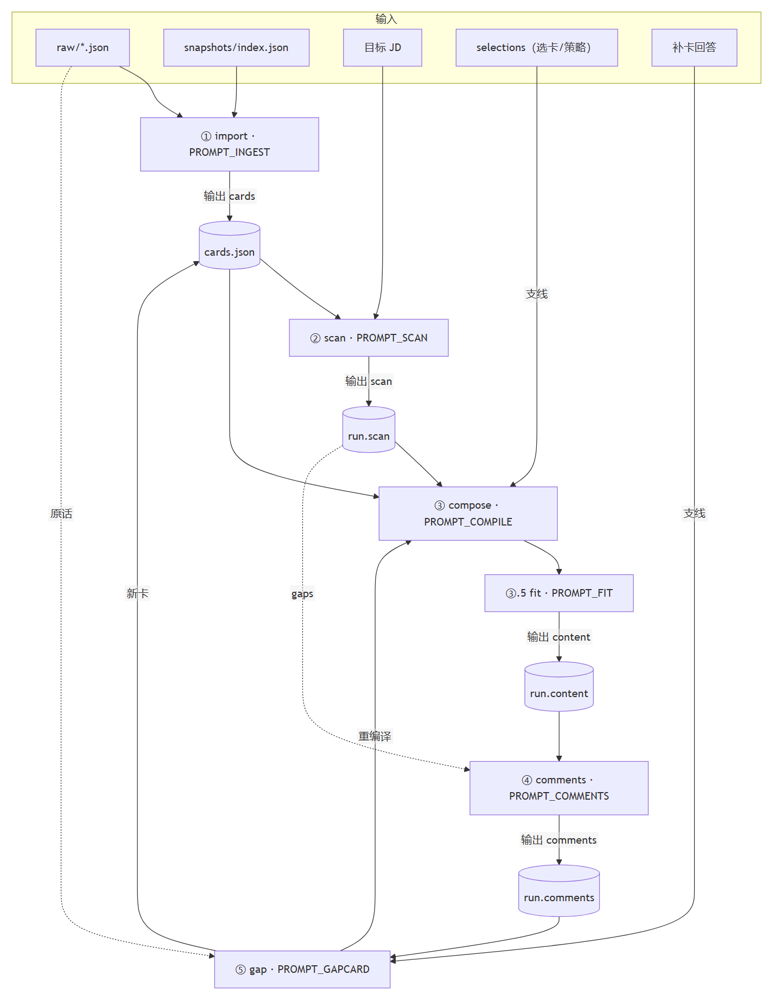

<details><summary>Mermaid 源码（可编辑）</summary>

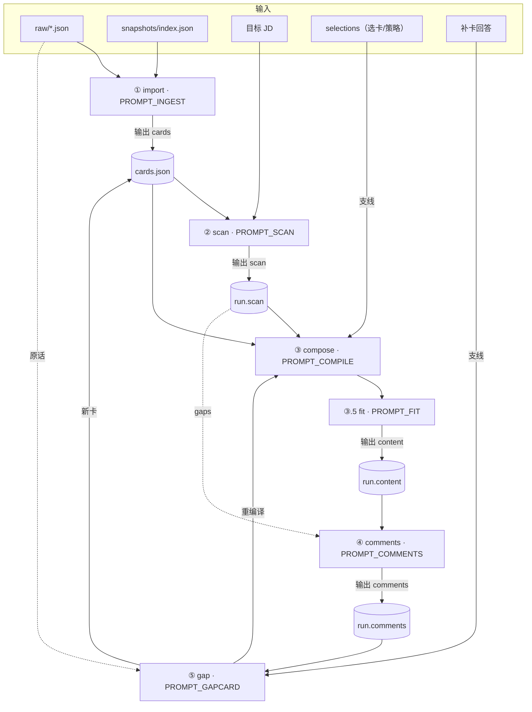

</details>

### 1.1 每阶段输入输出总表

| # | 阶段 | 必填输入 | 支线/可选输入 | 输出 | 落盘 | 失败/分支 |
| --- | --- | --- | --- | --- | --- | --- |
| ① | import | `raw/*.json`（experience_id + messages）、`snapshots/<rev>/index.json` | `wiki/*.md`（正文补充） | `spine_summary` + `story_cards[]` | `v2/cards.json`（含 S/A/B、is_verified） | 解析失败记 error 并继续；全部失败抛 IMPORT_FAILED |
| ② | scan | 目标 JD、`cards.json` 全部经历与卡片 | —（当前无额外输入） | `jd_analysis`（jd_focus / hook_level / body_pattern）+ `experience_rankings`（选卡 / match_reason / gaps） | `v2/runs/<run_id>.json` 的 `scan` | 无卡片抛 NO_CARDS；模型 JSON 失败重试 1 次后报错 |
| ③ | compose | `run_id`、`selections`（exp_id + card_ids）、卡片事实、经历主干 | `strategy` 覆盖、`match_reason`、旧字段 `recommended_strategy`（兼容回退） | `project_background` + `bullets[]`（focus_angle / hook / content / raw_quote / checks） | `run.content` | 单段失败只记录该段 error；所有段失败则 run.content 为空 |
| ③.5 | fit | 超限/违规的 bullet、对应卡片 facts | 上一步的 checks | 改写后的 background/content | 回写 `run.content` | 3 轮仍不合规 → hardTrim 兜底 |
| ④ | comments | `run.content` 的 bullets | `scan.gaps`、未选中的 S/A 卡、JD | `comments[]`（锚定 bullet_id，≤4） | `run.comments` | 模型失败时用 gaps 兜底 3 条；非法锚点丢弃 |
| ⑤ | gapCard | `run_id` + `comment_id` + `answer` | 该经历 raw 原话（缺失时用 `exp.raw_text`） | 新卡（source=gap）或 `insufficient` + 追问；成功则该段重编译 | `cards.json` + `run.comments[].resolved` | 回答不足不改库；缺 comment/exp 报错 |

---

## 2. 支线输入（旁路输入）明确化

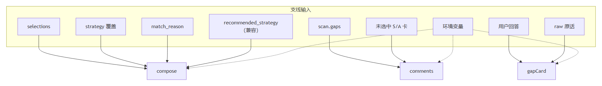

<details><summary>Mermaid 源码（可编辑）</summary>

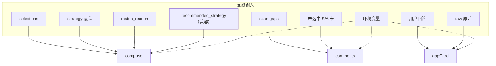

</details>

| 支线输入 | 来源 | 消费阶段 | 是否必需 | 不提供/缺失时的行为 |
| --- | --- | --- | --- | --- |
| `selections`（选卡 + 顺序） | 用户/CLI 自动用扫描推荐 | compose | 是（至少 1 张卡） | compose 无有效选卡 → 该段跳过；全空则报“没有可编译的选卡” |
| `strategy={jd_focus, hook_level, body_pattern}` | 扫描结果，可被 selections 覆盖 | compose | 否 | 回退 `scan.jd_analysis`；再回退旧字段 `recommended_strategy.depth` → L2 / CAR |
| `match_reason` | scan 的 selected_cards | compose（单点聚焦） | 否 | 空字符串；不阻断生成，但正文可能不够聚焦 |
| `scan.gaps` | scan | comments | 否 | 空数组；评论只看未选卡 |
| 未选中的 S/A 卡 | cards.json | comments | 否 | 不参与评论候选 |
| `answer`（补卡回答） | 用户 | gapCard | 是 | 缺回答直接报错；回答太短/没有事实 → 模型返回 insufficient + 追问 |
| `raw` 原话 | raw/*.json | gapCard | 否 | 回退 `experience.raw_text`；仍为空则模型只能基于问题和回答 |
| 环境变量 `DEEPSEEK_MOCK` | 运行环境 | 所有模型调用 | 否 | =1 时不调模型，用 mock.mjs 的确定性输出 |
| 环境变量 `WORKBENCH_DATA_DIR` | 运行环境 | 所有阶段 | 是 | 默认 `prototype/local-data` |
| 旧版字段 `recommended_strategy` | 旧 run | compose（兼容） | 否 | 仅用于回退 depth → hook_level |
| `profile.json` | 数据目录 | 旧版渲染 | 否 | **核心链路不读它**（只有前端排版用） |
| 历史 `runs/` | 数据目录 | 审计/测试 | 否 | 不参与生成；cards 重建后旧 run 变 stale |
| `graph()` | cards.json | 观察/展示 | 否 | 只读，不影响生成 |

---

## 3. 数据依赖

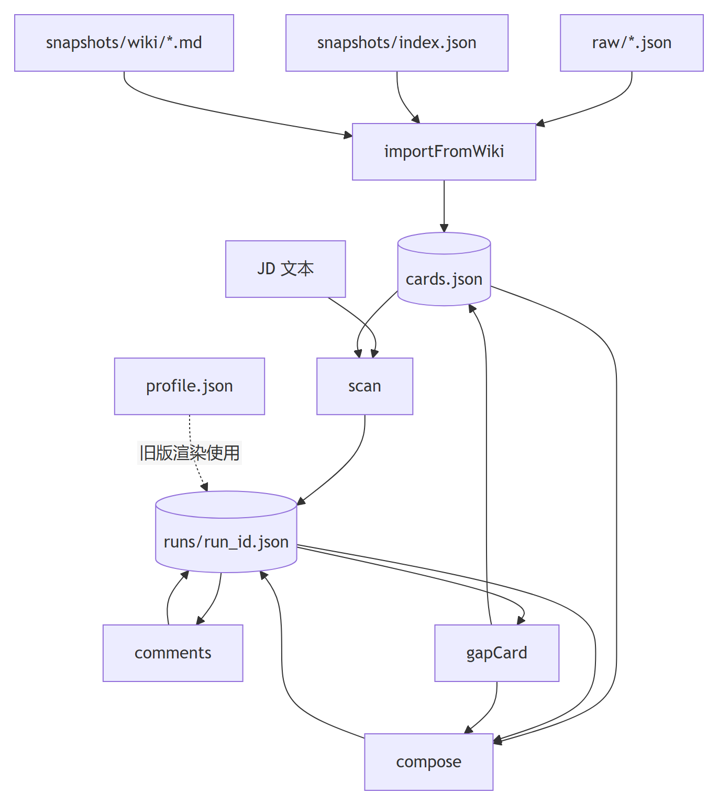

<details><summary>Mermaid 源码（可编辑）</summary>

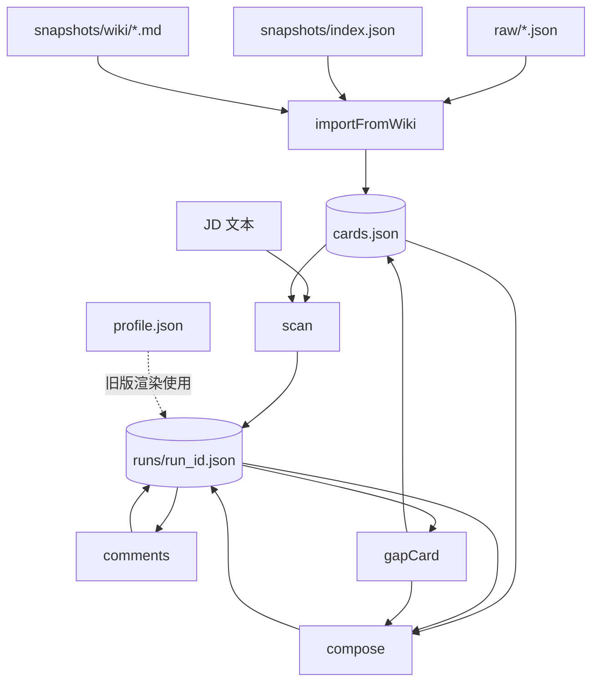

</details>

### 3.1 不变量（违反即数据坏了）

1. `cards[].exp_id` 必须存在于 `experiences[].exp_id`；`card_id` 全局唯一；
2. `quality_grade ∈ {S,A,B}`；`raw_quote` 非空；`is_verified=true`；
3. `run.scan.selected_cards[].card_id` ⊆ 当前 `cards`；
4. `run.content.bullets[].card_id` ⊆ 当前 `cards`，且 `raw_quote` 非空；
5. `run.comments[].bullet_id` ⊆ 该 run 的 bullets；
6. **重建 `cards.json` 会让之前的 run 变成 stale**（引用被删卡片的 run 失效）：历史 run 要么归档，要么只校验当前卡片版本内的 run。

### 3.2 数据目录

```text
<DATA>/
├── current.json                # 最新快照号
├── profile.json                # 基础信息（核心链路不用）
├── raw/raw_*.json              # ① 建卡的事实来源
├── snapshots/<rev>/index.json  # 经历库索引
├── snapshots/<rev>/wiki/*.md   # 经历正文
└── v2/
    ├── cards.json              # ②③⑤ 的事实源
    └── runs/<run_id>.json      # ②③④⑤ 的留痕
```

---

## 4. 时序（一次完整调用）

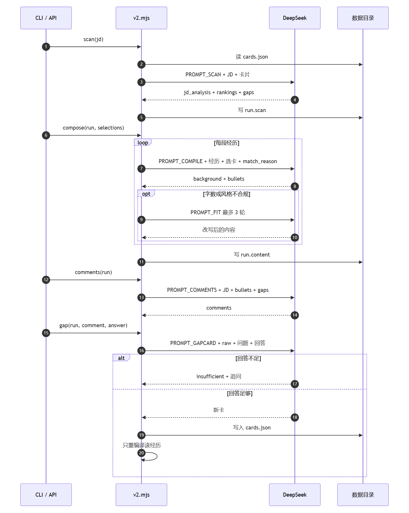

<details><summary>Mermaid 源码（可编辑）</summary>

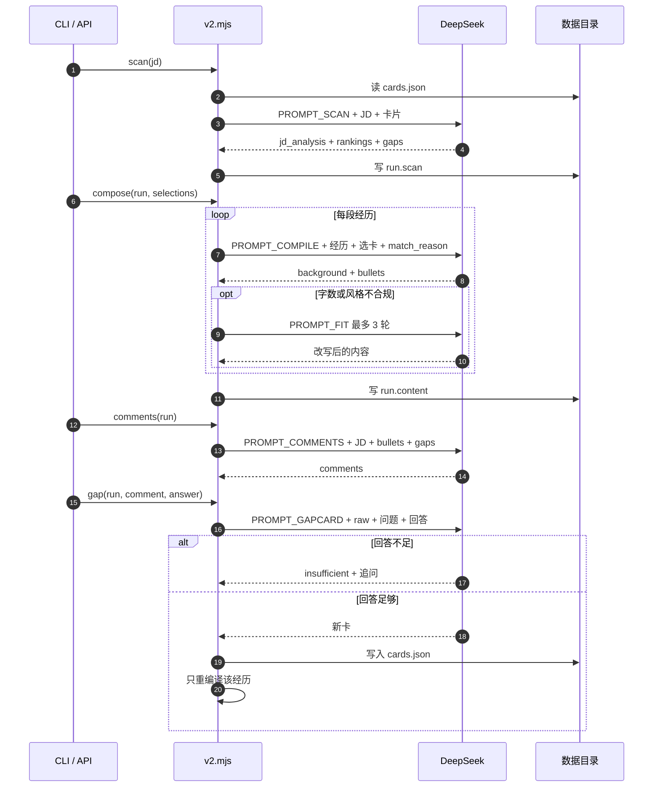

</details>

---

## 5. 各阶段细节 + 提示词全文

### ① 建卡：raw → cards

**代码**：`importFromWiki()` → `normalizeCards()` → `grade()`
**输入**：经历标题/类型 + `raw_text`（raw/*.json 的 messages 拼接）
**输出**：`{ spine_summary, story_cards[] }`，每卡 6 槽位；静态分级：

| 等级 | 规则 |
| --- | --- |
| S | problem/workflow/outcome 三槽齐全 且 outcome 含数字 |
| A | 三槽齐全；或两槽且有动作/数字 |
| B | 其余 |

**校验**：缺信息槽位必须写“未提及”；`raw_quote` 必须来自原话；`is_verified=true`。

```text
const PROMPT_INGEST = `# Role
你是一个严谨的知识图谱构建引擎与资深产品架构师。你的任务是将用户针对某段经历（项目、实习或校园经历）的【原始口述文本（Raw）】，提纯并转化为结构化的【经历主干（Spine）】与【全要素决策卡片（Story Cards）】。

# Core Principles
1. 绝对忠于事实（零幻觉原则）：只能基于用户提供的原始口述整理、去噪、结构化；严禁编造原文未提及的数据、组件或背景。槽位没有信息必须填"未提及"。
2. 独立闭环切分原则：出现新的子问题/卡点、新阶段里程碑或独立技术/产品决策，且包含动作与结果时，切分为新卡；同一决策的补充解释合并进同一张卡；核心经历目标 4~8 张卡，按时间/因果给 step_order。
3. 多视角完备性：每张卡尽量填满 6 个槽位，便于未来按不同策略渲染。

# Output Schema（只返回一个 JSON 对象）
{
  "spine_summary": "120-180字，客观第三人称：背景目标 → 关键阶段 → 最终成果",
  "story_cards": [
    {
      "step_order": 1,
      "toc_title": "20字以内短标题（做了什么决策/解决什么问题）",
      "slot_stage": "阶段",
      "slot_module": "业务域/功能模块",
      "slot_problem": "卡点、约束、方案权衡与决策依据",
      "slot_workflow": "输入 → 核心处理动作 → 交付输出",
      "slot_tech_link": "技术栈/模型/API/工具及连接关系；纯业务向写协作工具或方法论；无则填未提及",
      "slot_outcome": "客观结果/量化收益 + 体现的核心能力",
      "raw_quote": "从原话中一字不差截取的1-3句关键原话",
      "linked_nodes": [{ "node_name": "客观标签", "node_type": "tech|product|domain" }]
    }
  ]
}`;
```

---

### ② 扫描：JD + 卡片 → 选卡 / 策略 / 缺口

**代码**：`scan(jd)`
**输入**：
```json
{
  "jd": "...",
  "experiences": [{
    "exp_id": "", "category": "", "title": "", "spine_summary": "",
    "cards": [{ "card_id": "", "step_order": 1, "quality_grade": "S",
                "slot_problem": "", "slot_workflow": "", "slot_outcome": "" }]
  }]
}
```
**输出**：
```json
{
  "jd_analysis": { "core_demands": [], "jd_focus": "", "hook_level": "L1|L2|L3", "body_pattern": "XYZ|CAR|PAR", "reason": "" },
  "experience_rankings": [{
    "exp_id": "", "priority_rank": 1, "decision": "主推详写|补充略写|建议舍弃",
    "selected_cards": [{ "card_id": "", "step_order": 1, "match_reason": "" }],
    "gaps": []
  }]
}
```
**校验**：代码层只保证 JSON 可解析；字段完整性、rankings 覆盖、card_id 合法由 `npm test` 断言。`selected_cards` 为空则 compose 跳过该段。

```text
const PROMPT_SCAN = `# Role
你是一个资深技术/产品招聘专家与简历策略主编。请根据【目标 JD】，对候选人知识库中的【全量经历与决策卡片】进行深度语义扫描、证据质量质检与经历级取舍排序。

# Core Rules
1. 跨语义深度匹配（拒绝机械找词）：重点考察卡片的 slot_problem / slot_workflow / slot_outcome 是否能实质性印证 JD 的能力要求。
2. 证据质量一票否决：优先选用 quality_grade 为 S 或 A 的卡片；缺乏具体行动与结果支撑的卡片不得选为主力。
3. 叙事连贯性保护：同一经历选多张卡时，保留能体现"启动→攻坚→迭代/结果"逻辑链的卡片（关注 step_order）；每张入选卡必须给出 match_reason（该卡哪个具体动作/决策印证了 JD 的哪条要求），后续编译会用它做"单点聚焦"。
4. 客观缺口诊断：若某段核心经历值得写但缺少 JD 看重的维度，在 gaps 中明确指出。

# Hook 专业术语层级（hook_level，三选一，全篇统一）
- L1 功能直白层：非技术岗/传统业务岗，用大众易懂的中文功能词，不带技术概念。
- L2 行业标准术语层（默认推荐）：AI 应用 PM/策略 PM/AI 落地岗，直接调用业界公认标准名词，允许 1~3 个英文词或中英混排（如 Local-First 存储、Structured Output 校验、Rule-Based 规则约束、Human-in-the-Loop）。
- L3 架构与工程权衡层：大厂核心 AI 平台/Agent 架构岗/强技术向 PM，点出架构模式或工程边界（如 Zero-Backend 端侧架构、Deterministic Guardrails、Index-Free 语义扫描）。

# 正文叙事骨架（body_pattern，三选一，全篇统一）
- XYZ 成果导向型：先抛量化指标或核心交付结果 → 再写实现该结果的关键机制与动作。
- CAR 痛点破局型：先点明具体卡点/工程约束 → 再写方案权衡（放弃 A 选 B）与落地解法 → 最终结果。
- PAR 流程链路型：先交代目标场景 → 再按"输入 → 核心处理节点 → 交付输出"展开链路与效果。

# 选择原则
根据 JD 的岗位属性与考察重点选择 hook_level 与 body_pattern；不确定时 hook_level 取 L2。同时提炼一句 jd_focus（JD 最核心的考核句，不超过 60 字）。

# Output Schema（只返回 JSON）
{
  "jd_analysis": {
    "core_demands": ["3-5项核心诉求"],
    "jd_focus": "JD 最核心的考核句（≤60字）",
    "hook_level": "L1|L2|L3",
    "body_pattern": "XYZ|CAR|PAR",
    "reason": "一句话说明为什么选这个组合"
  },
  "experience_rankings": [
    { "exp_id": "经历ID", "priority_rank": 1, "decision": "主推详写|补充略写|建议舍弃",
      "selected_cards": [ { "card_id": "卡片ID", "step_order": 1, "match_reason": "该卡的具体动作/决策如何印证 JD 的某项要求（编译时用作单点聚焦）" } ],
      "gaps": ["缺口描述"] }
  ]
}
要求：覆盖输入里每个 exp_id；主推最多 2 段、略写最多 3 段。`;
```

---

### ③ 编译：单段经历 → 三区内容（背景 + Hook + 正文）

**代码**：`compose(runId, selections)`
**输入**（每段）：
- 经历 `title / category / spine_summary`
- 选中卡片（按 step_order，带 6 槽位）
- 这些卡片的 `match_reason`（单点聚焦）
- `strategy = { jd_focus, hook_level, body_pattern }`

**输出**：
```json
{
  "exp_id": "",
  "project_background": "40-60 字背景总述",
  "bullets": [{ "card_id": "", "focus_angle": "≤15字", "hook": "4-12字符", "content": "35-80字" }]
}
```
**程序后处理**：剥离开头 `【hook】` 或裸 hook；生成 `checks`（长度、eval_end、hook_repeated、banned、focus）。

**质量闸门**见第 6 节；**归一化提示词**：

```text
const PROMPT_FIT = `# Role
你是简历字数与风格归一化器。严格不新增事实、不删关键数字/工具/结果，保持原 hook 与叙事骨架。

# Rules
1. project_background 目标 40-60 字，必须是完整句子（以。或；结尾），不得截断成病句。
2. 每条 bullet 的 content 目标 50-75 字、可接受 35-80 字（含标点）；>80 必须删到 ≤80；<35 可适度补充。
3. 只围绕 focus_angle 的一个抓手，删修饰、合并从句；允许只保留 2~3 个要素，不得只做同义替换。
4. 若结尾是评价性表述（体现了…能力 / 展现了… / 验证了… / 确保了… / 保障了…），改成事实、数字或交付物收尾。
5. content 中不要重复 hook、不要带【】前缀；不改 hook、不改 card_id。
6. 只返回 JSON：{ "project_background": "...", "bullets": [ { "card_id": "...", "content": "..." } ] }`;
```

**编译提示词**（`{jd_focus}/{hook_level}/{body_pattern}` 由策略注入）：

```text
const PROMPT_COMPILE = (p) => `# Role
你是一个顶尖的 AI 产品经理简历架构师，写作参照大厂内部复盘文档：冷静、具体、可核对，不抒情、不自我评价。
请严格基于候选人的【单段经历主干】和【已选决策卡片（6槽位事实）】，按照【Hook 专业术语层级】与【正文叙事骨架】，编译出专业、克制、全篇层级统一的简历模块。

# Input Parameters
- 目标岗位 JD 考察重点：${p.jd_focus || '未提供'}
- Hook 术语层级（全局锁定）：${p.hook_level || 'L2'}
- 正文叙事骨架（全局锁定）：${p.body_pattern || 'CAR'}

# 一、项目背景区（project_background）
- 1~2 句，40~60 字，放在所有 Bullet 之前。**必须是完整通顺的句子（以句号或分号结尾），不得为压字数截断成病句。**
- 必须交代三件事：① 业务背景（什么场景、为谁做）；② 从 0 到 1 的独立/主导定位；③ 整体产品/项目形态。
- 宏观定位只写在这里，不要塞进 Bullet；不要写"体现了…能力"。

# 二、Hook 层级映射（严格执行 ${p.hook_level}，全篇不得混级）
## L1 功能直白层
- 适用：非技术岗、传统业务岗、需要降低理解门槛的场景。
- 命名规范：大众易懂的中文功能词或动作词，不带技术概念、不带英文缩写。
- 正例：语音转待办、本地数据存储、提示词调优、报名表设计、名单核对。
- 反例：Zero-Backend、Deterministic、端侧架构（这些属于 L3）。

## L2 行业标准术语层（默认档）
- 适用：AI 应用 PM、策略 PM、AI 落地岗、大多数互联网产品岗。
- 命名规范：直接调用业界公认的产研标准名词；允许 1~3 个英文词或中英混排；不加"化/性/度"等虚词后缀；不用只有本公司内部才懂的缩写。
- 正例：Local-First 存储、Structured Output 校验、Rule-Based 规则约束、Human-in-the-Loop、Prompt 迭代、数据口径对齐。
- 反例：万能助手、智能中枢、全链路生态（生造概念）。

## L3 架构与工程权衡层
- 适用：大厂核心 AI 平台、Agent 架构岗、强技术向 PM。
- 命名规范：点出架构模式（Pattern）或工程边界/权衡（Trade-off），必须能在架构语境里被同行复述。
- 正例：Zero-Backend 端侧架构、Deterministic Guardrails、Index-Free 语义扫描、Human-in-the-Loop 审核。
- 反例：单纯堆技术名词（RAG+Agent+向量库）却没有模式或权衡。

## 通用约束
- 同一段经历的所有 hook 必须处于同一层级、同一命名风格（不能一条英文架构词、下一条口语白话）。
- 术语必须 100% 对应卡片里的真实动作；卡片没写过的东西不得写进 hook。
- 严禁空洞黑话：闭环、赋能、矩阵、抓手、生态、全景、体系、全链路（作为空词时）。

# 三、正文叙事骨架（严格执行 ${p.body_pattern}，完整展开）
## XYZ 成果导向型
- 目的：让读者先看到结果，再看到你怎么做到的。
- 元素：①量化结果或核心交付物；②实现该结果的关键机制/动作；③（可选）约束或口径说明。
- 展开顺序：结果先行 → 机制/动作 → 口径或边界。
- 要素要求：至少 2 个、最多 3 个，不要求四件套。
- 反例：通过优化内容并持续迭代，有效提升了阅读表现。
- 正例：公众号推文均值 3000 阅读；改选题、重做配图并在班级群与朋友圈投放，48 小时阅读量到 1.2 万。

## CAR 痛点破局型
- 目的：让读者看到你识别问题、做权衡、落地解决的能力。
- 元素：①具体卡点/工程约束；②方案权衡（放弃 A 选 B 的依据）；③落地解法；④结果。
- 展开顺序：卡点 → 权衡 → 解法 → 结果。**不要求四个都写**：60 字内写 2~3 个刚刚好（常见组合：卡点+解法+结果，或卡点+权衡+解法）。
- 反例：针对交接不清的问题，通过建立表格实现了流程优化。
- 正例：口头交接常断在"谁改到哪一步"；把入职拆成合同、交付、返还三段，用共享 Excel 记责任人、进度与卡点，交接从 10 分钟压到 3 分钟。

## PAR 流程链路型
- 目的：让读者一眼看清端到端链路与你在其中的位置。
- 元素：①目标场景/输入；②核心处理节点（2~3 个动作）；③交付输出；④效果。
- 展开顺序：场景 → 输入 → 处理节点 → 输出 → 效果；可省略"效果"，写成 3 段链路。
- 反例：负责活动全流程，完成报名、执行和复盘。
- 正例：6 场保研分享会：问卷收名单 → 按场次排嘉宾与场地 → 签到表执行，场均 40 人、累计 240 人次。

# 四、语言风格（反八股）
1. 动词优先：拆解、核对、合并、收敛、替换、复盘、对账、埋点、整理成表、压到…；少用"负责/参与/完成"。
2. 开头轮换：同一段经历内相邻 Bullet 不用同一种开头（动作/结果/工具/约束四选一轮换）。
3. \`针对/面对/为\` 只在真正的卡点句使用，每段经历最多 1 次。
4. 禁止评价性收尾：不得以"体现了…能力 / 展现了… / 验证了… / 确保了… / 保障了…"收尾；结尾落在事实、数字或交付物上。
5. 禁虚词：持续、有效、进一步、从而、不断、积极、认真、较好地、显著、大幅；能用具体量级就不用形容词。
6. 单点聚焦：一条 Bullet 只讲一个抓手，宁可少讲，不堆三个动作。
7. 可追问：每条都应让读者能接着问"怎么做的 / 数据哪来的 / 你负责哪一步"。
8. 字数：content 35~80 字（主区间 50~75，宁短勿长，允许 2~3 个要素；短句只要信息完整即可）；project_background 40~60 字。

# 五、Few-Shot（模仿 good 的写法，不要照抄内容）
- CAR｜bad：针对轮班口头交接进度不清，用 Excel 搭建共享追踪表，将入职等多步骤任务拆解为阶段并记录负责人与状态，实现交接顺畅，体现流程优化能力。
  good：【共享追踪表】口头交接常断在"谁改到哪一步"；把入职拆成合同、交付、返还三段，用共享 Excel 记责任人、进度与卡点，交接从 10 分钟压到 3 分钟。
- XYZ｜bad：通过策划选课攻略选题并完成文案排版，最终提升了公众号阅读量，体现了内容运营能力。
  good：【选课攻略选题】公众号推文均值 3000 阅读；改选题、重做配图并在班级群与朋友圈投放，48 小时阅读量到 1.2 万，是均值的 4 倍。
- PAR｜bad：负责组织保研分享会，完成报名、现场执行等工作，确保了活动效果。
  good：【分享会流程】6 场保研分享会：问卷收名单 → 按场次排嘉宾与场地 → 签到表执行，场均 40 人、累计 240 人次。

# 六、输出（只返回 JSON，不要解释）
每条额外给 focus_angle（≤15 字，只用于自检，不出现在简历正文）。
{
  "exp_id": "经历ID",
  "project_background": "40-60字",
  "bullets": [
    { "card_id": "卡片ID", "focus_angle": "≤15字", "hook": "4-12字符", "content": "35-80字" }
  ]
}`;
```

---

### ④ 评论：生成「值得补的方向」

**代码**：`comments(runId)`
**输入**：`{ jd, gaps, unselected_cards（最多 20 张 S/A）, bullets }`
**输出**：`{ comments: [{ bullet_id, exp_id, question, reason, card_ids }] }`
**校验**：只允许锚定本次已生成的 bullet（否则丢弃）；最多 4 条；模型失败时用 gaps 兜底 3 条。

```text
const PROMPT_COMMENTS = `# Role
你是简历策略编辑。基于【JD】【已生成简历内容】【扫描发现的知识缺口】【未被选中的高质量卡片】，在简历对应位置生成"气泡评论"，询问用户是否要补卡。

# Rules
1. 每条评论必须锚定到一条已生成的 bullet（bullet_id），问的是"是否补充某个方向"，而不是评价措辞。
2. 优先针对 JD 核心要求中当前简历没有体现、但该经历本可深挖的方向（gaps）；其次才是未被选中的 S/A 卡。
3. 每条评论带 1 个具体问题（用户可直接回答），并列出可选卡片 id（可为空）。
4. 最多 4 条，宁缺毋滥。

# Output Schema（只返回 JSON）
{ "comments": [ { "bullet_id": "锚定的bullet", "exp_id": "经历ID", "question": "向用户提的问题", "reason": "为什么值得补（对应JD哪条）", "card_ids": ["可选的已有卡片ID"] } ] }`;
```

---

### ⑤ 补卡：回答 → 新卡 → 只重编译该段

**代码**：`gapCard(runId, {comment_id, answer})`
**输入**：该经历 `raw_text`（缺失回退 `exp.raw_text`）+ 缺口问题 + 用户回答
**输出**：
- 不足：`{ insufficient: true, question }` → 追问，**不改库**；
- 足够：`{ card, run }` → 新卡（`source=gap`、重新分级）写入 `cards.json`；只重编译该经历（原选卡 + 新卡）；评论 `resolved=true / new_card_id`。

```text
const PROMPT_GAPCARD = `# Role
你是知识卡片补齐引擎。用户对简历中的某个缺口问题给出了回答。请结合【该经历的全部原话】与【用户的补充回答】，生成 1 张新的 6 槽位决策卡片。

# Rules
1. 事实只能来自【原话】或【用户回答】；不得编造。槽位缺失填"未提及"。
2. raw_quote 必须逐字来自【原话】或【用户回答】。
3. 如果原话和回答都不足以形成一张卡（没有具体动作或结果），返回 JSON：{ "insufficient": true, "question": "再追问一个更具体的问题" }。
4. 否则只返回一个 JSON 对象：{ "insufficient": false, "card": { step_order, toc_title, slot_stage, slot_module, slot_problem, slot_workflow, slot_tech_link, slot_outcome, raw_quote, linked_nodes:[{node_name,node_type}] } }。`;
```

---

## 6. 编译质量闸门

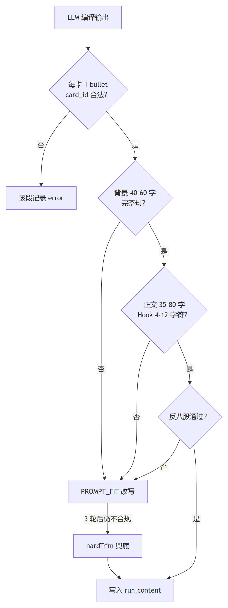

<details><summary>Mermaid 源码（可编辑）</summary>

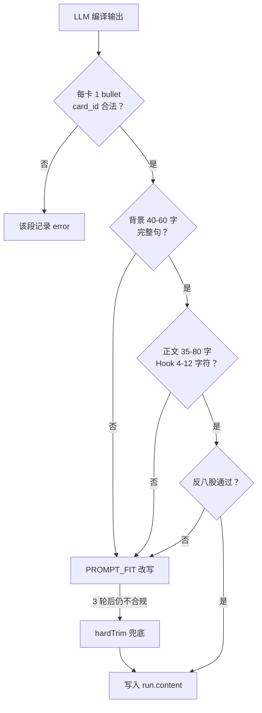

</details>

| 检查 | 规则 | 不合规处理 |
| --- | --- | --- |
| 1 卡 1 bullet | `card_id` 合法、无重复 | 该段记 error |
| 背景 | 40-60 字，以。或；结尾 | PROMPT_FIT |
| 正文 | 35-80 字（舒适 50-75） | PROMPT_FIT，仍超则 hardTrim |
| Hook | 4-12 字符 | 计入 checks；测试断言 |
| 反八股 | 禁“体现/展现/验证/确保/保障 + 能力/效果/质量”收尾；content 不以 hook/【开头 | PROMPT_FIT + 程序剥离 |
| 溯源 | `raw_quote` 非空且来自卡片 | 测试失败 |
| 聚焦 | `focus_angle` 非空 | 测试失败 |

---

## 7. run 状态机

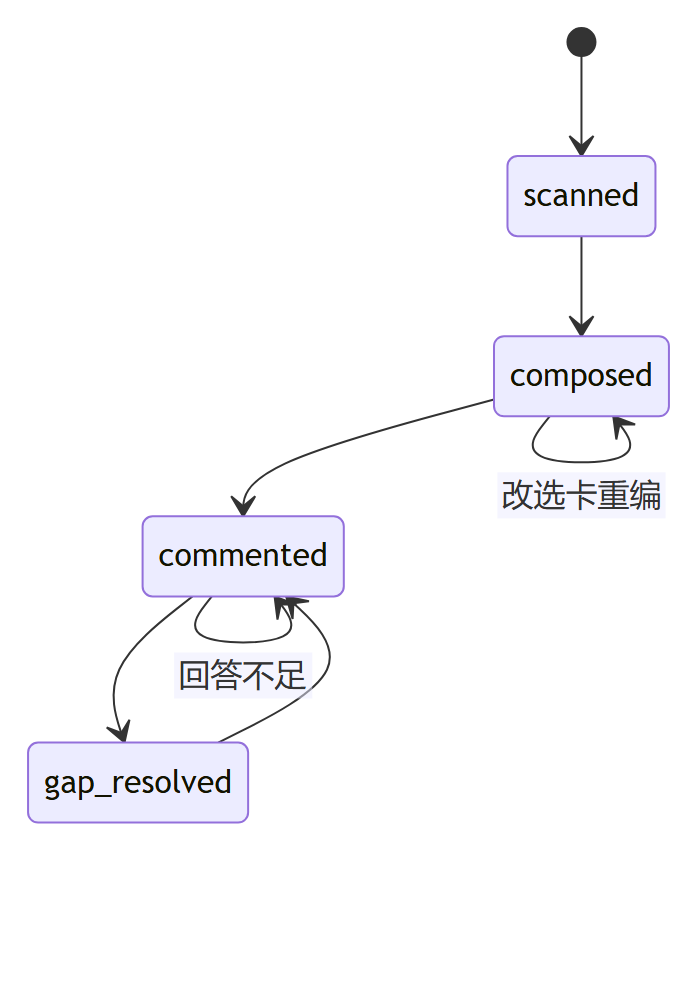

<details><summary>Mermaid 源码（可编辑）</summary>

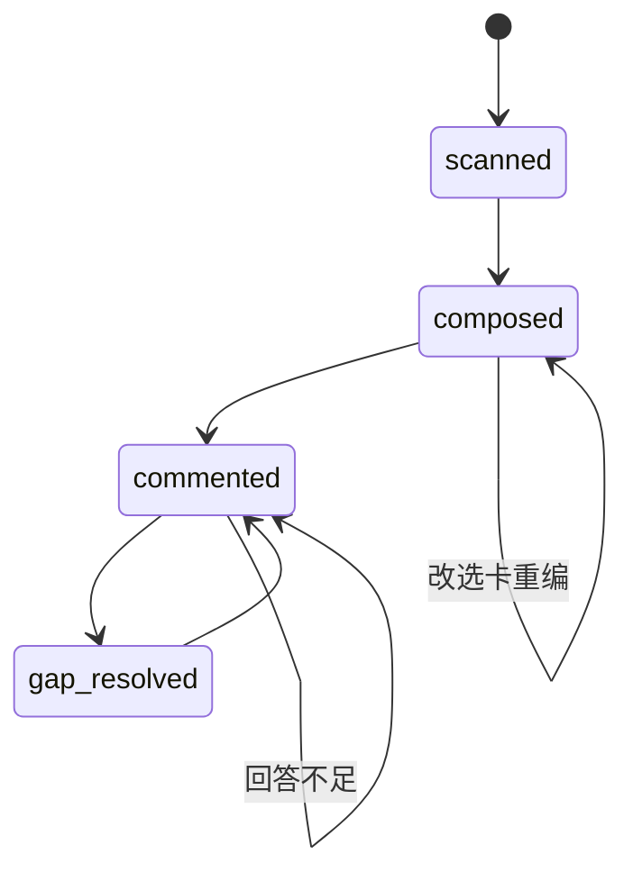

</details>

| 状态 | run 中存在的字段 |
| --- | --- |
| scanned | `scan` |
| composed | `selections` + `content` |
| commented | `comments` |
| gap_resolved | `comments[].resolved/new_card_id` + `cards.json` 新卡 |

---

## 8. 入口与测试

```bash
# CLI（每阶段单独跑，输出 JSON）
node prototype/cli.mjs state
node prototype/cli.mjs import
node prototype/cli.mjs scan --jd-file 回归集/jd-01-市场部实习生.md
node prototype/cli.mjs compose --run v2run_xxx
node prototype/cli.mjs comments --run v2run_xxx
node prototype/cli.mjs gap --run v2run_xxx --comment cm_1 --answer "..."
node prototype/cli.mjs check --run v2run_xxx
node prototype/cli.mjs pipeline --jd-file 回归集/jd-01-市场部实习生.md

# 离线（不花钱）
DEEPSEEK_MOCK=1 node prototype/cli.mjs pipeline --jd-file ...

# 只启 JSON API（无前端）
node prototype/serve.mjs   # /health, /api/v2/*
```

| 测试 | 验证 |
| --- | --- |
| `pipeline-mock.test.mjs` | 扫描结构/引用、编译闸门、评论锚点、补卡 resolved、图谱一致性 |
| `data-deps.test.mjs` | 数据目录结构、卡片分级/引用、当前版本 run 的引用（stale 跳过） |
| `live-e2e.mjs` | 真实模型 scan→compose→comments 冒烟 |

当前状态：`npm test` 8/8；live 冒烟通过（7 经历 / 26 卡 → 12 bullets / 4 评论）。

---

## 9. 已知边界

1. 扫描缺程序级 schema 校验（只有测试断言），建议在 `scan()` 加 `assertScan()`；
2. `hardTrim` 兜底仍可能裁掉次要动作，需要统计触发率；
3. 补卡只做一轮，没有多轮追问闭环；
4. 评论主题可能重复，需要去重；
5. `hook_level/body_pattern` 需要跨 JD 验证是否真按岗位选择；
6. mock 只验证契约，不验证语言质量。

---

## 10. 文件索引

| 文件 | 说明 |
| --- | --- |
| `prototype/v2.mjs` | 核心链路 + 全部提示词 |
| `prototype/cli.mjs` | 阶段命令入口 |
| `prototype/serve.mjs` | 精简 JSON API（无静态页） |
| `prototype/mock.mjs` | 离线确定性模型替身 |
| `prototype/workbench.mjs` | 经历库/快照/raw 读取 |
| `prototype/llm.mjs` | 模型连接配置（旧 Wiki 任务保留） |
| `prototype/docs/DATA-CONTRACT.md` | 数据契约 |
| `prototype/docs/MODEL-PIPELINE.md` | 阶段参数速查 |
| `prototype/tests/` | 契约 / 数据依赖 / live 冒烟 |
